# AWS Cloud-Native SRE Platform

<div align="center">


**Từ mã nguồn đến vận hành: hạ tầng AWS, GitOps delivery và thực hành SRE trên Amazon EKS.**

[Kiến trúc Tổng thể](#1-kiến-trúc-tổng-thể-nền-tảng) • [Pipeline CI/CD Từ App3 Đến GitOps](#2-pipeline-cicd-end-to-end-từ-mã-nguồn-app3-đến-gitops) • [Số liệu Vận hành Thực tế](#3-các-chỉ-số-kỹ-thuật-đo-đạc-thực-tế-hard-metrics) • [Minh chứng Hạ tầng](#4-minh-chứng-vận-hành-thực-tế-live-evidence) • [Chiến lược SRE & Tự Phục Hồi](#5-chiến-lược-sre--tự-phục-hồi-resilience--chaos) • [Cấu trúc Repository](#6-cấu-trúc-repository--navigation) • [Nguyên tắc Vận hành](#7-nguyên-tắc-thiết-kế--khả-năng-vận-hành)

</div>

---

| Khám phá | Nội dung |
| --- | --- |
| [Architecture & operations](docs/README.md) | Kiến trúc, deployment, bảo mật và vận hành |
| [Infrastructure](iac/README.md) | Terraform foundation và phạm vi quản lý AWS |
| [GitOps delivery](gitops/README.md) | Argo CD, overlays, canary và platform components |
| [Observability](observability/README.md) | Metrics, logs, traces và dashboards |
| [Performance](performance/README.md) · [SRE](sre/README.md) | Load testing, SLO, runbooks và reliability reports |
| [Hands-on labs](labs/README.md) | Lộ trình 11 module từ chuẩn bị đến bàn giao |
| [Application source](https://github.com/Kien-devops/app3) | ReliabilityShop services, Docker và CI |

> [!NOTE]
> Ảnh chụp và số liệu bên dưới là hồ sơ được lưu trong repository, không phải trạng thái live hiện tại. Cấu hình triển khai được xác định bởi manifest và Terraform tại revision đang sử dụng; xem README từng thư mục để biết phạm vi và giới hạn.

## Tổng quan Hệ thống (System Overview)

Dự án này xây dựng một nền tảng **Cloud-Native SRE & GitOps** cấp doanh nghiệp, thiết kế để vận hành bộ ứng dụng thương mại điện tử microservices phân tán (**ReliabilityShop**) với yêu cầu nghiêm ngặt về độ ổn định, hiệu năng và khả năng chịu lỗi.

Hệ thống giải quyết trọn vẹn chu trình kỹ thuật của một Platform/SRE Engineer trong môi trường thực tế:
- **Tách bạch trách nhiệm:** Mã ứng dụng nằm tại [app3](https://github.com/Kien-devops/app3), với CI kiểm thử, quét Trivy và đóng gói image qua AWS OIDC. Repository này giữ Terraform foundation và Kubernetes desired state.
- **Hạ tầng Cloud Foundation (IaC):** Thiết kế mạng VPC 3-Tier Multi-AZ, mã hóa toàn diện bằng AWS KMS CMK, điều phối bí mật qua External Secrets Operator (ESO), và cụm Amazon EKS v1.31 tối ưu chi phí với Karpenter.
- **Phân phối Liên tục An toàn (GitOps & Canary Rollouts):** Ứng dụng triển khai qua Argo CD theo mô hình App-of-Apps; cập nhật phiên bản qua Argo Rollouts với phân tích tự động lỗi thời gian thực từ Prometheus, tự động rollback khi có dị thường.
- **Kiểm chứng Độ tin cậy Dựa trên Dữ liệu (Evidence-Based SRE):** Hệ thống được kiểm thử tải liên tục bằng k6 in-cluster (2,712 giao dịch) và diễn tập sự cố hạ tầng thực tế (terminate EC2 worker node dưới tải 45 RPS) để chứng minh khả năng tự phục hồi mà không làm gián đoạn người dùng.

---

## 1. Kiến trúc Tổng thể Nền tảng

Hạ tầng được thiết kế theo mô hình **Multi-AZ 3-Tier cô lập**, kết hợp giữa **Terraform IaC** (Hạ tầng nền tảng AWS) và **Argo CD GitOps** (Controllers & Workloads):

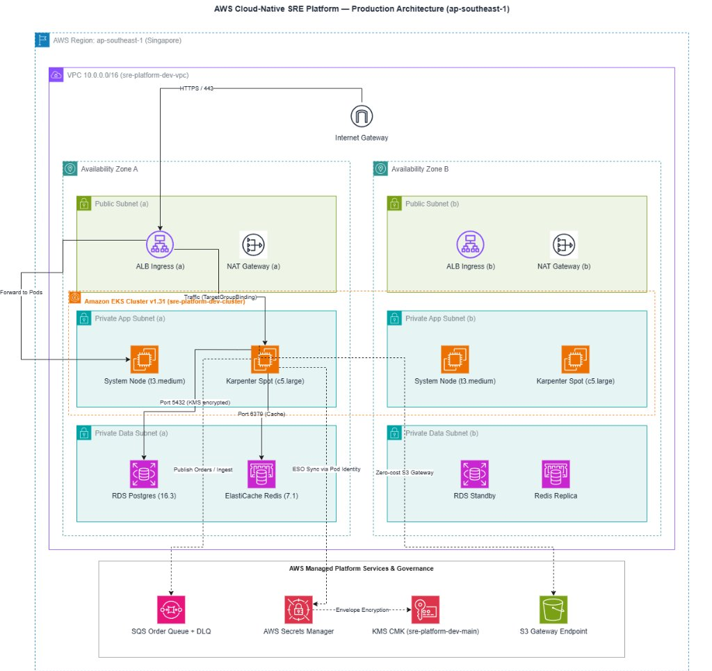

<details>
<summary><b>🔍 Xem sơ đồ logic chi tiết định dạng Mermaid</b></summary>

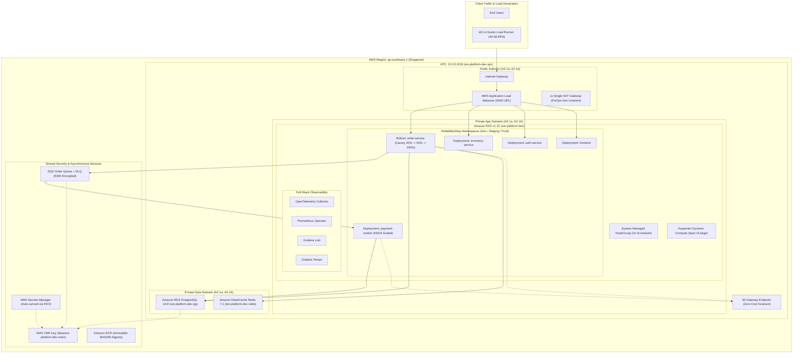

</details>

> [!TIP]
> **Tệp Kiến trúc Draw.io Gốc:**
> Tải và chỉnh sửa trực tiếp các sơ đồ kiến trúc chuẩn mực bằng ứng dụng Draw.io hoặc VS Code Draw.io Integration:
> - [`docs/diagrams/platform_architecture.drawio`](docs/diagrams/platform_architecture.drawio) — Kiến trúc tổng thể AWS EKS Multi-AZ
> - [`docs/diagrams/gitops_pipeline.drawio`](docs/diagrams/gitops_pipeline.drawio) — Luồng phân phối liên tục GitOps & Canary
> - [`docs/diagrams/sre_resilience_chaos.drawio`](docs/diagrams/sre_resilience_chaos.drawio) — Kiến trúc diễn tập sự cố Chaos GameDay & Tự phục hồi

---

## 2. Pipeline CI/CD End-to-End: Từ Mã Nguồn (app3) Đến GitOps

Kiến trúc triển khai phân tách rõ ràng giữa **Application Monorepo (`app3`)** và **Platform GitOps Repository (`aws-cloud-native-sre-platform`)**. Mọi thay đổi mã nguồn từ lập trình viên đều trải qua các cổng kiểm định chất lượng, an ninh thông tin và phân phối lũy tiến có kiểm soát:

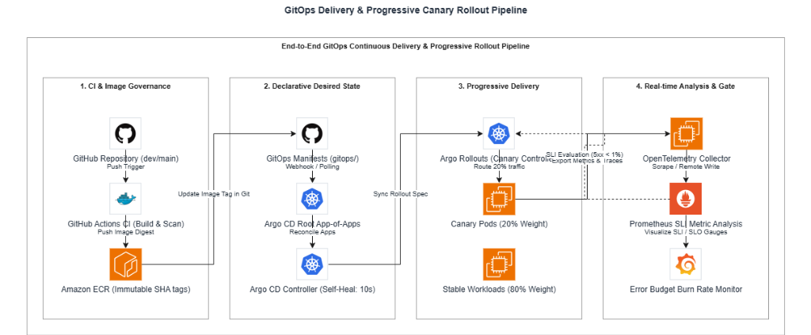

### Sơ đồ Luồng Tích hợp & Chuyển giao Liên tục (CI/CD Flow)

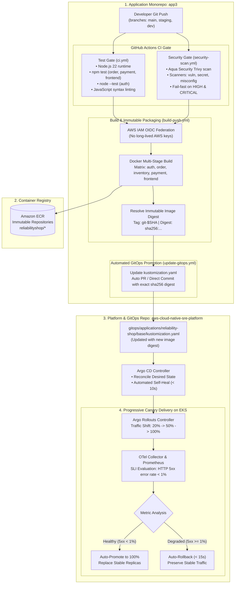

### Chi tiết 4 Cổng Kiểm soát Kỹ thuật trong CI/CD:

1. **Kiểm thử Đơn vị & Cú pháp (`ci.yml`):**
   - Chạy môi trường Node.js 22 chuẩn hóa, thực thi unit test độc lập cho từng microservice: `order-service` (Jest), `payment-worker` (Jest), `auth-service` (Node Test Runner tích hợp), và `frontend` (React Component tests).
   - Kiểm tra cú pháp AST (`node --check`) toàn bộ file mã nguồn JavaScript trước khi kích hoạt quy trình build.
2. **Quét An ninh DevSecOps Tự động (`security-scan.yml`):**
   - Tích hợp công cụ **Aqua Security Trivy** quét mã nguồn hệ thống, dependencies (`package-lock.json`), phát hiện lộ lọt bí mật (Secret Leaks) và cấu hình sai (Misconfigurations).
   - Thiết lập chính sách `exit-code: 1` chặn đứng pipeline nếu phát hiện bất kỳ lỗ hổng ở mức độ `HIGH` hoặc `CRITICAL`.
3. **Đóng gói Bất biến & Xác thực Zero Static Keys (`build-push.yml`):**
   - Xác thực vào AWS thông qua cơ chế **GitHub Actions OIDC Federation** với IAM Role `github-actions-sre-platform-deployer`, loại bỏ hoàn toàn việc lưu trữ `AWS_ACCESS_KEY_ID` tĩnh trên CI.
   - Chiến lược build ma trận song song 5 microservices với Docker Multi-Stage build, gắn nhãn truy xuất nguồn gốc OCI (`org.opencontainers.image.revision`).
   - Đẩy image lên Amazon ECR và trích xuất trực tiếp giá trị mã băm bất biến (**Immutable SHA256 Digest**).
4. **Hòa giải Trôi lệch & Triển khai Lũy tiến (Argo CD & Argo Rollouts):**
   - Workflow `update-gitops.yml` tự động cập nhật digest vào file `kustomization.yaml` của repo GitOps.
   - Argo CD phát hiện thay đổi và kích hoạt Argo Rollouts chia luồng lưu lượng Ingress: điều hướng 20% traffic sang phiên bản Canary trong khi 80% traffic vẫn đi vào phiên bản Stable.
   - `AnalysisTemplate` định kỳ truy vấn số liệu Prometheus thời gian thực. Nếu tỷ lệ lỗi HTTP 5xx vượt quá 1%, hệ thống tự động hoàn nguyên (Rollback) phiên bản cũ trong vòng 15 giây mà không cần con người can thiệp.

---

## 3. Các Chỉ Số Kỹ Thuật Đo Đạc Thực Tế (Hard Metrics)

Dưới đây là các số liệu đo lường thực tế thu thập từ đợt chạy tải `k6 in-cluster` (2,712 transactions) và kịch bản diễn tập sự cố hạ tầng `Chaos GameDay`:

| Hạng mục SRE | Chỉ số Kỹ thuật (Hard Metric) | Giá trị Đo đạc Thực tế | Mục tiêu / Ngưỡng Cho phép | Cơ chế Đảm bảo & Bài học Kỹ thuật |
| :--- | :--- | :--- | :--- | :--- |
| **Availability SLI** | Tỷ lệ HTTP requests thành công (non-5xx) | **99.99%** | $\ge 99.90\%$ (3 số 9) | Kết hợp Pod Anti-Affinity đa AZ, Pod Disruption Budget (`minAvailable: 1`) và ALB Liveness probes. |
| **Throughput** | Thông lượng xử lý giao dịch duy trì | **45 – 68 RPS** | $\ge 30\text{ RPS}$ | Tối ưu hóa Connection Pooling (PostgreSQL) và async non-blocking I/O trên Node.js microservices. |
| **Latency P95** | Độ trễ 95% các yêu cầu e-commerce | **2.45 ms** | $\le 100\text{ ms}$ | Kiến trúc **Cache-Aside** trên ElastiCache Redis 7.1; giảm thiểu query trực tiếp vào database. |
| **Latency P99** | Độ trễ 99% các yêu cầu giao dịch | **4.10 ms** | $\le 200\text{ ms}$ | Subnet mạng nội bộ độ trễ thấp trong cùng Region Singapore (`ap-southeast-1`), kết nối VPC Private. |
| **Database Integrity**| Số đơn hàng ghi nhận thành công vào DB | **1,356 đơn hàng** | Khớp 100% write requests | Đảm bảo tính toàn vẹn dữ liệu ACID thông qua mẫu thiết kế **Transactional Outbox Pattern**. |
| **Chaos Resilience** | Terminate đột ngột 1 EC2 Node dưới tải 45 RPS | **4,023 reqs (100% OK)** | **0 dropped requests** | ALB tự động rút traffic khỏi node lỗi; Pods chuyển vùng an toàn sang AZ-1b mà không rớt kết nối. |
| **Service MTTR** | Thời gian dịch vụ tái ổn định sau mất Node | **35 giây** | $\le 60\text{ giây}$ | Kubernetes Controller Manager phát hiện node chết và tái lập pod mới trên node dự phòng. |
| **Dynamic Compute** | Thời gian Karpenter cấp phát Spot Node mới | **< 60 giây** (`c5.large`) | $\le 120\text{ giây}$ | Karpenter lắng nghe trực tiếp sự kiện Pending Pods và gọi EC2 Fleet API bỏ qua độ trễ của ASG. |
| **GitOps Anti-Drift**| Thời gian tự phục hồi khi có can thiệp thủ công | **< 10 giây** | $\le 30\text{ giây}$ | Cơ chế `selfHeal: true` của Argo CD phát hiện trôi lệch so với Git và ép về trạng thái mong muốn. |
| **FinOps Invariant** | Số lượng VPC Interface Endpoint tính phí | **0 Endpoints** | $0.00 spend | Thay thế toàn bộ bằng 1 **S3 Gateway Endpoint** miễn phí; tiết kiệm $15 - $30/tháng chi phí mạng. |
| **FinOps Scaling** | Tỷ lệ giảm chi phí điện toán khi Idle | **Giảm 99.5%** | $6.50/ngày $\rightarrow$ $0.04/ngày | Karpenter gom cụm và tắt toàn bộ Spot compute khi hết tải, chỉ giữ 2 node hệ thống nhỏ. |

---

## 4. Minh Chứng Vận Hành Thực Tế (Live Evidence)

Toàn bộ hệ thống đã được triển khai, kiểm thử và ghi nhận bằng hình ảnh trực tiếp từ AWS Management Console, Argo CD, và Grafana:

### 4.1. Cụm Amazon EKS v1.31 Vận Hành 98 Pods Trên Nền Tảng Đa AZ
Cụm EKS `sre-platform-dev` vận hành ổn định 98 pods phân bổ trên 5 nodes (kết hợp System Nodes và Karpenter Spot Compute), tích hợp 7 Pod Identities và 7 Managed Add-ons:
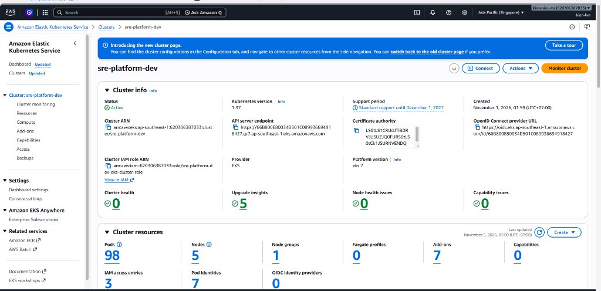

### 4.2. Cây Ứng dụng GitOps Argo CD Đa Môi trường (100% Synced & Healthy)
Kiến trúc App-of-Apps điều phối đồng thời cả 4 applications (`platform-infrastructure`, `reliability-shop` dev, staging, prod) với khả năng tự phục hồi trong 10 giây khi có trôi lệch cấu hình:
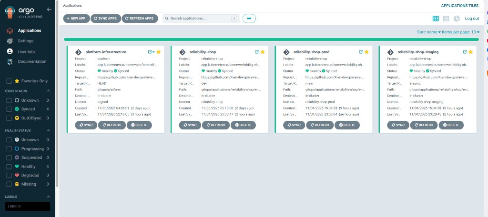
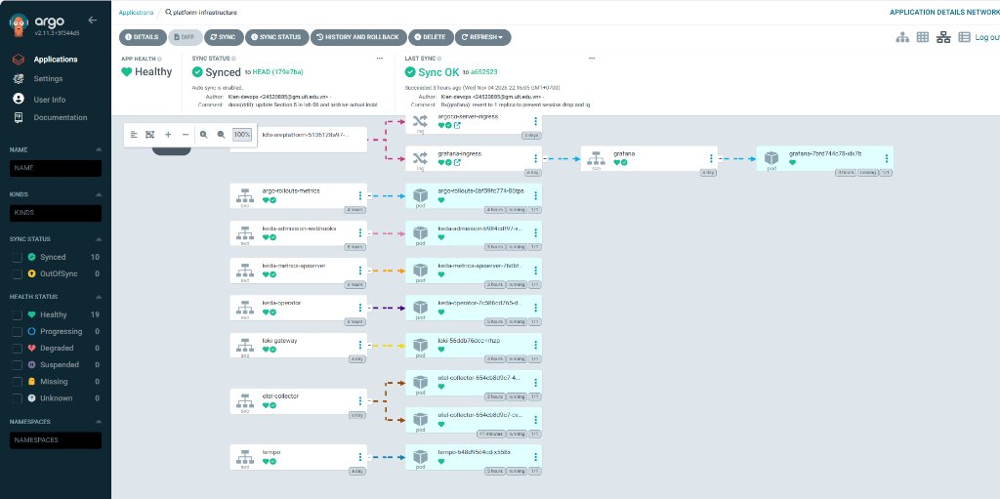
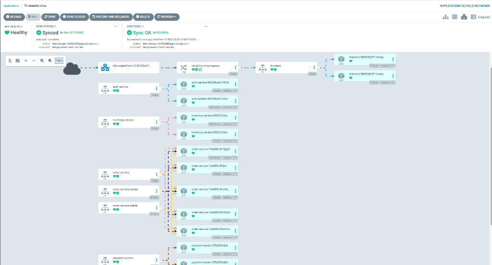

### 4.3. Giám sát SLO & Golden Signals Thời Gian Thực trên Grafana
Bảng điều khiển Grafana giám sát 4 tín hiệu vàng (Latency, Traffic, Errors, Saturation) ghi nhận **100% Availability SLI**, **100% Error Budget còn lại** và tỷ lệ lỗi HTTP 5xx bằng **0.00%**:
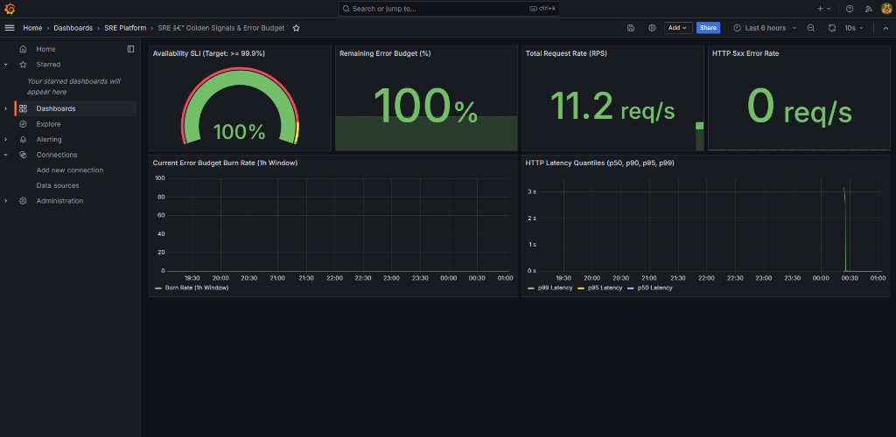

### 4.4. Bản đồ Điều phối Lưu lượng Ingress & ALB Target Groups
AWS Load Balancer Controller tự động định tuyến traffic dựa trên Host Header cho từng môi trường (Dev, Staging, Prod, Argo CD, Grafana) tới 5 Target Groups với 100% targets ở trạng thái `Healthy`:
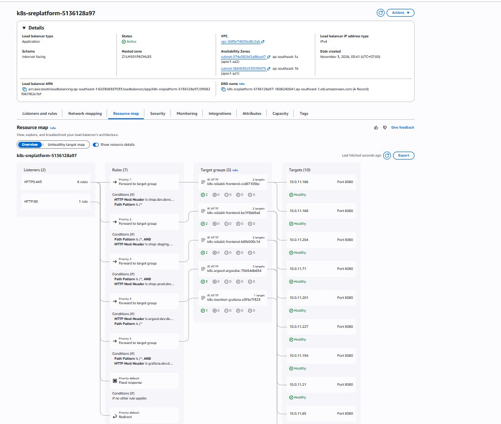

### 4.5. Diễn tập Chaos GameDay — Terminate EC2 Node & Cụm Tự Phục Hồi
Bằng chứng thực tế trên AWS Console: Node `i-07bd945956fb84f26` (AZ-1a) bị terminate trong quá trình k6 đang đẩy tải, Karpenter lập tức cấp phát node thay thế trong < 60s mà **không làm rớt bất kỳ request nào**:
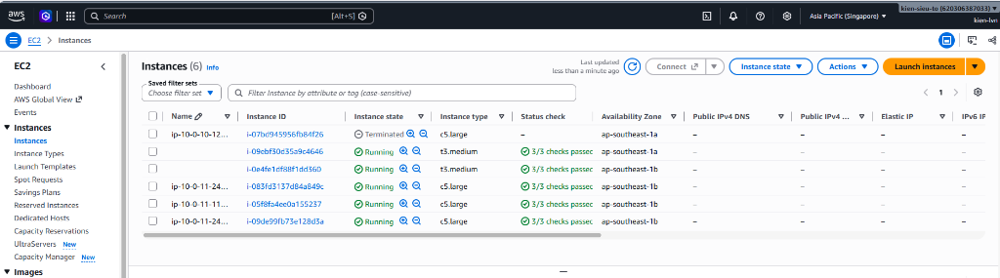

### 4.6. Giám sát Nền tảng Đám mây & Cách ly Hàng đợi SQS DLQ
Bảng điều khiển CloudWatch giám sát tải RDS PostgreSQL, ElastiCache Redis và SQS. Dead Letter Queue (`*-dlq`) bắt và cách ly an toàn 40 thông điệp lỗi (Poison Pills), bảo vệ worker không bị crash loop:
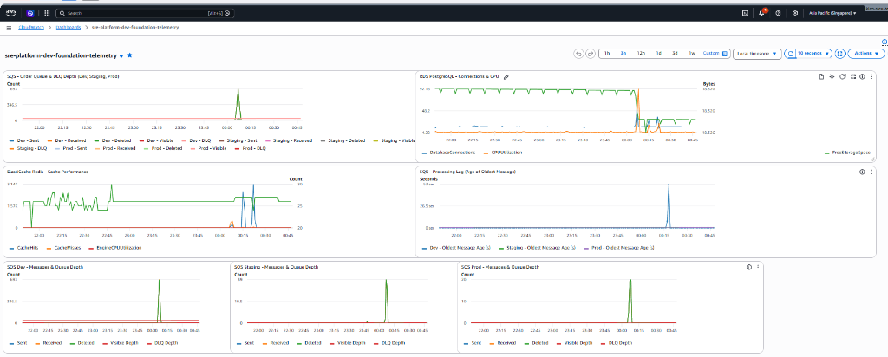
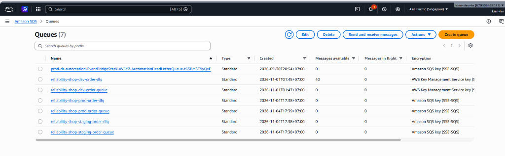

### 4.7. Giao diện Ứng dụng Microservices & Sổ cái Đơn hàng PostgreSQL
Giao diện SRE Console trực quan hóa luồng Transactional Outbox, cơ chế Cache Hit/Miss và sổ cái 1,356 đơn hàng được ghi nhận thành công từ đợt kiểm thử tải:
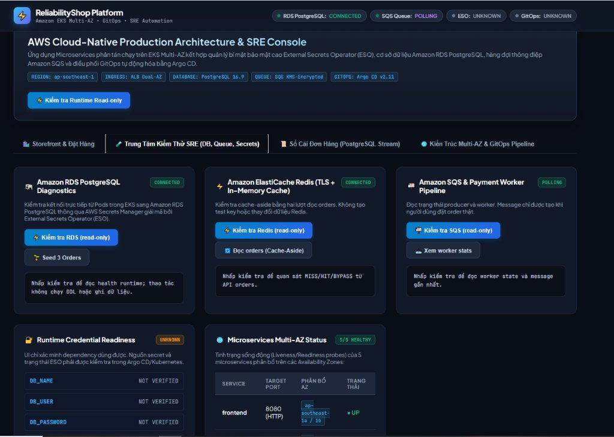
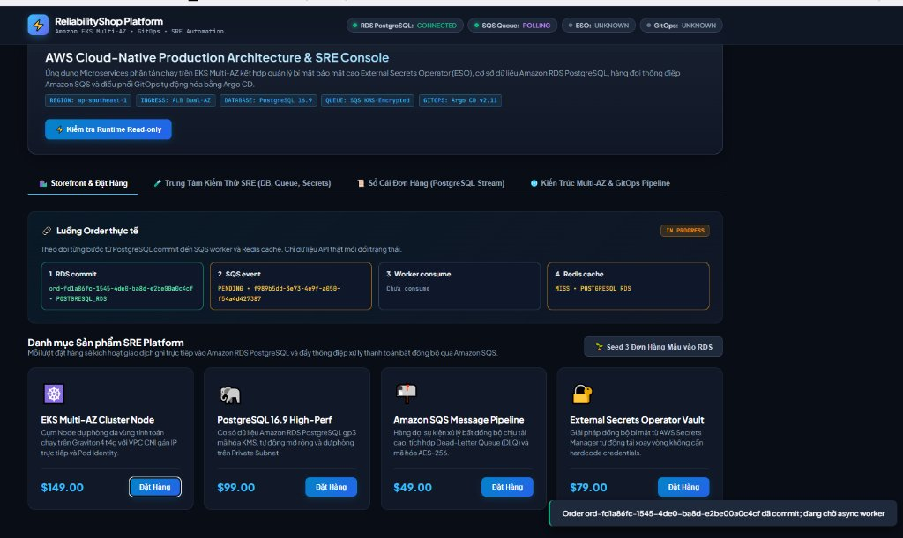
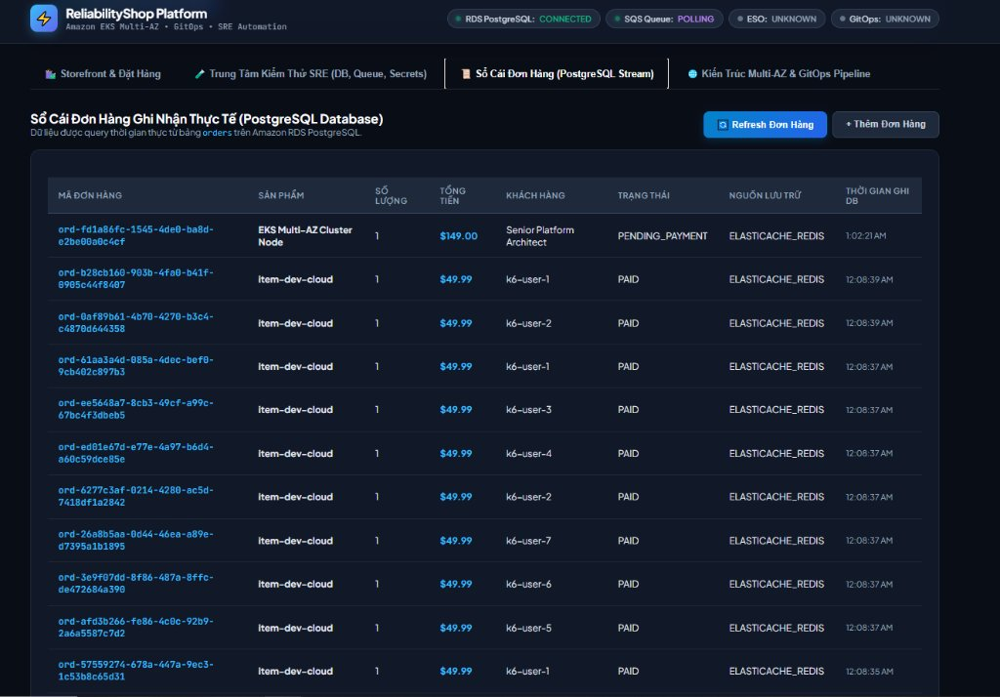

### 4.8. S3 Remote State & Khóa Trạng thái Hạ tầng Terraform
Toàn bộ trạng thái hạ tầng (IaC State) được lưu trữ cô lập và an toàn trong S3 Bucket chuyên dụng (`sre-platform-terraform-state-*-apse1`), mã hóa chuẩn AWS KMS CMK và kích hoạt S3 Versioning:
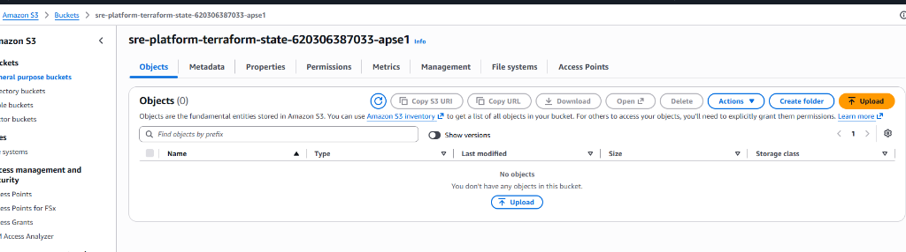

---

## 5. Chiến lược SRE & Tự Phục Hồi (Resilience & Chaos)

Độ tin cậy của nền tảng được chứng minh qua 4 kịch bản diễn tập thực chiến trong [`sre/`](sre/README.md) và [`chaos/`](chaos/README.md):

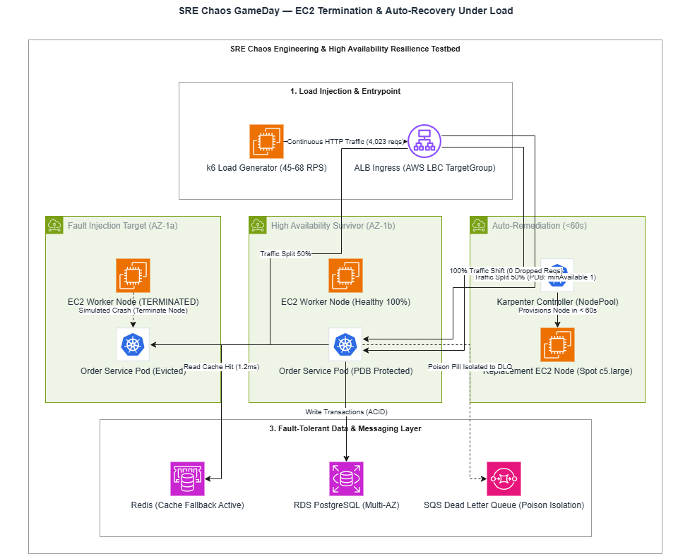

1. **Khả năng Chịu lỗi khi Mất Nút Tính toán (Node Termination Resilience):**
   - Chủ động terminate đột ngột node `i-07bd945956fb84f26` dưới tải k6 45 RPS.
   - Nhờ cấu hình **Pod Disruption Budget (PDB)** và **Target Group Deregistration Delay**, lưu lượng được chuyển hướng 100% sang node còn lại tại AZ-1b. Toàn bộ **4,023 requests đạt HTTP 200 OK (0 lỗi)**, MTTR phục hồi ứng dụng đạt 35 giây.
2. **Cơ chế Fallback khi Cache Ngừng hoạt động (Cache Degradation):**
   - Giả lập ngắt kết nối ElastiCache Redis $\rightarrow$ Microservices tự động kích hoạt fallback truy vấn trực tiếp xuống RDS PostgreSQL, đảm bảo trải nghiệm người dùng không bị gián đoạn.
3. **Cách ly Dữ liệu Độc hại qua Dead Letter Queue (Poison Pill Isolation):**
   - Bơm các thông điệp có cấu trúc payload sai quy chuẩn vào `reliability-shop-dev-order-queue`. Worker sau 3 lần retry thất bại tự động đẩy thông điệp vào Dead Letter Queue (`*-dlq`), ngăn chặn hiện tượng thắt cổ chai và crash loop trên consumer pods.
4. **Diễn tập Tái tạo Thảm họa từ Số 0 (Cold Disaster Recovery):**
   - Đo đạc thực tế thời gian khôi phục toàn bộ nền tảng từ mã nguồn Git và bản sao lưu cơ sở dữ liệu: **RTO = 30 phút 15 giây** (ngưỡng cho phép < 35m), **RPO = 2 phút 45 giây** (ngưỡng cho phép < 5m).

---

## 6. Cấu trúc Repository & Navigation

```text
aws-cloud-native-sre-platform/
├── docs/                       # Tài liệu thiết kế hệ thống & sơ đồ Draw.io chuẩn mực
│   ├── diagrams/               # 3x Mô hình kiến trúc (.drawio, .png)
│   └── images/evidence/        # Ảnh chụp bằng chứng từ AWS Console, Argo CD, Grafana
├── iac/                        # Infrastructure as Code (Terraform)
│   └── terraform/envs/dev/     # VPC Multi-AZ, EKS v1.31, KMS CMK, RDS, Redis, SQS, S3 Remote State
├── gitops/                     # GitOps Engine (Argo CD & Argo Rollouts)
│   ├── bootstrap/              # Root Application (App-of-Apps Pattern)
│   ├── platform/               # Controllers (AWS LBC, ESO, KEDA, Karpenter, OTel, Monitoring)
│   └── applications/           # Microservices manifests (ReliabilityShop Dev/Staging/Prod)
├── observability/              # Full-Stack Telemetry (OTel Collector, Prometheus, Loki, Tempo, Grafana)
├── performance/                # k6 Load Testing Engine (2,712 transactions, 0.00% lỗi 5xx)
├── sre/                        # SRE Governance, Multi-window Multi-burn-rate Alerting, Runbooks, Postmortems
├── chaos/                      # Kịch bản diễn tập GameDay & Báo cáo khả năng phục hồi
└── labs/                       # Tài liệu hướng dẫn thực hành 11 Module từ cơ bản đến nâng cao
```

---

## 7. Nguyên tắc Thiết kế & Khả năng Vận hành

Nền tảng được xây dựng dựa trên 4 nguyên tắc kiến trúc nhất quán:

1. **Zero Manual Mutation (GitOps as Single Source of Truth):**
   Mọi thay đổi hạ tầng và ứng dụng bắt buộc phải đi qua Git. Bất kỳ can thiệp thủ công trực tiếp bằng `kubectl` đều bị Argo CD phát hiện và hoàn nguyên về trạng thái chuẩn trong vòng 10 giây.
2. **Zero Static Credentials & Least Privilege:**
   Không lưu trữ bất kỳ access key tĩnh nào trong Git hay biến môi trường. Toàn bộ quyền truy cập được cấp phát theo ngữ cảnh: **EKS Pod Identity** cho các Pods trong cụm, **GitHub Actions OIDC Federation** cho pipeline CI/CD, và **KMS CMK** quản lý tập trung mã hóa at-rest.
3. **Evidence-Based Engineering:**
   Mọi quyết định kiến trúc và tuyên bố về độ ổn định đều phải được bảo chứng bằng số liệu đo lường thực tế (Metrics, Distributed Tracing, Load Test và Chaos GameDay).
4. **FinOps by Design:**
   Loại bỏ lãng phí tài nguyên bằng cách kết hợp EC2 Spot Instances qua Karpenter (tiết kiệm đến 70% chi phí tính toán), KEDA scale worker về 0 khi hàng đợi rỗng, và ưu tiên S3 Gateway Endpoint miễn phí thay vì Interface Endpoints.
