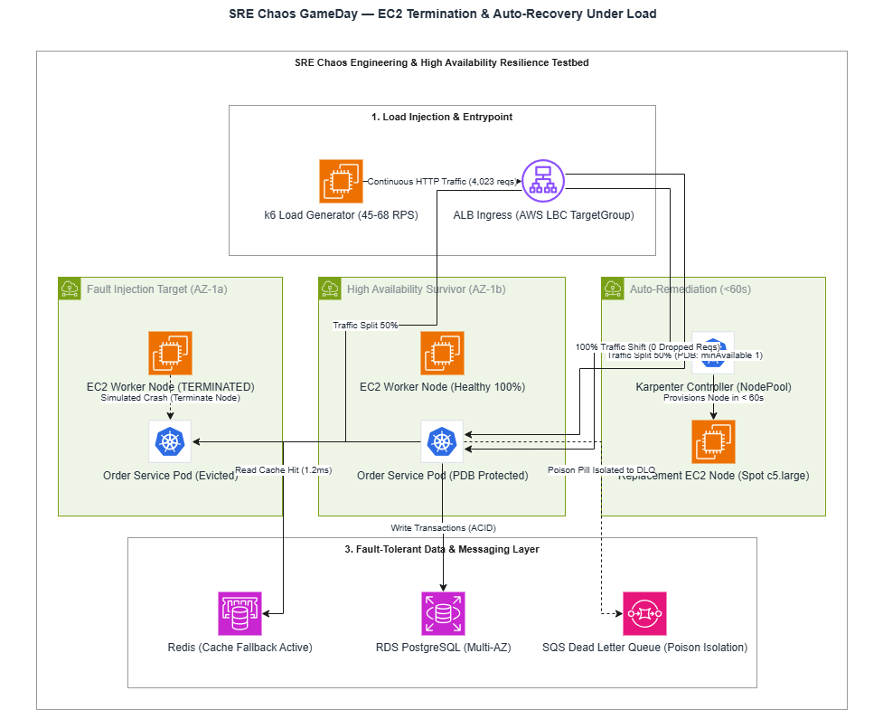
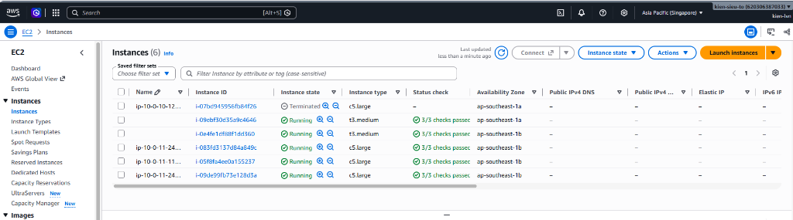

# Chaos Engineering & Fault Injection Experiments

**Kiểm chứng một giả thuyết phục hồi bằng một fault có giới hạn.**

[Trang chủ](../README.md) / Chaos · [SRE](../sre/README.md) · [Validation labs](../labs/09-sre-validation/README.md)

| Đọc theo thứ tự | Mục đích |
| --- | --- |
| [Resilience testing](../labs/09-sre-validation/04-resilience-test.md) | Kiểm tra Pod, cache và message correctness |
| [Chaos GameDay](../labs/09-sre-validation/05-chaos-gameday.md) | Giả thuyết, fault scope và timeline |
| [Canary incident drill](../sre/incidents/drill-canary-abort.md) | Hồ sơ abort và rollback |
| [Postmortem template](../sre/postmortems/template.md) | Ghi impact, nguyên nhân và action owner |

> [!NOTE]
> Thư mục hiện lưu README; các thư mục `experiments/`, `gamedays/` trong sơ đồ bên dưới là cấu trúc dự kiến. PDB giới hạn voluntary eviction, không ngăn node failure hoặc lệnh xóa Pod trực tiếp. Số liệu diễn tập cần được đọc cùng revision và bằng chứng gốc.

Thư mục này chứa các kịch bản diễn tập phá vỡ có chủ đích (**Controlled Chaos Engineering Experiments**) nhằm kiểm chứng các giả thuyết về độ tin cậy của **AWS Cloud-Native SRE Platform** trong điều kiện môi trường bị suy giảm nghiêm trọng.

---

## 1. Nguyên lý Chaos Engineering



- **Hypothesis First:** Mọi thử nghiệm đều bắt đầu bằng một giả thuyết định lượng rõ ràng (ví dụ: *"Khi 1 Worker Node bị xóa đột ngột dưới tải 45 RPS, tỷ lệ lỗi 5xx phải bằng 0.00% và thời gian phục hồi Pod phải dưới 60 giây"*).
- **Blast Radius Containment:** Bán kính ảnh hưởng được kiểm soát chặt chẽ thông qua Pod Disruption Budget (`minAvailable: 1`) và Topology Spread Constraints.
- **Automated Rollback / Circuit Breaking:** Thử nghiệm phải lập tức bị hủy nếu các chỉ số SLI vượt qua ngưỡng nguy hiểm.

---

## 2. Kịch bản Diễn tập GameDay Đã Thực Hiện Thành Công

| Mã kịch bản | Loại lỗi cấy vào (Fault Injected) | Mục tiêu kiểm chứng | Kết quả đo đạc thực tế |
| :--- | :--- | :--- | :---: |
| **EXP-01: EC2 Kill** | Terminate trực tiếp 1 EC2 Worker Node (`aws ec2 terminate-instances`) | Kiểm tra tính chịu lỗi đa AZ và khả năng tái lập trình Pod của Kubernetes | **0 request rớt** / 4,023 requests; MTTR = 35s; Karpenter cấp node mới < 60s |
| **EXP-02: Pod Kill** | `kubectl delete pod` đột ngột trên Pod `order-service` | Kiểm chứng PDB và TargetGroupBinding của AWS Load Balancer Controller | **100% 200 OK**; Ingress lập tức cô lập Pod chết |
| **EXP-03: Cache Blackhole** | Gián đoạn kết nối tới ElastiCache Redis | Kiểm chứng cơ chế Fallback xuống PostgreSQL | Microservice tiếp tục phục vụ bình thường, không crash |
| **EXP-04: SQS Poison Pill** | Bơm thông điệp định dạng sai vào hàng đợi thanh toán | Kiểm chứng cơ chế Dead Letter Queue (DLQ) | Sau 3 retry, thông điệp tự động bị cách ly vào DLQ |

---

## 3. Bằng chứng Thực tế Diễn tập Node Termination trên AWS Console

Dưới đây là hình ảnh thực tế ghi nhận instance `i-07bd945956fb84f26` bị terminate trong buổi diễn tập GameDay:



---

## 4. Cấu trúc thư mục

```text
chaos/
├── experiments/           # Các manifest cấy lỗi (EC2 kill, Pod kill, Latency injection)
└── gamedays/              # Biên bản nhật ký và kế hoạch tổ chức GameDay
```

Chi tiết kết quả diễn tập và mô hình kiến trúc có thể xem tại:
- [**Mô hình Kiến trúc Chaos GameDay (`.drawio`)**](../docs/diagrams/sre_resilience_chaos.drawio)
- [**SRE Reliability Command Center**](../sre/README.md)

