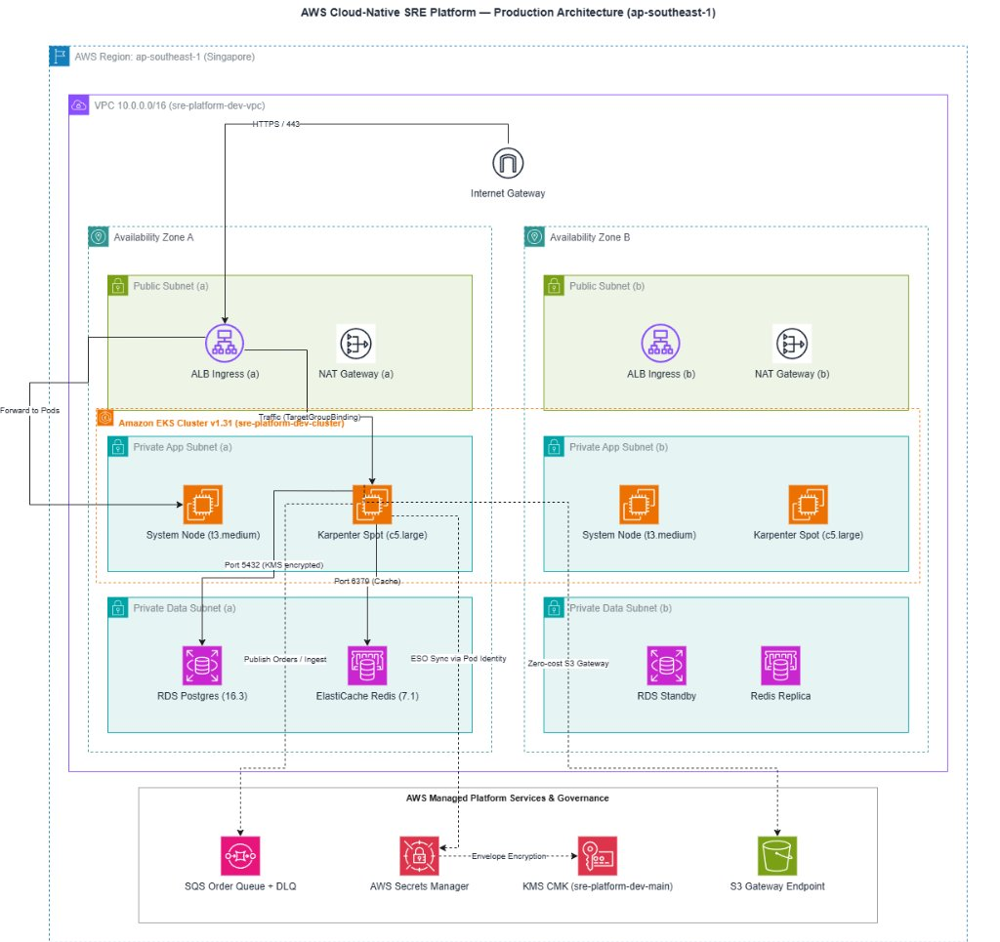
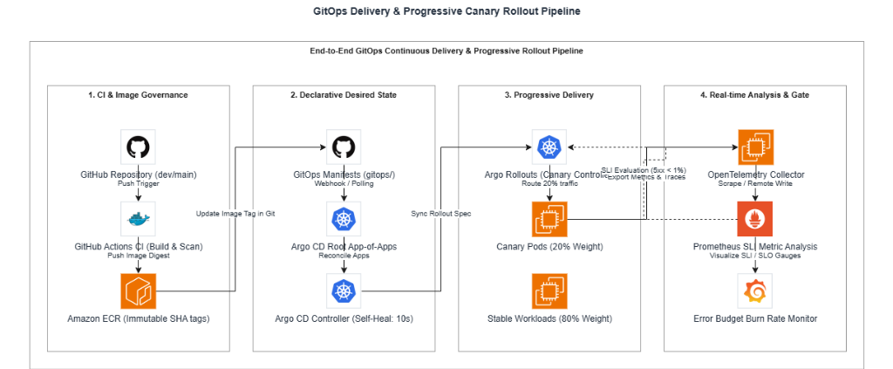
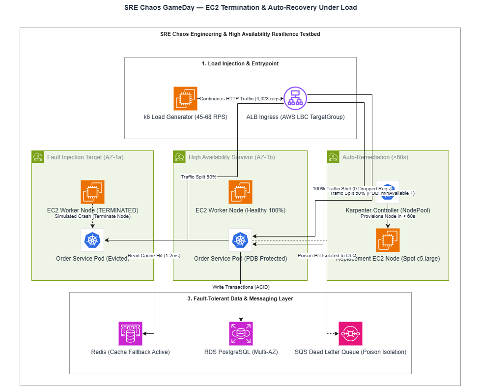

# Architecture Diagrams & Visual Models

Thư mục này chứa toàn bộ các mô hình kiến trúc chuẩn hóa của hệ sinh thái **AWS Cloud-Native SRE Platform**, được xây dựng bằng công cụ `drawio-ai-kit` với các icon AWS chính thức và cú pháp khai báo hiện đại.

---

## 1. Danh mục các mô hình kiến trúc (`.drawio`) & Bản vẽ trực quan

| Tên tệp Diagram | Bản vẽ trực quan đã export | Chủ đề kiến trúc | Trạng thái kiểm định (`drawio-ai`) |
| :--- | :--- | :--- | :---: |
| [**`platform_architecture.drawio`**](platform_architecture.drawio) | [](../images/architecture/platform-architecture-drawio.jpg) | **Kiến trúc Tổng thể Nền tảng AWS Cloud-Native SRE:** Multi-AZ VPC (3 Tiers), EKS v1.31, Managed Nodes + Karpenter Spot, RDS Postgres, ElastiCache Redis, SQS DLQ, KMS CMK, S3 Gateway Endpoint. | `0 errors, 0 warnings, 0 advice` |
| [**`gitops_pipeline.drawio`**](gitops_pipeline.drawio) | [](../images/architecture/gitops-pipeline-drawio.png) | **Luồng Phân phối Liên tục GitOps & Progressive Delivery:** GitHub Actions CI $\rightarrow$ ECR Digest $\rightarrow$ Argo CD App-of-Apps (10s Self-Heal) $\rightarrow$ Argo Rollouts Canary $\rightarrow$ OTel/Prometheus Analysis Gate. | `0 errors, 0 warnings, 0 advice` |
| [**`sre_resilience_chaos.drawio`**](sre_resilience_chaos.drawio) | [](../images/architecture/sre-chaos-resilience-drawio.png) | **Kiến trúc Kiểm định Độ tin cậy & Chaos GameDay:** k6 Load Generator $\rightarrow$ ALB Ingress $\rightarrow$ EKS Pods (PDB Protected) $\rightarrow$ EC2 Termination Injection $\rightarrow$ Karpenter Auto-provisioning (<60s) $\rightarrow$ MTTR 35s. | `0 errors, 0 warnings, 0 advice` |

---

## 2. Hướng dẫn mở và chỉnh sửa Diagram

### Cách 1: Sử dụng Extension trên Visual Studio Code (Khuyến nghị)
1. Cài đặt extension: **Draw.io Integration** (`hediet.vscode-drawio`) trên VS Code.
2. Nhấp đúp trực tiếp vào tệp `.drawio` bất kỳ trong thư mục này để mở giao diện kéo thả trực quan.

### Cách 2: Mở trực tiếp trên web Draw.io
1. Truy cập [app.diagrams.net](https://app.diagrams.net/).
2. Chọn **Open Existing Diagram** và tải lên file `.drawio` tương ứng.

### Cách 3: Tái tạo hoặc tùy biến qua `drawio-ai-kit`
Để cập nhật hoặc sửa đổi kiến trúc bằng code (Diagram-as-Code):
```bash
# Chạy script xây dựng và tự động kiểm định:
drawio-ai run docs/diagrams/build_platform_arch.mjs
drawio-ai run docs/diagrams/build_gitops_pipeline.mjs
drawio-ai run docs/diagrams/build_chaos_resilience.mjs

# Kiểm tra độ hợp lệ của sơ đồ:
drawio-ai validate docs/diagrams/platform_architecture.drawio
```
