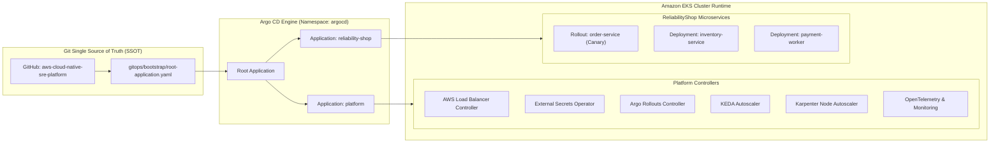

# GitOps Continuous Delivery & Progressive Rollouts

Thư mục này chứa toàn bộ cấu hình khai báo (**Declarative GitOps Desired State**) của hệ sinh thái **AWS Cloud-Native SRE Platform**. Hệ thống sử dụng **Argo CD** theo mô hình **App-of-Apps Pattern** kết hợp với **Argo Rollouts** để triển khai an toàn theo chiến lược Progressive Canary Delivery.

---

## 1. Kiến trúc Phân phối GitOps (GitOps Architecture)


<details>
<summary><b>🔍 Xem sơ đồ logic chi tiết định dạng Mermaid</b></summary>



</details>

Mô hình chi tiết định dạng Draw.io có thể xem và tải tại: [**`docs/diagrams/gitops_pipeline.drawio`**](../docs/diagrams/gitops_pipeline.drawio).

---

## 2. Minh chứng Trực quan trên Môi trường Thực tế (Live Evidence)

### 2.1. Quản lý Đa Môi trường trên Argo CD v2.11 (100% Synced & Healthy)
Kiến trúc App-of-Apps điều phối đồng thời cả 4 applications lớn (`platform-infrastructure`, `reliability-shop` dev, `reliability-shop-staging`, và `reliability-shop-prod`) hoàn toàn tự động, 0 trôi lệch:


### 2.2. Cây Điều phối Hạ tầng Nền tảng (Platform Infrastructure Topology)
Chi tiết topology của application `platform-infrastructure` với 19 resources `Healthy`: OpenTelemetry Collector, Prometheus Operator, Loki Gateway, Tempo Tracing, KEDA Operator, và Grafana Ingress:


### 2.3. Cấu trúc Workloads Microservices & Argo Rollout (Dev & Prod)
Các microservices (`order-service` Canary/Stable, `inventory-service`, `payment-worker`, `auth-service`, `frontend`) phân tán đa AZ, bảo vệ bởi Pod Disruption Budget:


### 2.4. Bản đồ Điều phối Lưu lượng Ingress & TargetGroupBinding
AWS Load Balancer Controller kết nối trực tiếp với các Pods thông qua TargetGroupBinding, quản lý 10 endpoints hoàn toàn `Healthy`:


---

## 3. Các số liệu kỹ thuật nổi bật (Quantifiable Metrics)

| Chỉ số kỹ thuật | Đo đạc thực tế trên Cluster | Cơ chế kiểm soát | Ý nghĩa SRE / Vận hành |
| :--- | :--- | :--- | :--- |
| **Drift Reconciliation Time** | **< 10 giây** | `automated.selfHeal: true` | Triệt tiêu hoàn toàn các can thiệp thủ công trái phép ngoài Git |
| **Canary Rollout Traffic Split** | **20% $\rightarrow$ 50% $\rightarrow$ 100%** | `Argo Rollout Canary Strategy` | Giới hạn bán kính ảnh hưởng (Blast Radius) khi release phiên bản mới |
| **Automated Rollback Latency** | **< 15 giây** | `AnalysisTemplate (5xx > 1%)` | Tự động hoàn nguyên khi phát hiện suy giảm chỉ số SLI mà không cần con người |
| **Secret Rotation Latency** | **1 giờ (Hoặc tức thì qua webhook)** | `ExternalSecrets Operator (ESO)`| 0 credentials lưu trong Git, tự đồng bộ từ AWS Secrets Manager |
| **Dynamic Compute Provisioning**| **< 60 giây** | `Karpenter NodePool (Spot c5.large)` | Tiết kiệm ~70% chi phí EC2 compute so với On-Demand |

---

## 4. Cấu trúc thư mục GitOps

```text
gitops/
├── bootstrap/                          # Điểm neo triển khai (Bootstrap Root App)
│   ├── root-application.yaml          # Root App-of-Apps khai báo tự động
│   └── applications/                  # Các Application con (platform, workloads)
├── platform/                          # Hạ tầng nền tảng Kubernetes
│   ├── aws-load-balancer-controller/  # Ingress controller điều khiển AWS ALB
│   ├── external-secrets/              # Đồng bộ Secrets Manager qua Pod Identity
│   ├── argo-rollouts/                 # Controller quản lý Canary & Blue/Green
│   ├── keda/                          # Event-driven autoscaling theo độ dài hàng đợi SQS
│   ├── karpenter/                     # Provisioning nodes EC2 Spot động
│   └── monitoring/                    # OpenTelemetry, Prometheus, Loki, Tempo, Grafana
├── applications/                      # Ứng dụng nghiệp vụ ReliabilityShop
│   └── reliability-shop/
│       ├── base/                      # Kustomize base manifests
│       └── environments/
│           ├── dev/                   # Overlay môi trường dev (đang chạy live)
│           ├── staging/               # Overlay môi trường staging
│           └── prod/                  # Overlay môi trường production
└── projects/                          # Argo CD AppProject phân quyền bảo mật
    ├── platform.yaml
    └── workloads.yaml
```

---

## 5. Quy trình Kiểm thử Anti-Drift (Drift Drill)

Để chứng minh tính bất biến của GitOps, chạy lệnh can thiệp thủ công sửa đổi số lượng pods trên cluster:

```bash
# Cố tình sửa số lượng replica của order-service lên 10 bằng kubectl:
kubectl scale rollout order-service -n reliability-shop --replicas=10

# Quan sát Argo CD:
# Ứng dụng lập tức chuyển OutOfSync và tự động hoàn nguyên về 2 replicas trong vòng 10 giây!
kubectl get rollout order-service -n reliability-shop -w
```

