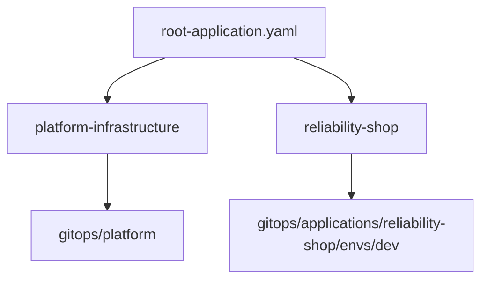

# GitOps Bootstrap

**Điểm nối giữa Git repository và các Argo CD Application.**

[Trang chủ](../../README.md) / [GitOps](../README.md) / Bootstrap

## Phạm vi

`root-application.yaml` chứa bốn Argo CD `Application` độc lập:

| Application | AppProject | Source path | Trách nhiệm |
| --- | --- | --- | --- |
| `platform-infrastructure` | `platform` | `gitops/platform` | Platform dùng chung, revision `HEAD`, auto sync |
| `reliability-shop` | `reliability-shop` | `gitops/applications/reliability-shop/envs/dev` | Dev, nhánh `dev`, auto sync |
| `reliability-shop-staging` | `reliability-shop` | `gitops/applications/reliability-shop/envs/staging` | Staging, nhánh `staging`, auto sync |
| `reliability-shop-prod` | `reliability-shop` | `gitops/applications/reliability-shop/envs/prod` | Prod, nhánh `main`, manual sync |

Đây là các Application ngang hàng. Tên file `root-application.yaml` được giữ để tương thích với tài liệu/lệnh hiện có.



## Prerequisites bên ngoài GitOps

Bootstrap này không cài Argo CD, AWS Load Balancer Controller, External Secrets Operator hoặc EKS Pod Identity. Trước khi sync cần có:

- EKS access, Argo CD và hai `AppProject` trong `gitops/projects/`.
- AWS Load Balancer Controller, External Secrets Operator và CRD tương ứng.
- IAM/Pod Identity cho controller; quyền ECR pull và quyền AWS của workload theo least privilege.
- ACM certificate, DNS, security group, subnet tagging và network path phù hợp.
- Secret nguồn trong AWS Secrets Manager; kết nối tới RDS, ElastiCache và SQS nếu workload sử dụng.

## Cold bootstrap có thứ tự

Trên cluster mới, chuẩn bị platform trước workload. `ExternalSecret` của workload phụ thuộc `ClusterSecretStore` do platform quản lý. Ví dụ bên dưới bootstrap platform và dev; staging/prod được mở theo gate riêng.

```powershell
# 1. Tạo security boundary trước Application.
kubectl apply -f gitops/projects/

# 2. Chỉ tạo Application platform từ file multi-document.
kubectl apply -f gitops/bootstrap/root-application.yaml `
  --selector "app.kubernetes.io/name=platform-infrastructure"

# 3. Gate: platform phải sẵn sàng trước workload.
kubectl -n argocd wait application/platform-infrastructure `
  --for=jsonpath='{.status.sync.status}'=Synced --timeout=10m
kubectl -n argocd wait application/platform-infrastructure `
  --for=jsonpath='{.status.health.status}'=Healthy --timeout=10m
kubectl wait clustersecretstore/aws-secretsmanager-dev `
  --for=condition=Ready --timeout=5m
kubectl -n argocd wait ingress/argocd-server-ingress `
  --for=jsonpath='{.status.loadBalancer.ingress}' --timeout=10m

# 4. Chỉ tạo Application workload sau khi gate đạt.
kubectl apply -f gitops/bootstrap/root-application.yaml `
  --selector "app.kubernetes.io/name=reliability-shop"
```

Gate tối thiểu:

- `platform-infrastructure`: `Synced` và `Healthy`.
- `ClusterSecretStore/aws-secretsmanager-dev`: `Ready=True`.
- Argo CD Ingress có ALB address; DNS/TLS và target health hợp lệ.

Nếu cluster đã ổn định và prerequisites của cả ba môi trường đã được xác nhận, có thể apply cả file. Bốn Application vẫn reconcile độc lập; prod giữ manual sync:

```powershell
kubectl apply -f gitops/bootstrap/root-application.yaml
```

## Xác nhận workload

```powershell
kubectl -n argocd get application reliability-shop
kubectl -n reliability-shop get externalsecret reliability-shop-credentials
kubectl -n reliability-shop get deployment,service,ingress
```

Kết quả cần xác nhận trên cluster thật:

- `reliability-shop`: `Synced` và `Healthy`.
- `ExternalSecret/reliability-shop-credentials`: `Ready=True`.
- Deployment đủ replica Ready; ALB target health và application smoke test đạt.

Local render không chứng minh IAM, network, DNS, TLS, AWS endpoint hoặc runtime health.

## Drift và rollback

Platform, dev và staging bật `prune` và `selfHeal`; prod giữ manual sync. Rollback bằng Git revert tới commit đã biết tốt rồi sync/quan sát health theo policy môi trường.

Không xóa Application tùy tiện: finalizer có thể xóa toàn bộ resource do Application quản lý. Không xóa ALB, certificate, AWS secret, RDS, ElastiCache hoặc SQS trong rollback GitOps thông thường.

## Phạm vi platform

Kustomization hiện nạp `ingress`, `external-secrets`, `monitoring`, `keda`, `karpenter`, `argo-rollouts`. Karpenter ở đây chỉ có node policy; controller cần có sẵn. `chaos-mesh` và `cert-manager` là module giữ chỗ, chưa được nạp. Xem [Platform](../platform/README.md) để biết dependency từng module.
