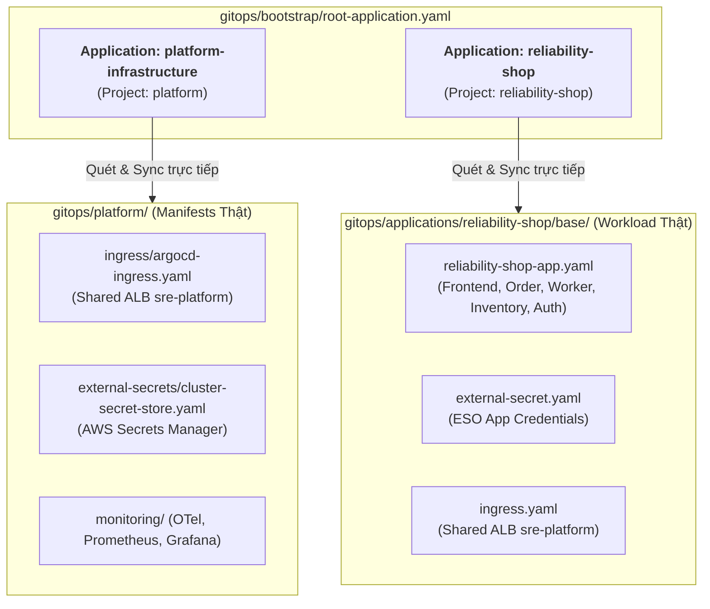

# GitOps Bootstrap Architecture Guide

Thư mục `gitops/bootstrap/` là điểm khởi động duy nhất (**Single Entrypoint**) cho toàn bộ nền tảng **AWS Cloud-Native SRE Platform**.

Kiến trúc đã được tinh gọn tối đa theo mô hình **2-Tier Clean Architecture** để loại bỏ hoàn toàn hiện tượng lồng nhau phức tạp (Over-nesting / Redundancy).

---

## 1. Sơ Đồ Kiến Trúc Tinh Gọn (Flat & Direct Model)



---

## 2. Ý Nghĩa Của Từng Thư Mục Trong GitOps Repository

| Thư mục | Chức năng chính | Quy ước & Ranh giới bảo mật |
| :--- | :--- | :--- |
| **`gitops/bootstrap/`** | Chứa duy nhất file `root-application.yaml` để khởi tạo toàn bộ cụm chỉ bằng 1 lệnh `kubectl apply`. | Không chứa workload; chỉ chứa định nghĩa 2 Application lớn. |
| **`gitops/projects/`** | Khai báo 2 thực thể `AppProject`: `platform` (toàn quyền cluster-scoped) và `reliability-shop` (bị cô lập nghiêm ngặt, chỉ hoạt động trong namespace `reliability-shop`). | Bảo vệ an toàn cụm (Blast Radius Containment). |
| **`gitops/platform/`** | Chứa trực tiếp Kubernetes manifests của các Add-ons hạ tầng (Ingress, External Secrets, Monitoring, Autoscaling). | Quản lý bởi đội ngũ Platform SRE. |
| **`gitops/applications/`** | Chứa trực tiếp mã nguồn manifests của ứng dụng microservices (`reliability-shop/base`). | Quản lý bởi đội ngũ Product/Application. |

---

## 3. Lệnh Khởi Động Duy Nhất (One-Command Bootstrap)

Khi thiết lập một cụm EKS mới hoặc khi diễn tập khôi phục sau thảm họa (Disaster Recovery):

```bash
# Bước 1: Khởi tạo chính sách phân quyền RBAC
kubectl apply -f gitops/projects/

# Bước 2: Kích hoạt toàn bộ nền tảng qua Root Application
kubectl apply -f gitops/bootstrap/root-application.yaml
```

Ngay sau 2 lệnh trên, Argo CD sẽ tự động:
1. Đồng bộ `platform-infrastructure`: Tạo Ingress cho Argo CD Dashboard và kết nối Secrets Manager.
2. Đồng bộ `reliability-shop`: Triển khai 5 microservices, kéo secret tự động và gắn vào ALB chung.
