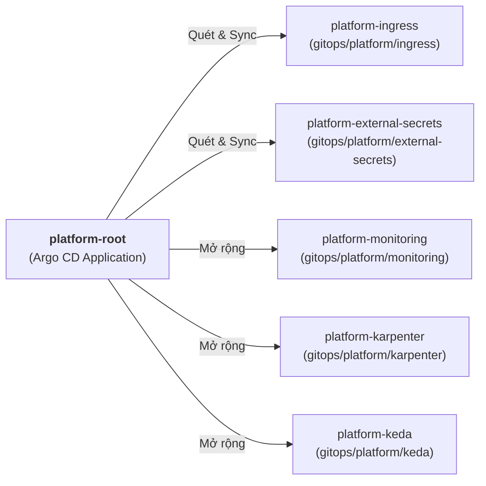

# Platform Infrastructure Add-ons (`gitops/platform/`)

Thư mục `gitops/platform/` chứa các thành phần hạ tầng bổ trợ (**Platform Add-ons**) cấp cụm (Cluster-Wide) được quản trị bởi **Platform SRE Team** thông qua Argo CD AppProject `platform`.

Mọi Add-on trong thư mục này đều phục vụ mục tiêu đảm bảo độ tin cậy (**Reliability**), khả năng tự phục hồi (**Resilience**), bảo mật (**Security**), và khả năng quan sát (**Observability**) cho toàn bộ các ứng dụng chạy trên cụm Amazon EKS.

---

## 1. Cấu trúc Thư mục và Chức năng Chi tiết

```text
gitops/platform/
├── ingress/              # [1] Cấu hình Routing & Shared Application Load Balancer
├── external-secrets/     # [2] Đồng bộ Bảo mật với AWS Secrets Manager qua Pod Identity
├── monitoring/           # [3] Hệ thống Quan sát Toàn diện (OTel, Prometheus, Grafana, Loki, Tempo)
├── argo-rollouts/        # [4] Động cơ Triển khai Tiến bộ (Canary / Blue-Green Deployments)
├── karpenter/            # [5] Tự động Co giãn Node cấp tốc độ giây (Just-In-Time Autoscaling)
├── keda/                 # [6] Tự động Co giãn Pod theo Sự kiện (Queue-Driven Autoscaling)
├── chaos-mesh/           # [7] Kỹ thuật Hỗn mang (Chaos Engineering & Resilience Drills)
├── cert-manager/         # [8] Tự động hóa Vòng đời Chứng chỉ X.509 / TLS
├── ingress-app.yaml      # Argo CD Application quản lý thư mục ingress/
└── external-secrets-app.yaml # Argo CD Application quản lý thư mục external-secrets/
```

---

## 2. Bảng Mô tả Chi tiết Từng Module Hạ Tầng

| Thư mục | Thành phần chính | Tương tác Dịch vụ AWS | Mục đích & Trách nhiệm SRE |
| :--- | :--- | :--- | :--- |
| **`ingress/`** | `argocd-ingress.yaml` | AWS ALB, ACM, Route 53 | Quản lý định tuyến HTTP/HTTPS tầng Ingress. Áp dụng kỹ thuật **Shared IngressGroup** (`sre-platform`) để gộp các dịch vụ quản trị (Argo CD) và dịch vụ người dùng (`ReliabilityShop`) dùng chung **DUY NHẤT 1 ALB**, tiết kiệm chi phí FinOps và kết nối chứng chỉ ACM wildcard `*.dev.devopsss.site`. |
| **`external-secrets/`**| `ClusterSecretStore` | AWS Secrets Manager, KMS CMK | Triển khai **External Secrets Operator (ESO)**. Lắng nghe và đồng bộ tự động thông tin nhạy cảm (DB password, Redis auth token, API keys) từ Secrets Manager vào Kubernetes Secrets mà không lưu bất kỳ secret nào trên Git. Xác thực qua **EKS Pod Identity**. |
| **`monitoring/`** | OTel, Prometheus, Loki, Tempo, Grafana | Amazon CloudWatch, S3 (Loki/Tempo) | Thu thập bộ 3 tín hiệu quan sát (**Tri-Signal Observability**): Metrics (Prometheus), Logs (Loki), và Traces (Tempo). Cung cấp Dashboard đo lường SLO/SLI và cảnh báo đa tốc độ đốt ngân sách (**Multi-Window Multi-Burn-Rate Alerts**). |
| **`argo-rollouts/`** | Controller & AnalysisTemplate | CloudWatch / Prometheus Metrics | Thay thế cơ chế RollingUpdate mặc định bằng **Canary Release**. Tự động phân tích tỷ lệ lỗi (Error Rate) và độ trễ (Latency p95); nếu có bất thường sẽ tự động **Rollback** tức thì trong vài giây để bảo vệ người dùng. |
| **`karpenter/`** | NodePool, EC2NodeClass | Amazon EC2 Fleet, Spot Instances | Tự động phân tích nhu cầu tài nguyên của Pods đang ở trạng thái `Pending` và tạo Node EC2 phù hợp trực tiếp chỉ trong vòng 30 - 45 giây, tối ưu hóa chi phí bằng cách kết hợp linh hoạt On-Demand và Spot Instances. |
| **`keda/`** | ScaledObject | Amazon SQS Queue | Giám sát độ sâu hàng đợi (`ApproximateNumberOfMessagesVisible`) của AWS SQS Queue. Tự động tăng số lượng Pod `payment-worker` khi đơn hàng dồn ứ và giảm về 1 (hoặc 0) khi hàng đợi trống. |
| **`chaos-mesh/`** | Chaos Experiments | EKS Pods, Network, Nodes | Thực hiện các kịch bản diễn tập sự cố (GameDay): mô phỏng rớt Node, nghẽn mạng (Network Latency), gián đoạn kết nối tới RDS PostgreSQL/Redis để kiểm chứng khả năng tự phục hồi của hệ thống. |
| **`cert-manager/`** | ClusterIssuer, Certificate | Let's Encrypt / Private CA | Cấp phát và tự động xoay vòng chứng chỉ nội bộ cho giao tiếp mTLS giữa các microservices hoặc Ingress phụ. |

---

## 3. Cách Thức Argo CD Đồng Bộ Tầng Platform

Các thành phần trong `gitops/platform/` được quản lý trực tiếp bởi **`platform-root` Application** (thuộc AppProject `platform`):



* **Anti-Drift & Self-Healing:** Toàn bộ Add-on đều kích hoạt `selfHeal: true` và `prune: true`. Bất kỳ thay đổi thủ công nào qua terminal đều sẽ bị Argo CD tự động hoàn tác về trạng thái chuẩn trong Git.
* **Least Privilege:** AppProject `platform` chỉ cho phép triển khai vào các namespaces hệ thống được cấp phép: `kube-system`, `external-secrets`, `argocd`, `monitoring`, `observability`.
