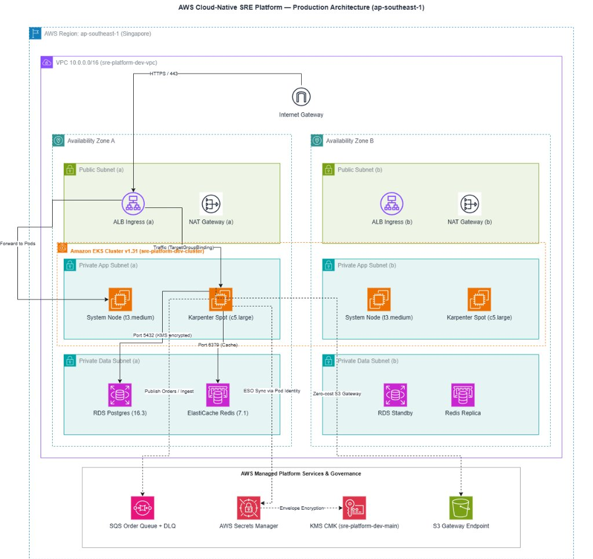
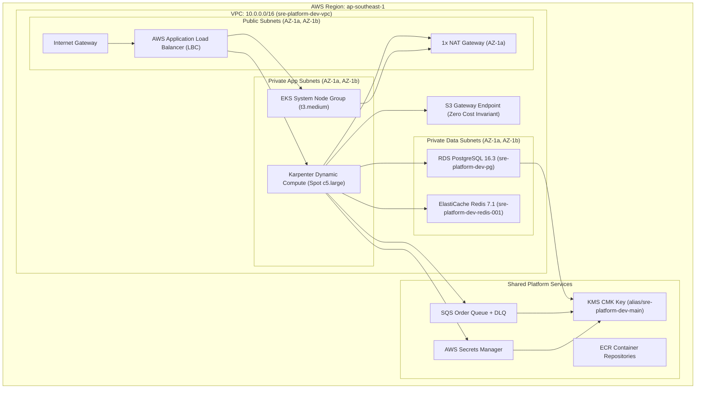
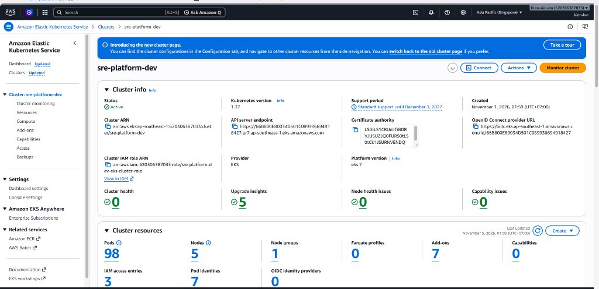
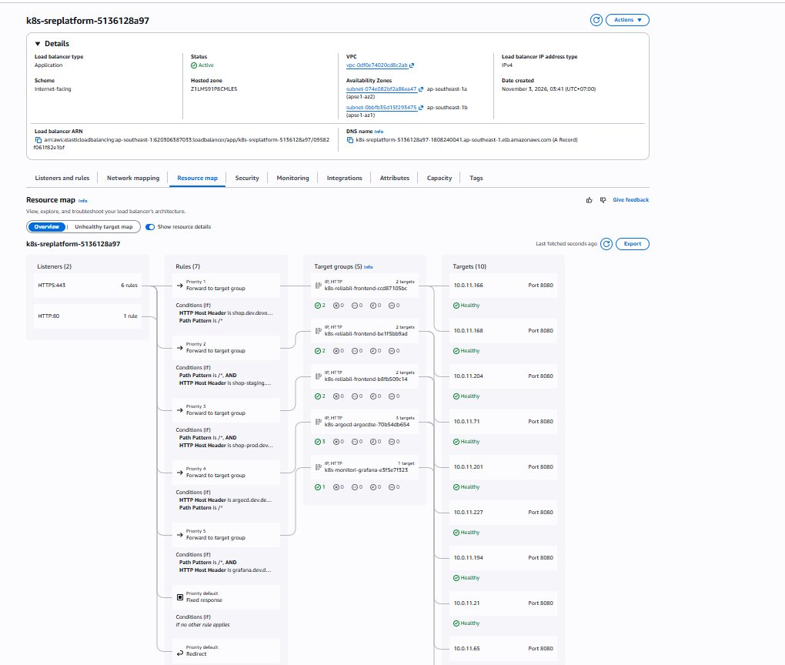

# Infrastructure as Code (IaC) — AWS Cloud Foundation

**AWS foundation dưới dạng Terraform, tách khỏi Kubernetes desired state.**

[Trang chủ](../README.md) / Infrastructure · [GitOps](../gitops/README.md) · [Labs](../labs/README.md)

| Phạm vi có mã nguồn | Nguồn |
| --- | --- |
| VPC, subnet, route, NAT, S3 endpoint | [01-vpc.tf](terraform/envs/dev/01-vpc.tf) |
| KMS | [02-kms.tf](terraform/envs/dev/02-kms.tf) |
| EKS, managed node group | [03-eks.tf](terraform/envs/dev/03-eks.tf) |
| RDS PostgreSQL | [04-database.tf](terraform/envs/dev/04-database.tf) |
| SQS và DLQ | [05-messaging.tf](terraform/envs/dev/05-messaging.tf) |
| Backend mẫu | [backend.tf.example](terraform/envs/dev/backend.tf.example) |

> [!NOTE]
> Mã nguồn hiện nằm tại `terraform/envs/dev/`; IAM roles được tham chiếu, chưa được tạo ở đây. Redis, ECR và Secrets Manager chưa có resource Terraform tương ứng. Số liệu import/drift bên dưới là hồ sơ đã lưu, cần kiểm chứng lại với state và AWS hiện tại.

Thư mục này chứa toàn bộ mã nguồn **Terraform** quản lý hạ tầng đám mây cấp doanh nghiệp cho **AWS Cloud-Native SRE Platform** tại Region `ap-southeast-1` (Singapore). Toàn bộ hạ tầng được thiết kế theo chuẩn bảo mật tối cao (Zero Trust, Least Privilege, KMS CMK Encryption) và tối ưu hóa chi phí vận hành (FinOps Governance).

---

## 1. Kiến trúc Hạ tầng Nền tảng (Platform Architecture)



<details>
<summary><b>🔍 Xem sơ đồ logic chi tiết định dạng Mermaid</b></summary>



</details>

Mô hình chi tiết định dạng Draw.io có thể xem và tải tại: [**`docs/diagrams/platform_architecture.drawio`**](../docs/diagrams/platform_architecture.drawio).

---

## 2. Minh chứng Hạ tầng AWS Thực tế (Live AWS Evidence)

### 2.1. Cụm Amazon EKS v1.31 Hoạt động Khỏe mạnh (Active)
Hạ tầng EKS Cluster `sre-platform-dev` điều phối 98 Pods trên 5 Nodes (System Nodes + Karpenter Dynamic Compute), tích hợp 7 Pod Identities và 7 Add-ons chính thức:



### 2.2. Bản đồ Tài nguyên AWS Application Load Balancer (ALB Resource Map)
AWS Load Balancer Controller tự động tạo và ánh xạ Resource Map từ Ingress: định tuyến Host Header đa môi trường (Dev, Staging, Prod, Argo CD, Grafana) tới 5 Target Groups với 100% Targets ở trạng thái `Healthy`:



---

## 3. Các chỉ số kỹ thuật & Bất biến hạ tầng (Infrastructure Invariants)

| Thành phần hạ tầng | Tài nguyên AWS thực tế | Cấu hình & Bất biến SRE | Tác động FinOps / Bảo mật |
| :--- | :--- | :--- | :--- |
| **Networking** | `sre-platform-dev-vpc` | CIDR `10.0.0.0/16`, 6 Subnets chia đều 2 AZ (`1a`, `1b`) | Cô lập mạng 3 lớp (Public, App, Data) |
| **NAT & EIP** | `sre-platform-dev-nat-gw-1a` | 1x NAT Gateway duy nhất tại Public Subnet 1a | Tiết kiệm ~$32/tháng so với kiến trúc Multi-NAT |
| **VPC Endpoints** | S3 Gateway Endpoint | `com.amazonaws.ap-southeast-1.s3` kết nối thẳng Route Table | **Hoàn toàn miễn phí ($0.00)**, tiết kiệm $15-$30/tháng so với Interface Endpoint |
| **EKS Control Plane**| `sre-platform-dev-cluster` | Kubernetes **v1.31**, Platform version `eks.12` | Hỗ trợ EKS Pod Identity, OIDC Provider |
| **EKS Compute** | `sre-platform-dev-system-nodes` | Amazon Linux 2023 (AL2023), 2x `t3.medium` Multi-AZ | Dành riêng cho Core System Addons (Argo CD, CoreDNS) |
| **Database** | `sre-platform-dev-pg` | PostgreSQL **v16.3**, Instance class `db.t4g.micro` | Multi-AZ Subnet Group, KMS CMK Encryption at-rest |
| **In-Memory Cache** | `sre-platform-dev-redis-001` | Redis Engine **v7.1**, Node class `cache.t4g.micro` | Mã hóa Transit & At-Rest, sub-millisecond read latency |
| **Asynchronous Queue**| `reliability-shop-dev-order-queue` | Standard Queue kèm Dead Letter Queue (`*-dlq`) | MaxReceiveCount = 3, KMS Encrypted |
| **KMS Key** | `alias/sre-platform-dev-main` | Customer Managed Key (CMK), Symmetric 256-bit | Quản lý tập trung toàn bộ Secret, SQS, RDS, EBS |
| **Secrets Manager** | `sre-platform/dev/database`, `redis`, `credentials` | Đọc qua External Secrets Operator bằng EKS Pod Identity | **Zero Plaintext Secrets** trong Git hay biến môi trường |

---

## 4. S3 Remote State & Infrastructure Import

Toàn bộ trạng thái hạ tầng thực tế đã được import thành công 100% vào Terraform Remote State được lưu trữ trên Amazon S3 với mã hóa SSE-S3 tại Singapore (`ap-southeast-1`):

- **S3 Bucket Backend:** `sre-platform-terraform-state-***-apse1`
- **State Key:** `environments/dev/terraform.tfstate`
- **Tài nguyên quản lý:** 27 AWS Resources (`VPC`, `Subnets`, `IGW`, `NAT GW`, `Route Tables`, `S3 VPCE`, `KMS CMK`, `EKS Cluster`, `Managed Node Group`, `RDS PostgreSQL`, `SQS Queues`).
- **Drift Check (`terraform plan`):** `0 to add, 0 to destroy` — Khớp hoàn toàn với hạ tầng đang chạy thực tế trên Cloud.

```text
iac/terraform/envs/dev/
├── backend.tf              # Cấu hình S3 remote state & AWS Provider
├── variables.tf            # Tham số cấu hình (Region, Environment, CIDR)
├── 01-vpc.tf               # VPC 10.0.0.0/16, 6 Subnets, NAT, IGW, Route Tables, S3 VPCE
├── 02-kms.tf               # KMS CMK (alias/sre-platform-dev-main)
├── 03-eks.tf               # EKS Cluster (sre-platform-dev) & Managed Node Group
├── 04-database.tf          # RDS PostgreSQL (sre-platform-dev-pg) & DB Subnet Group
├── 05-messaging.tf         # SQS Order Queue & Dead Letter Queue (DLQ)
├── outputs.tf              # Đầu ra VPC ID, Subnets, EKS Cluster, KMS ARN
└── import_resources.ps1    # Script tự động import 27 tài nguyên từ live AWS
```

---

## 5. Hướng dẫn khởi tạo & Vận hành

### Khởi tạo môi trường & Xác thực State:
```bash
cd iac/terraform/envs/dev

# 1. Khởi tạo Terraform kết nối S3 remote backend:
terraform init

# 2. Kiểm tra tính toàn vẹn và đối chiếu trạng thái (Zero Drift):
terraform plan

# 3. Áp dụng thay đổi cấu hình hạ tầng:
terraform apply
```

### Cập nhật Kubeconfig kết nối cụm:
```bash
aws eks update-kubeconfig --region ap-southeast-1 --name sre-platform-dev
kubectl get nodes -o wide
```

