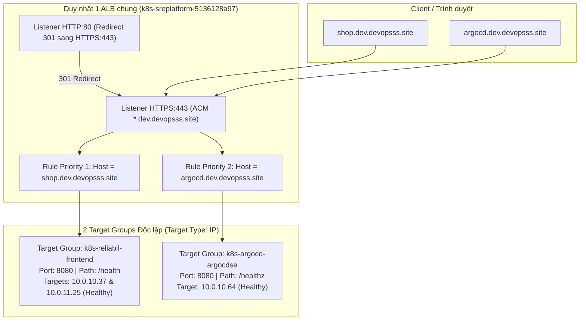

# 05.04 — Xác minh và Vận hành Application Load Balancer (ALB) Ingress & Shared IngressGroup

> **Trạng thái:** Hướng dẫn thực hành chi tiết trên AWS Management Console (Console-first).  
> **Áp dụng cho:** Kiểm tra đường truyền HTTPS, cấu hình IngressGroup chia sẻ 1 ALB chung cho nhiều Ingress (`shop.dev.devopsss.site` & `argocd.dev.devopsss.site`), Target Group Health, chứng chỉ ACM, Route 53 Alias Routing và giám sát chỉ số ALB qua CloudWatch.

---

## 1. Mục tiêu và Nguyên tắc SRE & FinOps

- **Mục tiêu:** 
  - Xác nhận rằng sau khi triển khai Ingress manifest, **AWS Load Balancer Controller** đã tự động tạo hoặc liên kết một **Application Load Balancer (ALB)** trên AWS.
  - Áp dụng kỹ thuật **IngressGroup (`alb.ingress.kubernetes.io/group.name: sre-platform`)** để gộp cả **ReliabilityShop** và **Argo CD Control Plane** chạy chung trên **DUY NHẤT 1 ALB**.
  - Kiểm tra trạng thái sức khỏe (Target Health) của các Pod endpoints trong từng Target Group thông qua AWS Console.
  - Thiết lập Route 53 Alias Record cho cả 2 tên miền (`shop.dev.devopsss.site` và `argocd.dev.devopsss.site`) trỏ về DNS name của ALB dùng chung.
  - Phân tích các chỉ số vận hành quan trọng (Golden Signals: Latency, Request Count, 4xx/5xx Errors) trên AWS CloudWatch Metrics.
- **Nguyên tắc SRE & FinOps:**
  - **FinOps Shared Ingress Pattern:** Mỗi ALB trên AWS tiêu tốn ~$25 - $30/tháng kèm phí LCU. Việc dùng IngressGroup gom nhiều namespace/dịch vụ vào 1 ALB giúp tiết kiệm 50% - 75% chi phí Load Balancer cho môi trường Dev/Staging.
  - **Host-Based Routing:** Sử dụng HTTP Host Header (`shop.dev.devopsss.site` và `argocd.dev.devopsss.site`) tại Listener 443 để phân tách traffic vào các Target Groups độc lập.
  - **Zero Unhealthy Targets in Steady State:** Ở trạng thái bình thường, 100% targets trong Target Group phải báo trạng thái `Healthy`.
  - **SRE Latency Tracking:** Giám sát phân vị độ trễ của ALB (`TargetResponseTime`) để so sánh với mục tiêu SLO latency (< 300ms p95).

---

## 2. Thông số đầu vào (Input Parameters)

| Tham số | Giá trị mẫu / Quy ước | Ý nghĩa |
| :--- | :--- | :--- |
| **Ingress Group Name** | `sre-platform` | Định danh nhóm để gộp các Ingress vào cùng 1 ALB |
| **Domain Storefront** | `shop.dev.devopsss.site` | Tên miền người dùng truy cập vào ứng dụng ReliabilityShop |
| **Domain GitOps** | `argocd.dev.devopsss.site` | Tên miền quản trị Argo CD Web Dashboard |
| **ACM Wildcard Cert** | `*.dev.devopsss.site` | Chứng chỉ SSL/TLS quản lý bởi AWS Certificate Manager |
| **Ingress Class** | `alb` | Điều khiển bởi AWS Load Balancer Controller |
| **Target Type** | `ip` | Điều hướng trực tiếp đến Pod IP thông qua AWS VPC CNI |
| **ALB Scheme** | `internet-facing` | Load balancer tiếp nhận traffic trực tiếp từ Internet |
| **Security Group ALB** | `sre-platform-dev-alb-sg` (`sg-067f16ca5bd986a83`) | Cho phép Inbound 80, 443 từ 0.0.0.0/0 |

---

## 3. Kiến trúc Luồng Host-Based Routing trên Shared ALB



---

## 4. Các bước thực hiện chi tiết trên AWS Console (Console Steps)

### Bước 1: Kiểm tra Application Load Balancer dùng chung trên EC2 Console

1. Mở ô tìm kiếm Console -> Nhập `EC2` -> Chọn dịch vụ **EC2**.
2. Tại menu bên trái, cuộn xuống mục **Load Balancing** -> Chọn **Load Balancers**.
3. Bạn sẽ thấy một ALB duy nhất mang tên nhóm dạng **`k8s-sreplatform-5136128a97`**.
4. Nhấp vào tên của Load Balancer để xem chi tiết:
   - **DNS name:** Dạng `k8s-sreplatform-5136128a97-xxxxxx.ap-southeast-1.elb.amazonaws.com`. *(Sao chép DNS name này)*.
   - **State:** Kiểm tra trạng thái phải là **Active** (Màu xanh).
   - **Scheme:** Xác nhận là **Internet-facing**.
   - **IP address type:** `IPv4`.
   - **VPC & Subnets:** Xác nhận ALB nằm trong đúng 2 Public Subnet thuộc 2 AZ khác nhau (`ap-southeast-1a` và `ap-southeast-1b`).
   - **Security groups:** Xác nhận gắn đúng `sre-platform-dev-alb-sg`.
5. Chuyển sang tab **Listeners and rules**:
   - **HTTP:80:** Phải có default action chuyển hướng (Redirect HTTP sang HTTPS:443 với status code 301).
   - **HTTPS:443:** Nhấp vào số rules (ví dụ `3 rules`):
     - **Priority 1:** IF `Host is shop.dev.devopsss.site` AND `Path is /*` -> THEN `Forward to k8s-reliabil-frontend-...`.
     - **Priority 2:** IF `Host is argocd.dev.devopsss.site` AND `Path is /*` -> THEN `Forward to k8s-argocd-argocdse-...`.
     - **Default rule:** Fixed response `404 Not Found` (ngăn chặn các host lạ scan IP ALB).
   - **Certificate:** Kiểm tra chứng chỉ gắn vào HTTPS listener: phải trỏ đúng chứng chỉ ACM `*.dev.devopsss.site`.

---

### Bước 2: Kiểm tra 2 Target Groups và Trạng thái Sức khỏe Pods (Target Health)

1. Tại menu bên trái của EC2 Console, chọn **Target Groups**.
2. Bạn sẽ thấy 2 Target Groups tương ứng:
   - `k8s-reliabil-frontend-...`
   - `k8s-argocd-argocdse-...`

3. **Kiểm tra Target Group 1 (`k8s-reliabil-frontend`):**
   - **Tab Details:** `Target type: IP`, `Protocol: HTTP:8080`.
   - **Tab Health checks:** Đường dẫn `/health`, Port `traffic-port`, Interval `15s`, Timeout `5s`, Healthy threshold `2`.
   - **Tab Targets:** Hiển thị 2 Pod IPs (ví dụ: `10.0.10.37` và `10.0.11.25`) thuộc 2 AZs khác nhau, trạng thái **Healthy** (Màu xanh lá).

4. **Kiểm tra Target Group 2 (`k8s-argocd-argocdse`):**
   - **Tab Details:** `Target type: IP`, `Protocol: HTTP:8080`.
   - **Tab Health checks:** Đường dẫn `/healthz`, Success codes `200`.
   - **Tab Targets:** Hiển thị Pod IP của `argocd-server`, trạng thái **Healthy** (Màu xanh lá).

---

### Bước 3: Cấu hình Route 53 Alias Records trỏ về Shared ALB

1. Nhập `Route 53` vào thanh tìm kiếm Console -> Chọn **Route 53**.
2. Chọn **Hosted zones** -> Nhấp vào tên miền của bạn (`devopsss.site`).
3. **Tạo bản ghi cho Storefront (`shop.dev`):**
   - Nhấp nút cam **Create record**.
   - **Record name:** `shop.dev` (FQDN: `shop.dev.devopsss.site`).
   - **Record type:** `A`.
   - **Alias:** Gạt sang **ON**.
   - **Route traffic to:**
     - Mục 1: **Alias to Application and Classic Load Balancer**.
     - Mục 2: `ap-southeast-1`.
     - Mục 3: Chọn ALB `k8s-sreplatform-5136128a97-...`.
   - **Evaluate target health:** `Yes`.
   - Nhấp **Save**.

4. **Tạo bản ghi cho Argo CD Dashboard (`argocd.dev`):**
   - Nhấp nút **Create record**.
   - **Record name:** `argocd.dev` (FQDN: `argocd.dev.devopsss.site`).
   - **Record type:** `A`.
   - **Alias:** Gạt sang **ON**.
   - **Route traffic to:** Tương tự, chọn cùng Load Balancer `k8s-sreplatform-5136128a97-...`.
   - **Evaluate target health:** `Yes`.
   - Nhấp **Create records**.

---

### Bước 4: Giám sát Chỉ số Vận hành ALB trên AWS CloudWatch

1. Nhập `CloudWatch` vào thanh tìm kiếm Console -> Chọn **CloudWatch**.
2. Tại menu bên trái, chọn **Metrics** -> **All metrics**.
3. Chọn namespace **AWS/ApplicationELB** -> Chọn **Per AppELB Metrics**.
4. Tìm kiếm theo tên Load Balancer (`k8s-sreplatform-5136128a97`) và tích chọn các metrics trọng yếu của SRE:
   - `RequestCount`: Tổng lưu lượng truy cập.
   - `TargetResponseTime`: Thời gian phản hồi của backend pods (p95).
   - `HTTPCode_Target_2XX_Count`: Số request xử lý thành công.
   - `HTTPCode_Target_4XX_Count` & `HTTPCode_Target_5XX_Count`: Lỗi tầng ứng dụng.
   - `HTTPCode_ELB_5XX_Count`: Lỗi do chính Load Balancer sinh ra (Target Group trống hoặc gateway timeout).
5. Chuyển sang tab **Graphed metrics**, đổi Statistic thành `Sum` (cho Count) hoặc `p95` (cho TargetResponseTime), đổi Period thành `1 Minute`.
6. Quan sát biểu đồ biến thiên theo thời gian thực khi chạy thử nghiệm tải.

---

## 5. Xác minh Thực nghiệm từ Terminal (Verification)

### 5.1. Kiểm tra Ingress trên Kubernetes
```bash
# Xem thông tin cả 2 ingress dùng chung ALB
kubectl get ingress -A

# Kết quả mong đợi: Cả 2 Ingress cùng trỏ về 1 địa chỉ ALB duy nhất
# NAMESPACE          NAME                       CLASS   HOSTS                      ADDRESS
# argocd             argocd-server-ingress      alb     argocd.dev.devopsss.site   k8s-sreplatform-5136128a97-....ap-southeast-1.elb.amazonaws.com
# reliability-shop   reliability-shop-ingress   alb     shop.dev.devopsss.site     k8s-sreplatform-5136128a97-....ap-southeast-1.elb.amazonaws.com
```

### 5.2. Kiểm tra Kết nối HTTPS & Chứng chỉ TLS cho cả 2 Domain
```bash
# 1. Kiểm tra HTTP Redirect sang HTTPS (Mong đợi 301 Moved Permanently)
curl -I http://shop.dev.devopsss.site

# 2. Kiểm tra trực tiếp HTTPS Endpoint và TLS Handshake của Storefront
curl -Iv https://shop.dev.devopsss.site/health

# 3. Kiểm tra trực tiếp HTTPS Endpoint của Argo CD Web UI
curl -Iv https://argocd.dev.devopsss.site/healthz
```

**Kết quả mong đợi:**
- HTTP trả về `HTTP/1.1 301 Moved Permanently` với header `Location: https://...`.
- HTTPS trả về `HTTP/2 200` (hoặc `HTTP/1.1 200 OK`).
- SSL Certificate handshake hiển thị:
  - `Server certificate: *.dev.devopsss.site`
  - `Issuer: Amazon`
  - `SSL certificate verify ok`.

---

## 5. Chuyển giao sang IaC (Terraform Snippet cho Route 53 Record)

```hcl
data "aws_lb" "ingress_alb" {
  tags = {
    "ingress.k8s.aws/stack" = "reliability-shop-ingress"
  }
}

resource "aws_route53_record" "shop" {
  zone_id = data.aws_route53_zone.primary.zone_id
  name    = "shop.dev.devopsss.site"
  type    = "A"

  alias {
    name                   = data.aws_lb.ingress_alb.dns_name
    zone_id                = data.aws_lb.ingress_alb.zone_id
    evaluate_target_health = true
  }
}
```

---

## 6. Output & Bằng chứng thực nghiệm (Evidence Template)

```text
=== LAB 05.04 EVIDENCE ===
Timestamp:            2026-10-21T01:35:00Z
ALB DNS Name:         k8s-reliabilityshop-1234567890.ap-southeast-1.elb.amazonaws.com
Target Group Health:  2/2 Targets Healthy (IP Target Type)
Route 53 Alias:       shop.dev.devopsss.site -> ALB Alias
HTTP Status:          301 Redirect to HTTPS
HTTPS Status:         HTTP/2 200 OK
TLS Cipher / Cert:    TLS_AES_128_GCM_SHA256 / Amazon Issued ACM
TargetResponseTime:   p95 = 24.5 ms
```

---

## 7. Điều kiện hoàn thành Gate (Gate Check)

- [ ] ALB hiển thị trạng thái `Active`, scheme `internet-facing`.
- [ ] 100% Targets trong Target Group hiển thị trạng thái `Healthy`.
- [ ] Route 53 Alias Record phân giải chính xác về DNS name của ALB.
- [ ] Lệnh `curl -Iv https://<FQDN>/health` trả về HTTP 200 và chứng chỉ hợp lệ.
- [ ] CloudWatch Metrics ghi nhận request và latency bình thường, không có lỗi `ELB_5XX`.

---

## 8. Dọn dẹp tài nguyên (Cleanup)

1. Khi dọn dẹp, Ingress manifest phải được xóa thông qua **Argo CD** hoặc `kubectl delete ingress`.  
   AWS Load Balancer Controller sẽ tự động phát hiện và xóa ALB cùng Target Group tương ứng trên AWS.
2. Xóa bản ghi Alias Record `shop.dev` trong **Route 53 Hosted zones**.
3. Kiểm tra lại **EC2 > Load Balancers** để đảm bảo ALB đã bị hủy hoàn toàn, tránh phát sinh chi phí duy trì hàng giờ ($0.0225/giờ + LCU).
