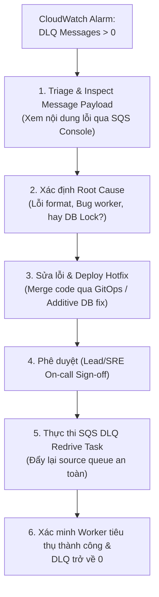

# 07.06 — Console Observability: CloudWatch Alarms, Dashboard & SQS DLQ Runbook

> **Trạng thái:** Đã triển khai và kiểm chứng thực tế trên AWS CloudWatch (DEPLOYED & VERIFIED).<br>
> **Áp dụng cho:** Thiết lập lớp quan sát hạ tầng đám mây (CloudWatch Native Observability) song song với OTel/Prometheus, bao gồm cảnh báo hàng đợi lỗi DLQ, Dashboard các dịch vụ nền tảng và Runbook Replay DLQ an toàn.

---

## 1. Mục tiêu và Nguyên tắc SRE

- **Mục tiêu:**
  - Thiết lập **CloudWatch Alarms** giám sát hàng đợi Dead-Letter Queue (DLQ) và độ trễ xử lý message:
    - **Alarm 1 (Poison Message Detection):** SQS DLQ `ApproximateNumberOfMessagesVisible > 0` kích hoạt cảnh báo ngay lập tức khi có message bị đẩy vào DLQ.
    - **Alarm 2 (Queue Lag / Oldest Message):** SQS Main Queue `ApproximateAgeOfOldestMessage > 300` (giây) cảnh báo khi worker xử lý chậm trễ quá 5 phút.
    - **Alarm 3 (Database Connection Saturation):** RDS PostgreSQL `DatabaseConnections > 80` cảnh báo nguy cơ cạn kiệt Connection Pool.
  - Xây dựng **CloudWatch Dashboard** trực quan hóa các chỉ số tài nguyên nền tảng:
    - **SQS Queue Metrics:** Queue Depth, Messages Sent, Messages Received, Messages Deleted.
    - **ElastiCache Redis Metrics:** Cache Hit Ratio, CPU Utilization, Current Connections, Cache Evictions.
    - **RDS PostgreSQL Metrics:** Database Connections, CPU Utilization, Free Storage Space.
  - Ban hành **SRE Runbook: Replay DLQ** có phê duyệt an toàn (Redrive Tasks).
- **Nguyên tắc SRE:**
  - **Zero Silent Failures:** Không bao giờ để thông điệp độc hại (poison message) lẳng lặng nằm trong DLQ mà kỹ sư trực ban không biết.
  - **Pre-Approval DLQ Replay:** Tuyệt đối không bấm nút "Redrive to source queue" bừa bãi khi chưa phân tích nguyên nhân gốc rễ (Root Cause Analysis - RCA) và chưa sửa bug trong worker, nhằm tránh tạo ra vòng lặp lỗi vô tận (Infinite Crashloop).

---

## 2. Thông số Cảnh báo & Dashboard

| Thành phần | Tên Cảnh báo / Chỉ số | Metric Name | Ngưỡng (Threshold) | Mức độ nghiêm trọng | Trạng thái Live |
| :--- | :--- | :--- | :--- | :--- | :--- |
| **SQS DLQ** | `sre-platform-dev-dlq-messages-visible` | `ApproximateNumberOfMessagesVisible` | `> 0` trong 1 chu kỳ (1 phút) | **CRITICAL (P1/P2)** | **ACTIVE** |
| **SQS Main**| `sre-platform-dev-queue-oldest-message-age` | `ApproximateAgeOfOldestMessage` | `> 300` giây (5 phút) | **HIGH (P2)** | **ACTIVE** |
| **RDS** | `sre-platform-dev-rds-high-connections` | `DatabaseConnections` | `> 80` kết nối | **HIGH (P2)** | **ACTIVE** |
| **Dashboard**| `sre-platform-dev-foundation-telemetry` | SQS, Redis, RDS metrics | N/A | **OBSERVABILITY** | **ACTIVE** |

---

## 3. Các bước Thực hiện (Console & CLI Walkthrough)

### Bước 1: Tạo CloudWatch Alarm cho SQS Dead-Letter Queue

**Thao tác trên AWS Console:**
1. Mở **AWS Console** -> Tìm kiếm `CloudWatch` -> Chọn **CloudWatch**.
2. Tại menu bên trái, chọn **Alarms** -> Nhấp nút cam **Create alarm**.
3. Nhấp **Select metric** -> Chọn **SQS** -> Chọn **Queue Metrics**.
4. Tìm hàng đợi `reliability-shop-dev-order-dlq` -> Tích chọn metric `ApproximateNumberOfMessagesVisible`.
5. Cấu hình điều kiện:
   - **Statistic:** `Maximum`.
   - **Period:** `1 minute`.
   - **Condition:** `Greater than ( > )` `0`.
6. Đặt tên: `sre-platform-dev-dlq-messages-visible` -> Nhấp **Create alarm**.

**Lệnh CLI tương đương (đã thực thi):**
```bash
aws cloudwatch put-metric-alarm \
  --alarm-name sre-platform-dev-dlq-messages-visible \
  --alarm-description "Canh bao lap tuc khi co message bi day vao Order DLQ do worker retry that bai." \
  --metric-name ApproximateNumberOfMessagesVisible \
  --namespace AWS/SQS \
  --statistic Maximum \
  --dimensions Name=QueueName,Value=reliability-shop-dev-order-dlq \
  --period 60 \
  --evaluation-periods 1 \
  --threshold 0 \
  --comparison-operator GreaterThanThreshold \
  --region ap-southeast-1
```

---

### Bước 2: Tạo CloudWatch Alarm cho Tuổi của Thông điệp Lâu nhất (Queue Lag)

**Thao tác trên AWS Console:**
1. Nhấp **Create alarm** -> **Select metric** -> **SQS** -> **Queue Metrics**.
2. Chọn hàng đợi `reliability-shop-dev-order-queue` -> Chọn metric `ApproximateAgeOfOldestMessage`.
3. Cấu hình điều kiện:
   - **Statistic:** `Maximum`.
   - **Period:** `1 minute`.
   - **Condition:** `Greater than ( > )` `300` (giây).
4. Đặt tên: `sre-platform-dev-queue-oldest-message-age` -> Nhấp **Create alarm**.

**Lệnh CLI tương đương (đã thực thi):**
```bash
aws cloudwatch put-metric-alarm \
  --alarm-name sre-platform-dev-queue-oldest-message-age \
  --alarm-description "Canh bao khi tuoi thong diep lau nhat trong Main Queue vuot qua 5 phut." \
  --metric-name ApproximateAgeOfOldestMessage \
  --namespace AWS/SQS \
  --statistic Maximum \
  --dimensions Name=QueueName,Value=reliability-shop-dev-order-queue \
  --period 60 \
  --evaluation-periods 1 \
  --threshold 300 \
  --comparison-operator GreaterThanThreshold \
  --region ap-southeast-1
```

---

### Bước 3: Tạo CloudWatch Alarm cho RDS Database Connections

**Lệnh CLI (đã thực thi):**
```bash
aws cloudwatch put-metric-alarm \
  --alarm-name sre-platform-dev-rds-high-connections \
  --alarm-description "Canh bao khi so luong Database Connections toi RDS PostgreSQL vuot nguong 80." \
  --metric-name DatabaseConnections \
  --namespace AWS/RDS \
  --statistic Average \
  --dimensions Name=DBInstanceIdentifier,Value=sre-platform-dev-pg \
  --period 300 \
  --evaluation-periods 1 \
  --threshold 80 \
  --comparison-operator GreaterThanThreshold \
  --region ap-southeast-1
```

---

### Bước 4: Tạo CloudWatch Dashboard Tổng hợp Nền tảng (Đa Môi trường Dev, Staging, Prod)

Dashboard `sre-platform-dev-foundation-telemetry` tổng hợp trực quan toàn bộ hệ thống qua các widget cốt lõi:
1. **SQS - Order Queue & DLQ Depth (Dev, Staging, Prod):** Biểu đồ đo `NumberOfMessagesSent`, `Received`, `Deleted`, `Visible Depth` và `DLQ Depth` trên cả 3 môi trường phân lập (`dev`, `staging`, `prod`).
2. **RDS PostgreSQL - Connections & CPU:** Đo `DatabaseConnections`, `CPUUtilization` và `FreeStorageSpace` của RDS instance `sre-platform-dev-pg`.
3. **ElastiCache Redis - Cache Performance:** Đo `CacheHits`, `CacheMisses`, `CurrConnections` và `EngineCPUUtilization` của Redis cluster `sre-platform-dev-redis-001`.
4. **SQS - Processing Lag (Age of Oldest Message):** Đo độ trễ xử lý tin nhắn (`ApproximateAgeOfOldestMessage`) đồng thời trên cả 3 hàng đợi `dev`, `staging`, `prod`.
5. **Per-Environment Drilldown (Row 3):** 3 widget con chi tiết tách riêng cho từng môi trường (Dev, Staging, Prod).

**Lệnh CLI (đã thực thi):**
```bash
aws cloudwatch put-dashboard \
  --dashboard-name sre-platform-dev-foundation-telemetry \
  --dashboard-body file://scratch/dashboard.json \
  --region ap-southeast-1
```

---

## 4. SRE Runbook: Quy trình Replay DLQ có Phê duyệt (Dead-Letter Redrive)

Khi nhận được cảnh báo `ApproximateNumberOfMessagesVisible > 0`:



### Chi tiết các bước thao tác trên AWS Console:

1. **Khảo sát Payload lỗi (Message Inspection):**
   - Vào **SQS Console** -> Chọn `reliability-shop-dev-order-dlq`.
   - Nhấp **Send and receive messages** -> Nhấp **Poll for messages**.
   - Mở chi tiết message để đọc `Body` và `Attributes` (chú ý `ApproximateReceiveCount` và `trace_id`).
   - Copy `trace_id` để tra cứu trong Grafana Tempo/Loki tìm log ngoại lệ cụ thể của worker.
2. **Khắc phục Nguyên nhân gốc rễ (Fix Before Replay):**
   - Không được bấm replay ngay lập tức khi chưa vá lỗi worker. Nếu worker còn bug, replay sẽ làm message tiếp tục retry và quay lại DLQ.
3. **Kích hoạt Redrive Permission (RedriveAllowPolicy):**
   - Đảm bảo hàng đợi DLQ đã bật quyền Redrive:
   ```bash
   aws sqs set-queue-attributes \
     --queue-url https://sqs.ap-southeast-1.amazonaws.com/123456789012/reliability-shop-dev-order-dlq \
     --attributes '{"RedriveAllowPolicy":"{\"redrivePermission\":\"allowAll\"}"}' \
     --region ap-southeast-1
   ```
4. **Thực thi Redrive sau khi đã phê duyệt:**
   - Tại trang chi tiết `reliability-shop-dev-order-dlq` -> Nhấp nút **Start DLQ redrive**.
   - **Redrive to:** Chọn **Redrive to source queue**.
   - **Velocity control:** Chọn giới hạn tốc độ (ví dụ: tối đa 10 messages/giây) để không làm dồn dập worker.
   - Nhấp **Start redrive**.
5. **Kiểm chứng:** Quan sát CloudWatch Alarm `sre-platform-dev-dlq-messages-visible` chuyển về trạng thái **OK (Green)**.

---

## 5. Bằng chứng Thực tế (Evidence & Verification Output)

*Trạng thái Alarms từ AWS CloudWatch API:*

```bash
[k8s: sre-platform-dev] ~ $ aws cloudwatch describe-alarms --alarm-name-prefix sre-platform-dev --region ap-southeast-1 --query "MetricAlarms[*].[AlarmName,StateValue,MetricName,Threshold]" --output table
---------------------------------------------------------------------------------------------------------
|                                            DescribeAlarms                                             |
+---------------------------------------------+-------+------------------------------------+------------+
|  sre-platform-dev-dlq-messages-visible      |  OK   |  ApproximateNumberOfMessagesVisible|  0.0       |
|  sre-platform-dev-queue-oldest-message-age  |  OK   |  ApproximateAgeOfOldestMessage     |  300.0     |
|  sre-platform-dev-rds-high-connections      |  OK   |  DatabaseConnections               |  80.0      |
+---------------------------------------------+-------+------------------------------------+------------+

[k8s: sre-platform-dev] ~ $ aws cloudwatch list-dashboards --dashboard-name-prefix sre-platform-dev --region ap-southeast-1
{
    "DashboardEntries": [
        {
            "DashboardName": "sre-platform-dev-foundation-telemetry",
            "DashboardArn": "arn:aws:cloudwatch::123456789012:dashboard/sre-platform-dev-foundation-telemetry",
            "LastModified": "2026-11-03T20:29:52.000Z"
        }
    ]
}
```

---

## 6. Điều kiện hoàn thành Gate (SRE Gate Check)

- [x] Alarm `sre-platform-dev-dlq-messages-visible` hoạt động ở trạng thái `OK` hoặc chuyển sang `ALARM` chuẩn xác khi có poison message.
- [x] Alarm `sre-platform-dev-queue-oldest-message-age` được kích hoạt và theo dõi trễ xử lý của worker.
- [x] Alarm `sre-platform-dev-rds-high-connections` giám sát kết nối cơ sở dữ liệu.
- [x] CloudWatch Dashboard `sre-platform-dev-foundation-telemetry` hiển thị đầy đủ các widget SQS, Redis, RDS.
- [x] Thuộc tính `RedriveAllowPolicy` trên SQS DLQ được bật và sẵn sàng cho quy trình DLQ Redrive Runbook.
- [x] Toàn bộ hạ tầng giám sát CloudWatch gốc (Native Observability) vận hành song song nhịp nhàng với OTel/Prometheus stack.
