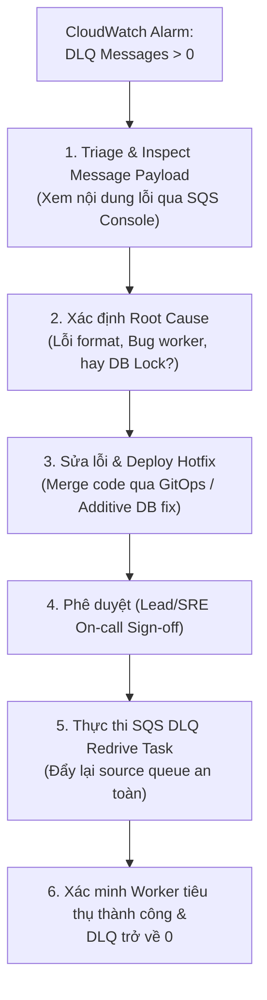

# 07.06 — Console Observability: CloudWatch Alarms, Dashboard & SQS DLQ Runbook

> **Trạng thái:** Hướng dẫn thực hành chi tiết trên AWS Management Console (Console-first). 
> **Áp dụng cho:** Thiết lập lớp quan sát hạ tầng đám mây (CloudWatch Native Observability) song song với OTel/Prometheus, bao gồm cảnh báo hàng đợi lỗi DLQ, Dashboard các dịch vụ nền tảng và Runbook Replay DLQ an toàn.

---

## 1. Mục tiêu và Nguyên tắc SRE

- **Mục tiêu:**
  - Thiết lập **CloudWatch Alarms** giám sát hàng đợi Dead-Letter Queue (DLQ) và độ trễ xử lý message:
    - **Alarm 1 (Poison Message Detection):** SQS DLQ `ApproximateNumberOfMessagesVisible > 0` kích hoạt cảnh báo ngay lập tức khi có message bị đẩy vào DLQ.
    - **Alarm 2 (Queue Lag / Oldest Message):** SQS Main Queue `ApproximateAgeOfOldestMessage > 300` (giây) cảnh báo khi worker xử lý chậm trễ quá 5 phút.
  - Xây dựng **CloudWatch Dashboard** trực quan hóa các chỉ số tài nguyên nền tảng:
    - **SQS Queue Metrics:** Queue Depth, Messages Sent, Messages Received, Messages Deleted.
    - **ElastiCache Redis Metrics:** Cache Hit Ratio, CPU Utilization, Current Connections, Cache Evictions.
    - **RDS PostgreSQL Metrics:** Database Connections, CPU Utilization, Free Storage Space.
  - Ban hành **SRE Runbook: Replay DLQ** có phê duyệt an toàn (Redrive Tasks).
- **Nguyên tắc SRE:**
  - **Zero Silent Failures:** Không bao giờ để thông điệp độc hại (poison message) lẳng lặng nằm trong DLQ mà kỹ sư trực ban không biết.
  - **Pre-Approval DLQ Replay:** Tuyệt đối không bấm nút "Redrive to source queue" bừa bãi khi chưa phân tích nguyên nhân gốc rễ (Root Cause Analysis - RCA) và chưa sửa bug trong worker, nhằm tránh tạo ra vòng lặp lỗi vô tận (Infinite Crashloop).

---

## 2. Thông số Cảnh báo & Dashboard

| Thành phần | Tên Cảnh báo / Chỉ số | Metric Name | Ngưỡng (Threshold) | Mức độ nghiêm trọng |
| :--- | :--- | :--- | :--- | :--- |
| **SQS DLQ** | `sre-platform-dev-dlq-messages-visible` | `ApproximateNumberOfMessagesVisible` | `> 0` trong 1 chu kỳ (1 phút) | **CRITICAL (P1/P2)** |
| **SQS Main**| `sre-platform-dev-queue-oldest-message-age` | `ApproximateAgeOfOldestMessage` | `> 300` giây (5 phút) | **HIGH (P2)** |
| **Redis** | `sre-platform-dev-redis-hit-ratio` | `CacheHitRate` | `< 80%` trong 5 phút | **MEDIUM (P3)** |
| **RDS** | `sre-platform-dev-rds-high-connections` | `DatabaseConnections` | `> 80` kết nối | **HIGH (P2)** |

---

## 3. Các bước thực hiện trên AWS Management Console

### Bước 1: Tạo CloudWatch Alarm cho SQS Dead-Letter Queue

1. Mở **AWS Console** -> Tìm kiếm `CloudWatch` -> Chọn **CloudWatch**.
2. Tại menu bên trái, chọn **Alarms** -> Nhấp nút cam **Create alarm**.
3. Nhấp **Select metric** -> Chọn **SQS** -> Chọn **Queue Metrics**.
4. Tìm hàng đợi `reliability-shop-dev-order-dlq` -> Tích chọn metric `ApproximateNumberOfMessagesVisible`.
5. Nhấp **Select metric**.
6. **Specify metric and conditions:**
   - **Statistic:** `Maximum`.
   - **Period:** `1 minute`.
   - **Threshold type:** `Static`.
   - **Whenever ApproximateNumberOfMessagesVisible is...:** Chọn `Greater than ( > )`.
   - **Define the threshold value:** Nhập `0`.
7. **Configure actions:**
   - Chọn SNS Topic gửi thông báo trực ban hoặc chuyển sang trạng thái cảnh báo trên Dashboard.
8. **Add name and description:**
   - **Alarm name:** `sre-platform-dev-dlq-messages-visible`.
   - **Alarm description:** `Canh bao lap tuc khi co message bi day vao Order DLQ do worker retry qua 3 lan that bai.`
9. Nhấp **Create alarm**.

---

### Bước 2: Tạo CloudWatch Alarm cho Tuổi của Thông điệp Lâu nhất

1. Nhấp **Create alarm** -> **Select metric** -> **SQS** -> **Queue Metrics**.
2. Chọn hàng đợi `reliability-shop-dev-order-queue` -> Chọn metric `ApproximateAgeOfOldestMessage`.
3. Cấu hình điều kiện:
   - **Statistic:** `Maximum`.
   - **Period:** `1 minute`.
   - **Condition:** `Greater than ( > )` `300` (giây).
4. Đặt tên: `sre-platform-dev-queue-oldest-message-age`.
5. Nhấp **Create alarm**.

---

### Bước 3: Tạo CloudWatch Dashboard Tổng hợp Nền tảng

1. Tại menu bên trái của CloudWatch Console, chọn **Dashboards** -> Nhấp **Create dashboard**.
2. Nhập tên Dashboard: `sre-platform-dev-foundation-telemetry` -> Nhấp **Create dashboard**.
3. **Thêm Widget 1: SQS Queue Activity (Line Chart):**
   - Chọn kiểu: **Line**.
   - Thêm các metrics từ `reliability-shop-dev-order-queue`:
     - `NumberOfMessagesSent` (Sum)
     - `NumberOfMessagesReceived` (Sum)
     - `NumberOfMessagesDeleted` (Sum)
     - `ApproximateNumberOfMessagesVisible` (Average)
4. **Thêm Widget 2: ElastiCache Redis Performance (Line Chart):**
   - Thêm các metrics từ cluster `sre-platform-dev-redis`:
     - `CacheHits` vs `CacheMisses` (Tính Cache Hit Ratio)
     - `EngineCPUUtilization`
     - `CurrConnections`
5. **Thêm Widget 3: RDS PostgreSQL Health (Line Chart):**
   - Thêm các metrics từ DB instance `sre-platform-dev-pg`:
     - `DatabaseConnections`
     - `CPUUtilization`
     - `FreeStorageSpace`
6. Nhấp **Save** để lưu Dashboard.

---

## 4. SRE Runbook: Quy trình Replay DLQ có Phê duyệt (Dead-Letter Redrive)

Khi nhận được cảnh báo `ApproximateNumberOfMessagesVisible > 0`:

### Chi tiết các bước thao tác trên AWS Console:

1. **Khảo sát Payload lỗi (Message Inspection):**
   - Vào **SQS Console** -> Chọn `reliability-shop-dev-order-dlq`.
   - Nhấp **Send and receive messages** -> Nhấp **Poll for messages**.
   - Mở chi tiết message để đọc `Body` và `Attributes` (chú ý `ApproximateReceiveCount = 3` và `trace_id`).
   - Copy `trace_id` để tra cứu trong Grafana Tempo/Loki tìm log ngoại lệ cụ thể của worker.
2. **Khắc phục Nguyên nhân gốc rễ (Fix Before Replay):**
   - Không được bấm replay ngay lập tức khi chưa vá lỗi worker. Nếu worker còn bug, replay sẽ làm message tiếp tục retry và quay lại DLQ.
3. **Thực thi Redrive sau khi đã phê duyệt:**
   - Tại trang chi tiết `reliability-shop-dev-order-dlq` -> Nhấp nút **Start DLQ redrive**.
   - **Redrive to:** Chọn **Redrive to source queue**.
   - **Velocity control:** Chọn giới hạn tốc độ (ví dụ: tối đa 10 messages/giây) để không làm dồn dập worker.
   - Nhấp **Start redrive**.
4. **Kiểm chứng:** Quan sát CloudWatch Alarm `sre-platform-dev-dlq-messages-visible` chuyển về trạng thái **OK (Green)**.

---

## 5. Điều kiện hoàn thành Gate (Gate Check)

- [ ] Alarm `sre-platform-dev-dlq-messages-visible` hoạt động ở trạng thái `OK` hoặc chuyển sang `ALARM` chuẩn xác khi có test poison message.
- [ ] Alarm `sre-platform-dev-queue-oldest-message-age` được kích hoạt.
- [ ] CloudWatch Dashboard `sre-platform-dev-foundation-telemetry` hiển thị đầy đủ 3 widget: SQS, Redis, RDS.
- [ ] Quy trình DLQ Redrive Runbook được diễn tập thành công trên môi trường thử nghiệm.
