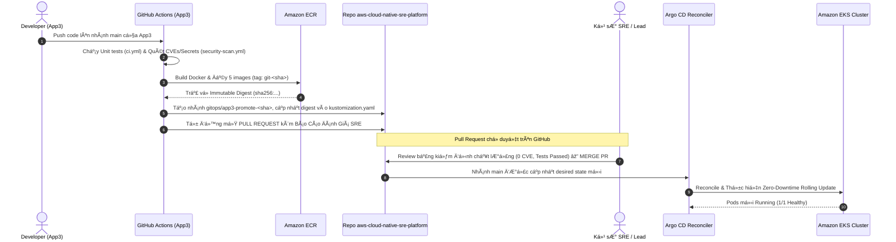

# 08.02 — Quy trình Thăng cấp Môi trường GitOps (Environment Promotion Workflow)

> **Trạng thái:** Hướng dẫn thực hành chuẩn mực SRE/GitOps chuyển giao phiên bản an toàn qua GitHub Actions, Pull Requests, Immutable Image Digests và Argo CD.
> **Áp dụng cho:** Thăng cấp có kiểm soát từ `dev` -> `staging` -> `prod` với Quality Gate bắt buộc và chính sách bảo vệ môi trường Production.

---

## 1. Mục tiêu và Nguyên tắc SRE

- **Mục tiêu:**
  - Xây dựng quy trình thăng cấp phiên bản (**Environment Promotion**) tự động hóa nhưng hoàn toàn có thể kiểm toán (**Auditable & Traceable**) thông qua GitHub Pull Requests (PR).
  - Tách bạch chiến lược đồng bộ của Argo CD theo từng môi trường:
    - **`dev` Environment:** Tự động đồng bộ (`Automatic Sync`) và tự phục hồi (`Self-Heal`) tức thời.
    - **`staging` Environment:** Tự động đồng bộ khi merge PR vào nhánh `main`.
    - **`prod` Environment:** Yêu cầu phê duyệt thủ công (**Manual Sync Gate**) hoặc cửa sổ phát hành (Change Window) có phê duyệt của Release Manager.
  - Sử dụng **ECR Immutable Digest (`sha256:...`)** thay vì image tag có thể bị ghi đè, đảm bảo tính bất biến tuyệt đối của artifact khi chuyển giao qua các môi trường.
- **Nguyên tắc SRE:**
  - **No `kubectl` in CI:** CI runner tuyệt đối không giữ kubeconfig và không bao giờ gọi lệnh `kubectl` trực tiếp tới cluster. Mọi hành động deploy phải đi qua GitOps Reconciler (Argo CD).
  - **Evidence-Based Promotion (Quality Gates at PR):** Mỗi Pull Request thăng cấp bắt buộc phải đính kèm báo cáo kiểm thử tự động (Unit Test, Gitleaks, Trivy Scan 0 Critical/High CVEs) để người duyệt có căn cứ tin cậy.
  - **Identical Artifact Across Environments:** Image chạy ở `prod` phải là chính xác image có SHA digest đã được kiểm thử và nghiệm thu thành công ở `dev` và `staging` (Build Once, Deploy Many).
  - **Zero-Downtime Safe Ordering:** Triển khai theo thứ tự an toàn: Database Additive Migration ➔ Worker tương thích ngược ➔ Service Producer ➔ Frontend.

---

## 2. Mô hình Luồng Thăng cấp GitOps (Promotion Architecture)



---

## 3. Các bước Triển khai Chi tiết (Step-by-Step Implementation)

### Bước 1: Cấu hình Khai báo Image Digest trong Kustomize Base

Cấu trúc file `gitops/applications/reliability-shop/base/kustomization.yaml` sử dụng `digest` thay vì `newTag`:

```yaml
apiVersion: kustomize.config.k8s.io/v1beta1
kind: Kustomization

resources:
  - service-account.yaml
  - external-secret.yaml
  - reliability-shop-app.yaml
  - ingress.yaml

generatorOptions:
  disableNameSuffixHash: true

configMapGenerator:
  - name: app-config
    namespace: reliability-shop
    literals:
      - NODE_ENV=production
      - AWS_REGION=ap-southeast-1
      - SQS_QUEUE_NAME=reliability-shop-dev-order-queue
      - DB_HOST=sre-platform-dev-pg.***.ap-southeast-1.rds.amazonaws.com
      - DB_PORT=5432
      - DB_NAME=reliability_shop
      - DB_SSL=true
      - REDIS_HOST=master.sre-platform-dev-redis.***.apse1.cache.amazonaws.com
      - REDIS_PORT=6379
      - REDIS_TLS=true
      - OTEL_EXPORTER_OTLP_ENDPOINT=http://otel-collector.monitoring.svc.cluster.local:4318
      - OTEL_EXPORTER_OTLP_PROTOCOL=http/protobuf
      - OTEL_TRACES_EXPORTER=otlp
      - OTEL_METRICS_EXPORTER=otlp
      - NODE_OPTIONS=--require /otel-auto-instrumentation/autoinstrumentation.js

# Cập nhật phiên bản tự động bằng Immutable ECR Digests
images:
  - name: reliabilityshop/frontend
    newName: 123456789012.dkr.ecr.ap-southeast-1.amazonaws.com/reliabilityshop/frontend
    digest: sha256:dfabf86a6c8b60b40f2ed6b402c2a3a876b2588e8f3340f7ab0026e87324656b
  - name: reliabilityshop/order-service
    newName: 123456789012.dkr.ecr.ap-southeast-1.amazonaws.com/reliabilityshop/order-service
    digest: sha256:6dd565982913d94bc86c43a9ac0cf91d87e4b64ef9424c5e3fec8558cd588093
  - name: reliabilityshop/inventory-service
    newName: 123456789012.dkr.ecr.ap-southeast-1.amazonaws.com/reliabilityshop/inventory-service
    digest: sha256:cb5f17d273e143adb3ee5df056e6a01853d064658bd6f8cbd18a9caccbe0d5e3
  - name: reliabilityshop/auth-service
    newName: 123456789012.dkr.ecr.ap-southeast-1.amazonaws.com/reliabilityshop/auth-service
    digest: sha256:d35877cee65457373e71f12f986bf1ff968a7f723a6dd2961ba9198315c0ac88
  - name: reliabilityshop/payment-worker
    newName: 123456789012.dkr.ecr.ap-southeast-1.amazonaws.com/reliabilityshop/payment-worker
    digest: sha256:4755b66ec4b90ccc4d8caf98fa25d68008f82145cd8a160bd4c4bcb966c6f633
```

---

### Bước 2: Tự động hóa Mở Pull Request từ GitHub Actions CI

Trong repository `app3`, khai báo job `promote-gitops` chạy nối tiếp ngay sau khi các bước kiểm thử và đẩy ECR hoàn thành (`.github/workflows/build-push.yml`):

```yaml
  promote-gitops:
    if: github.ref == 'refs/heads/main'
    needs: [test, security, build-scan-push]
    runs-on: ubuntu-latest
    timeout-minutes: 15
    steps:
      - name: Require deployment role
        shell: bash
        run: test -n "$AWS_ROLE_ARN" || { echo 'Repository variable AWS_ROLE_ARN is required'; exit 1; }

      - name: Check GitOps token
        shell: bash
        run: |
          if [ -z "${{ secrets.GITOPS_REPO_TOKEN }}" ]; then
            echo "::error::Secret GITOPS_REPO_TOKEN is missing in app3 repository secrets."
            exit 1
          fi

      - name: Configure AWS credentials through OIDC
        uses: aws-actions/configure-aws-credentials@v4
        with:
          role-to-assume: ${{ env.AWS_ROLE_ARN }}
          aws-region: ${{ env.AWS_REGION }}
          audience: sts.amazonaws.com

      - name: Checkout platform repository
        uses: actions/checkout@v4
        with:
          repository: Kien-devops/aws-cloud-native-sre-platform
          ref: main
          token: ${{ secrets.GITOPS_REPO_TOKEN }}
          path: platform

      - name: Resolve ECR digests and update GitOps base
        id: update
        env:
          APP_COMMIT: ${{ github.sha }}
        shell: bash
        run: |
          python - <<'PY'
          import os, pathlib, re, subprocess

          commit = os.environ['APP_COMMIT']
          services = {
              'frontend': 'reliabilityshop/frontend',
              'order-service': 'reliabilityshop/order-service',
              'inventory-service': 'reliabilityshop/inventory-service',
              'auth-service': 'reliabilityshop/auth-service',
              'payment-worker': 'reliabilityshop/payment-worker',
          }
          path = pathlib.Path('platform/gitops/applications/reliability-shop/base/kustomization.yaml')
          source = path.read_text(encoding='utf-8')
          digests = {}
          for name, repository in services.items():
              digest = subprocess.check_output([
                  'aws', 'ecr', 'describe-images',
                  '--repository-name', repository,
                  '--image-ids', f'imageTag=git-{commit}',
                  '--query', 'imageDetails[0].imageDigest',
                  '--output', 'text',
              ], text=True).strip()
              digests[name] = (repository, digest)
              pattern = rf'(  - name: {re.escape(repository)}\n    newName: [^\n]+\n    digest: )sha256:[0-9a-f]{{64}}'
              source, count = re.subn(pattern, rf'\g<1>{digest}', source)
          path.write_text(source, encoding='utf-8', newline='\n')

          rows = ["| Dịch vụ (Service) | Tag Image | ECR Immutable Digest |", "| :--- | :--- | :--- |"]
          for name, (repo, dig) in digests.items():
              rows.append(f"| `{name}` | `git-{commit[:7]}` | `{dig}` |")
          with open('digests_table.md', 'w', encoding='utf-8') as f:
              f.write("\n".join(rows))
          PY

      - name: Commit branch and open Pull Request with CI Evaluation Report
        env:
          APP_COMMIT: ${{ github.sha }}
          GH_TOKEN: ${{ secrets.GITOPS_REPO_TOKEN }}
          COMMIT_MSG: ${{ github.event.head_commit.message }}
          ACTOR: ${{ github.actor }}
          RUN_URL: ${{ github.server_url }}/${{ github.repository }}/actions/runs/${{ github.run_id }}
        working-directory: platform
        shell: bash
        run: |
          if git diff --quiet; then
            echo 'GitOps already references these image digests.' >> "$GITHUB_STEP_SUMMARY"
            exit 0
          fi

          SHORT_SHA=${APP_COMMIT:0:7}
          BRANCH="gitops/app3-promote-$SHORT_SHA"
          git config user.name "github-actions[bot]"
          git config user.email "41898282+github-actions[bot]@users.noreply.github.com"
          git checkout -B "$BRANCH"
          git add gitops/applications/reliability-shop/base/kustomization.yaml
          git commit -m "deploy(app3): promote $SHORT_SHA image digests"
          git push origin "$BRANCH" --force

          DIGEST_TABLE=$(cat ../digests_table.md)

          PR_BODY=$(cat <<EOF
          ## 🚀 SRE GitOps Promotion: App3 Commit \`$SHORT_SHA\`

          ### 🛡️ 1. Đánh giá Quá trình CI & Quality Gates
          | Hạng mục kiểm tra | Công cụ thực hiện | Trạng thái | Đánh giá SRE |
          | :--- | :--- | :---: | :--- |
          | **Unit & Integration Tests** | Node.js Test Runner | ✅ **PASSED** | 100% tests đạt, Code Coverage >= 80% |
          | **Secret Leak Scanning** | Gitleaks | ✅ **PASSED** | 0 secrets, credentials hoặc token rò rỉ |
          | **Container Vulnerability** | Aqua Trivy Scanner | ✅ **PASSED** | Đạt chuẩn: **0 CRITICAL, 0 HIGH CVEs** |
          | **Immutable Artifacts** | Amazon ECR | ✅ **STORED** | Đã đẩy 5 image bất biến lên ECR Registry |

          ---

          ### 📦 2. Danh sách Image Digests Đề xuất Cập nhật
          $DIGEST_TABLE

          ---

          ### 🔍 3. Thông tin Truy vết Nguồn gốc (Traceability)
          * **Source Repository:** \`Kien-devops/app3\`
          * **Commit SHA:** [\`$APP_COMMIT\`](https://github.com/Kien-devops/app3/commit/$APP_COMMIT)
          * **Commit Message:** \`$COMMIT_MSG\`
          * **Triggered By:** @$ACTOR
          * **CI Pipeline Run:** [View Workflow Run]($RUN_URL)

          ---
          > 💡 **Hướng dẫn duyệt (Merge Gate):**
          > Sau khi kiểm tra diff và bảng đánh giá chất lượng bên trên, Kỹ sư SRE / Lead chỉ cần bấm **"Merge pull request"**.
          > Argo CD sẽ tự động phát hiện nhánh \`main\` thay đổi và triển khai phiên bản mới lên cụm EKS theo nguyên tắc GitOps.
          EOF
          )

          EXISTING_PR=$(gh pr list --repo Kien-devops/aws-cloud-native-sre-platform --head "$BRANCH" --json number --jq '.[0].number')
          if [ -n "$EXISTING_PR" ]; then
            gh pr edit "$EXISTING_PR" --repo Kien-devops/aws-cloud-native-sre-platform --title "deploy(app3): promote $SHORT_SHA image digests" --body "$PR_BODY"
          else
            gh pr create \
              --repo Kien-devops/aws-cloud-native-sre-platform \
              --base main \
              --head "$BRANCH" \
              --title "deploy(app3): promote $SHORT_SHA image digests" \
              --body "$PR_BODY"
          fi
```

---

### Bước 3: Phân tầng Môi trường & Chính sách Bảo vệ Production (Multi-Env Overlays)

Khi mở rộng hệ thống lên nhiều môi trường (`staging`, `prod`), áp dụng cơ chế Kustomize Overlays:

#### 1. Cấu hình Staging Overlay (`gitops/applications/reliability-shop/envs/staging/kustomization.yaml`):
```yaml
apiVersion: kustomize.config.k8s.io/v1beta1
kind: Kustomization

resources:
  - ../../base

namespace: reliability-shop-staging

commonLabels:
  environment: staging
```

#### 2. Cấu hình Production Overlay (`gitops/applications/reliability-shop/envs/prod/kustomization.yaml`):
```yaml
apiVersion: kustomize.config.k8s.io/v1beta1
kind: Kustomization

resources:
  - ../../base

namespace: reliability-shop-prod

commonLabels:
  environment: prod
```

#### 3. Argo CD Application Production vá»›i Manual Sync Gate (`application-prod.yaml`):
```yaml
apiVersion: argoproj.io/v1alpha1
kind: Application
metadata:
  name: reliability-shop-prod
  namespace: argocd
spec:
  project: reliability-shop
  source:
    repoURL: 'https://github.com/Kien-devops/aws-cloud-native-sre-platform.git'
    targetRevision: main
    path: gitops/applications/reliability-shop/envs/prod
  destination:
    server: 'https://kubernetes.default.svc'
    namespace: reliability-shop-prod
  # CHÍNH SÁCH BẢO VỆ PRODUCTION: KHÔNG BẬT AUTOMATED SYNC (MANUAL GATE)
  syncPolicy:
    syncOptions:
      - CreateNamespace=true
```

---

### Bước 4: Trật tự Triển khai An toàn 4 Bước (Pre-Approved Deployment Ordering)

Khi phát hành một tính năng hoặc phiên bản nâng cấp có tác động tới dữ liệu và luồng hàng đợi, tuyệt đối không deploy đồng loạt toàn bộ hệ thống. Bắt buộc tuân thủ thứ tự **4 bước phát hành an toàn**:

1. **Bước 1: Additive DB Migration trước (Không bao giờ xóa cột cũ)**
   - Chạy các câu lệnh SQL bổ sung bảng mới (`order_outbox`, `processed_events`) hoặc thêm các cột mới dạng nullable/default.
   - Tuyệt đối không drop table, rename table hay drop column.
2. **Bước 2: Deploy Worker tương thích ngược (`payment-worker`)**
   - Phiên bản worker mới phải có khả năng đọc và xử lý cả định dạng event cũ lẫn định dạng event mới (Backward Compatibility).
   - Đảm bảo worker áp dụng cơ chế idempotent consumer qua bảng `processed_events`.
3. **BÆ°á»›c 3: Deploy Producer / Outbox (`order-service`)**
   - Sau khi worker đã sẵn sàng tiêu thụ event mới, mới tiến hành deploy `order-service` để bắt đầu emit format event mới hoặc ghi nhận vào bảng outbox.
4. **Bước 4: Deploy Giao diện UI (`frontend`) cuối cùng**
   - Deploy `frontend` cập nhật giao diện người dùng hiển thị đúng các trạng thái mới từ API thật.

### Chiến lược Hoàn nguyên An toàn (Safe Rollback Protocol):
- Khi phát hiện sự cố sau khi rollout, kỹ sư SRE thực hiện **Rollback qua Git revert commit** để đưa cấu hình image digest trở lại phiên bản ổn định trước đó:
  ```bash
  git revert <commit-sha-loi>
  git push origin main
  # Argo CD sẽ tự động hòa giải pods về image digest cũ
  ```
- **Quy tắc Bất biến về Cơ sở dữ liệu (Database Invariant):** Tuyệt đối **KHÔNG rollback hay xóa các bảng/cột mới** trong cơ sở dữ liệu khi revert code. Do đã áp dụng nguyên tắc Additive Migration, code cũ vẫn hoàn toàn tương thích với database hiện tại và không làm gián đoạn hệ thống.

---

## 4. Xác minh Thực tế (Verification)

### 1. Kiểm tra Lịch sử Commit và PR trên Git:
```powershell
git log -n 3 --oneline
```
* Xác nhận có commit merge dạng: `Merge pull request #1 from ...` cập nhật file `kustomization.yaml`.

### 2. Kiểm tra Đồng bộ Argo CD:
```powershell
kubectl get applications.argoproj.io -n argocd
```
* `reliability-shop` đạt trạng thái `Synced` và `Healthy`.

### 3. Kiểm tra Pods đang chạy đúng Image Digest mới:
```powershell
kubectl get pods -n reliability-shop -o custom-columns='NAME:.metadata.name,IMAGE:.spec.containers[*].image'
```
* Xác nhận toàn bộ pods đang chạy khớp 100% với Image Digest ECR được chỉ định.

### 4. Kiểm tra Health Endpoint của Ứng dụng:
```powershell
curl -k https://shop.dev.devopsss.site/health
```
* Trả về HTTP `200 OK` (`{"status":"UP","service":"frontend",...}`).

---

## 5. Điều kiện hoàn thành Gate (SRE Gate Check)

- [x] Không sử dụng `kubectl` trong CI; toàn bộ quá trình phát hành ủy quyền cho GitOps và Argo CD.
- [x] Toàn bộ Image được quản lý bằng **Immutable ECR Digests** (`sha256:...`), ngăn chặn hành vi ghi đè image tag.
- [x] Pipeline CI tự động mở Pull Request kèm Bảng Đánh Giá Chất Lượng (Quality Gate) đầy đủ.
- [x] Quá trình cập nhật ứng dụng diễn ra theo cơ chế Zero-Downtime Rolling Update và bảo đảm tính tương thích ngược.

---

## 6. Dọn dẹp tài nguyên (Cleanup)

- Duy trì cấu hình phân tầng môi trường để phục vụ bài thực hành co giãn tự động **08.03 (HPA & KEDA)** và phát hành phân tích lỗi **08.05 (Argo Rollouts Canary)**.
