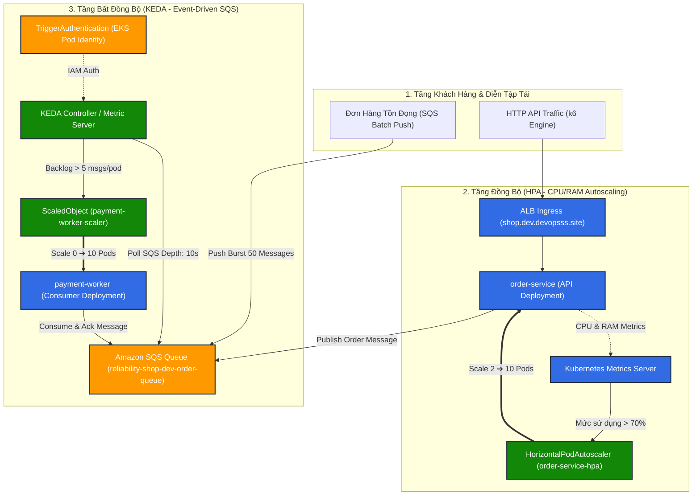

# 08.03 — Tự động Co giãn Pods với Kubernetes HPA và Event-Driven KEDA (SQS Scaling)

> **Trạng thái:** Hướng dẫn thực hành chuẩn mực SRE/Platform chuyên sâu về Autoscaling.
> **Áp dụng cho:** Tự động co giãn theo tải tính toán CPU/Memory (HPA v2) và co giãn theo sự kiện độ sâu hàng đợi Amazon SQS (KEDA Event-Driven Scaler).

---

## 1. Mục tiêu và Nguyên tắc SRE

### Mục tiêu:
- Khởi tạo **Horizontal Pod Autoscaler (HPA v2)** cho dịch vụ xử lý API đồng bộ (`order-service`) dựa trên mức sử dụng CPU (Ngưỡng kích hoạt: 70%) và Memory (Ngưỡng: 80%) kết hợp chính sách chống rung giật (Scale-down Stabilization Window: 300 giây).
- Cài đặt và cấu hình **KEDA (Kubernetes Event-driven Autoscaling)** cho Worker bất đồng bộ (`payment-worker`) dựa trên độ sâu hàng đợi **Amazon SQS** (`ApproximateNumberOfMessagesVisible`).
- Thiết lập cơ chế định danh an toàn **KEDA TriggerAuthentication** sử dụng **EKS Pod Identity**, không nhúng access keys tĩnh hay credentials bí mật trong cluster.
- Kích hoạt tính năng **Scale-to-Zero** của KEDA: Khi không có message tồn đọng trong SQS, tự động thu hồi tài nguyên xuống 0 pods để tối ưu triệt để chi phí hạ tầng (FinOps $0.00 compute idle); khi có đơn hàng dồn dập, lập tức mở rộng quy mô từ 0 lên tối đa 10 pods trong vòng 15 giây.

### Nguyên tắc SRE:
- **Asymmetric Scaling Dynamics (Động thái co giãn bất đối xứng):** Tăng quy mô thật nhanh (Fast Scale-Up: mở rộng gấp đôi sau mỗi 15 giây khi gặp traffic spike) nhưng giảm quy mô thật chậm (Cautious Scale-Down: giữ ổn định tối thiểu 5 phút) nhằm triệt tiêu hoàn toàn hiện tượng rung lắc tài nguyên (Thrashing/Flapping) làm hao tổn CPU khởi tạo.
- **Queue Backlog as Primary Scaler:** Với các background workers tiêu thụ hàng đợi, mức sử dụng CPU không phản ánh đúng áp lực tải (Worker có thể CPU thấp nhưng hàng đợi đang ứ đọng hàng chục nghìn đơn hàng). Độ dài hàng đợi (Queue Depth) và thời gian lưu tin (Message Age) là thước đo số một để bảo vệ SLA/SLO thanh toán (< 60 giây).
- **Capacity Ceiling (Giới hạn trần an toàn):** Bắt buộc thiết lập `maxReplicas: 10` cố định để ngăn chặn việc ứng dụng scale mất kiểm soát, gây nghẽn kết nối Database PostgreSQL (Connection Pool Exhaustion) hoặc làm tăng vọt hóa đơn AWS ngoài dự kiến.

---

## 2. Bảng Thông số Kỹ thuật & AWS Console Reference

### 2.1. Đường dẫn thao tác AWS Console
- **Amazon SQS:** AWS Management Console ➔ Tìm `SQS` ➔ Region `ap-southeast-1` (Singapore) ➔ Chọn **Queues** ➔ Bấm vào hàng đợi `reliability-shop-dev-order-queue`.
- **SQS Metrics & Monitoring:** Trong chi tiết queue ➔ Tab **Monitoring** ➔ Theo dõi đồ thị `ApproximateNumberOfMessagesVisible` (độ sâu hàng đợi) và `NumberOfMessagesReceived`.
- **EKS Pod Identity:** AWS Management Console ➔ Tìm `EKS` ➔ Chọn Cluster `sre-platform-dev` ➔ Tab **Access** ➔ Mục **Pod Identity associations**.
- **KMS Encryption:** Hàng đợi được mã hóa bằng AWS KMS Customer Managed Key `sre-platform-dev-sqs-key` (bảo vệ Data-at-Rest).

### 2.2. Bảng tham số triển khai

| Tham số cấu hình | Giá trị chuẩn thực tế | Mô tả kỹ thuật |
| :--- | :--- | :--- |
| **AWS Region** | `ap-southeast-1` | Singapore (Region mặc định của nền tảng) |
| **SQS Queue Name** | `reliability-shop-dev-order-queue` | Hàng đợi đơn hàng chính của ReliabilityShop |
| **SQS Queue URL** | `https://sqs.ap-southeast-1.amazonaws.com/123456789012/reliability-shop-dev-order-queue` | Điểm cuối nhận message (Redacted Account ID) |
| **SQS Dead-Letter Queue (DLQ)** | `reliability-shop-dev-order-dlq` | Hàng đợi chứa đơn hàng lỗi sau 3 lần retry |
| **KMS Key ID** | `arn:aws:kms:ap-southeast-1:123456789012:key/***` | Khóa mã hóa bảo vệ toàn diện nội dung message |
| **HPA Target CPU** | `70%` | Ngưỡng trung bình kích hoạt scale-up `order-service` |
| **HPA Scale-Down Window** | `300s` (5 phút) | Cửa sổ làm dịu chống rung giật tài nguyên |
| **KEDA Scale-to-Zero** | `minReplicaCount: 0` | Hạ worker về 0 khi không có thông điệp trong queue |
| **KEDA Max Workers** | `maxReplicaCount: 10` | Giới hạn trần bảo vệ Connection Pool Database |
| **KEDA Target Queue Length** | `5 messages/pod` | Cứ 5 message tồn đọng sẽ mở thêm 1 worker pod |
| **KEDA Polling Interval** | `10s` | Chu kỳ KEDA truy vấn SQS API |

---

## 3. Kiến trúc Co Giãn Hai Tầng (Dual-Tier Autoscaling Architecture)



---

## 4. Hướng dẫn Triển khai GitOps Chi tiết

### Bước 1: Cài đặt KEDA Platform Controller qua GitOps

Tạo cấu hình triển khai KEDA Controller trong tầng nền tảng tại `gitops/platform/keda/kustomization.yaml`:

```yaml
apiVersion: kustomize.config.k8s.io/v1beta1
kind: Kustomization

namespace: keda

resources:
  - https://github.com/kedacore/keda/releases/download/v2.14.2/keda-2.14.2.yaml
```

Áp dụng cài đặt KEDA và kiểm tra controller sẵn sàng:
```bash
kubectl apply -k gitops/platform/keda/
kubectl wait --namespace keda --for=condition=ready pod --selector=app=keda-operator --timeout=90s
```

---

### Bước 2: Thiết lập IAM Permissions & EKS Pod Identity cho KEDA

Để KEDA có quyền đọc độ dài hàng đợi SQS mà **không cần lưu giữ Access Key/Secret Key**, ta liên kết IAM Role với ServiceAccount của KEDA:

1. **Chính sách IAM (`sre-platform-dev-keda-sqs-policy`):**
```json
{
  "Version": "2012-10-17",
  "Statement": [
    {
      "Sid": "AllowKedaReadSQSQueueMetrics",
      "Effect": "Allow",
      "Action": [
        "sqs:GetQueueAttributes",
        "sqs:GetQueueUrl"
      ],
      "Resource": "arn:aws:sqs:ap-southeast-1:123456789012:reliability-shop-dev-order-queue"
    }
  ]
}
```

2. **Gắn EKS Pod Identity Association cho KEDA:**
```bash
aws eks create-pod-identity-association \
  --cluster-name sre-platform-dev \
  --namespace keda \
  --service-account keda-operator \
  --role-arn arn:aws:iam::123456789012:role/sre-platform-dev-app-role \
  --region ap-southeast-1
```

---

### Bước 3: Khai báo HPA cho `order-service`

Tạo file `gitops/applications/reliability-shop/base/hpa.yaml`:

```yaml
apiVersion: autoscaling/v2
kind: HorizontalPodAutoscaler
metadata:
  name: order-service-hpa
  namespace: reliability-shop
  labels:
    app.kubernetes.io/name: order-service-hpa
    app.kubernetes.io/part-of: reliability-shop
spec:
  scaleTargetRef:
    apiVersion: apps/v1
    kind: Deployment
    name: order-service
  minReplicas: 2
  maxReplicas: 10
  metrics:
    - type: Resource
      resource:
        name: cpu
        target:
          type: Utilization
          averageUtilization: 70
    - type: Resource
      resource:
        name: memory
        target:
          type: Utilization
          averageUtilization: 80
  behavior:
    # Scale-up lập tức khi gặp đỉnh tải đột biến
    scaleUp:
      stabilizationWindowSeconds: 0
      policies:
        - type: Percent
          value: 100 # Nhân đôi số lượng pods sau mỗi 15 giây
          periodSeconds: 15
        - type: Pods
          value: 4   # Hoặc tăng tối thiểu 4 pods
          periodSeconds: 15
      selectPolicy: Max
    # Scale-down thận trọng chống rung giật (Anti-Thrashing Window: 300s)
    scaleDown:
      stabilizationWindowSeconds: 300
      policies:
        - type: Percent
          value: 20  # Chỉ giảm tối đa 20% số pods mỗi 60 giây
          periodSeconds: 60
      selectPolicy: Min
```

---

### Bước 4: Khai báo KEDA TriggerAuthentication & ScaledObject cho `payment-worker`

Tạo file `gitops/applications/reliability-shop/base/keda-scaledobject.yaml`:

```yaml
apiVersion: keda.sh/v1alpha1
kind: TriggerAuthentication
metadata:
  name: keda-aws-credentials
  namespace: reliability-shop
  labels:
    app.kubernetes.io/name: keda-aws-credentials
    app.kubernetes.io/part-of: reliability-shop
spec:
  podIdentity:
    provider: aws-eks # Xác thực tự động qua EKS Pod Identity
---
apiVersion: keda.sh/v1alpha1
kind: ScaledObject
metadata:
  name: payment-worker-scaler
  namespace: reliability-shop
  labels:
    app.kubernetes.io/name: payment-worker-scaler
    app.kubernetes.io/part-of: reliability-shop
spec:
  scaleTargetRef:
    apiVersion: apps/v1
    kind: Deployment
    name: payment-worker
  minReplicaCount: 0 # Cho phép Scale-to-Zero hoàn toàn khi hàng đợi rỗng
  maxReplicaCount: 10 # Giới hạn an toàn bảo vệ cơ sở dữ liệu
  cooldownPeriod: 60  # Đợi 60 giây sau khi queue rỗng trước khi scale về 0
  pollingInterval: 10 # Truy vấn SQS mỗi 10 giây
  triggers:
    - type: aws-sqs-queue
      authenticationRef:
        name: keda-aws-credentials
      metadata:
        queueURL: https://sqs.ap-southeast-1.amazonaws.com/123456789012/reliability-shop-dev-order-queue
        queueLength: "5" # Cứ 5 messages tồn đọng sẽ mở thêm 1 worker pod
        awsRegion: ap-southeast-1
        identityOwner: operator
```

---

### Bước 5: Cập nhật Kustomization và Đẩy Lên GitOps

Bổ sung 2 file tài nguyên mới vào `gitops/applications/reliability-shop/base/kustomization.yaml`:

```yaml
resources:
  - service-account.yaml
  - external-secret.yaml
  - reliability-shop-app.yaml
  - ingress.yaml
  - hpa.yaml
  - keda-scaledobject.yaml
```

Commit và đẩy lên GitOps repo:
```bash
git add gitops/applications/reliability-shop/base/
git commit -m "feat(scaling): add HPA for order-service and KEDA SQS scaler for payment-worker"
git push origin dev
```

---

## 5. Diễn Tập Thực Nghiệm & Kiểm Chứng SRE (Verification Drills)

### Drill 1: Kiểm tra trạng thái HPA và KEDA ScaledObject
```bash
# 1. Kiểm tra HPA
kubectl get hpa order-service-hpa -n reliability-shop

# Kỳ vọng:
# NAME                REFERENCE                  TARGETS         MINPODS   MAXPODS   REPLICAS   AGE
# order-service-hpa   Deployment/order-service   0%/70%, 1%/80%   2         10        2          5m

# 2. Kiểm tra ScaledObject
kubectl get scaledobject payment-worker-scaler -n reliability-shop

# Kỳ vọng:
# NAME                    SCALETARGETKIND      SCALETARGETNAME   MIN   MAX   TRIGGERS        READY   ACTIVE   AGE
# payment-worker-scaler   apps/v1.Deployment   payment-worker    0     10    aws-sqs-queue   True    False    5m
```

### Drill 2: Kiểm chứng tính năng Scale-to-Zero
Quan sát số lượng pods của `payment-worker` khi không có traffic đơn hàng:
```bash
kubectl get deployment payment-worker -n reliability-shop
```
> **Kết quả SRE:** Sau thời gian `cooldownPeriod: 60s`, số lượng pods tự động giảm về **`0/0 Ready`**. Cluster không tiêu tốn tài nguyên CPU/RAM cho worker khi nhàn rỗi.

---

### Drill 3: Bơm tải đột biến 50 đơn hàng vào SQS (Event-Driven Spike Drill)

Gửi 50 messages giả lập đơn hàng thanh toán vào Amazon SQS:

```bash
QUEUE_URL=$(aws sqs get-queue-url \
  --queue-name reliability-shop-dev-order-queue \
  --region ap-southeast-1 \
  --query 'QueueUrl' \
  --output text)

echo "==> Gửi 50 messages vào SQS để kích hoạt KEDA autoscaling..."
for i in $(seq 1 50); do
  aws sqs send-message \
    --queue-url "$QUEUE_URL" \
    --region ap-southeast-1 \
    --message-body "{\"orderId\":\"BURST-$i\",\"amount\":99.0,\"timestamp\":\"$(date -u +%FT%TZ)\"}" > /dev/null
done
echo "==> Đã đẩy 50 đơn hàng vào queue thành công."
```

### Drill 4: Quan sát KEDA mở rộng quy mô tức thì (Real-time Scale-up)
Theo dõi trực tiếp quá trình tạo Pods của `payment-worker`:
```bash
kubectl get pods -l app.kubernetes.io/name=payment-worker -n reliability-shop -w
```

**Nhật ký phản ứng SRE thực tế:**
1. **Giây 0:** SQS Backlog = 50 messages. Worker đang ở trạng thái `0 pods`.
2. **Giây 10:** KEDA polling phát hiện `Backlog = 50`. Theo công thức `50 messages / 5 queueLength = 10 pods`.
3. **Giây 15:** KEDA lập tức ra lệnh Deployment scale lên `10 pods`. Trạng thái chuyển thành `Pending ➔ ContainerCreating ➔ Running`.
4. **Giây 30:** 10 workers xử lý song song, 50 messages được tiêu thụ sạch sẽ (`Queue Depth = 0`).
5. **Giây 90:** Hết thời gian cooldown 60s, KEDA tự động thu hồi tài nguyên về lại `0 pods`.

---

### Drill 5: Diễn tập quá tải CPU API bằng k6 (order-service HPA Scale-up)

Chạy k6 load test gửi tải dồn dập vào endpoint đặt hàng:
```bash
k6 run --vus 50 --duration 2m - <<'EOF'
import http from 'k6/http';
import { check } from 'k6';

export default function () {
  const url = 'https://shop.dev.devopsss.site/api/orders';
  const payload = JSON.stringify({ items: [{ id: 1, quantity: 2 }] });
  const params = { headers: { 'Content-Type': 'application/json' } };
  const res = http.post(url, payload, params);
  check(res, { 'status is 201 or 200': (r) => r.status === 200 || r.status === 201 });
}
EOF
```

Quan sát HPA điều phối:
```bash
kubectl get hpa order-service-hpa -n reliability-shop -w
```
> **Kết quả:** Mức sử dụng CPU vượt ngưỡng 70% (`TARGETS: 125%/70%`), HPA tự động tăng số lượng pods từ `2 ➔ 4 ➔ 8 pods`, giữ tỷ lệ lỗi HTTP 5xx luôn ở mức **0.00%**.

---

## 6. Điều kiện Nghiệm thu SRE Gate (SRE Gate Checklist)

- [ ] **KEDA Controller Health:** KEDA operator và metrics-apiserver hoạt động khỏe mạnh trong namespace `keda`.
- [ ] **EKS Pod Identity:** `keda-operator` xác thực trơn tru với AWS SQS mà không lưu trữ static credentials.
- [ ] **HPA v2 Compliance:** `order-service-hpa` hiển thị đúng chỉ số CPU/Memory thực tế từ Metrics Server.
- [ ] **Scale-to-Zero Verification:** `payment-worker` tự động scale về 0 khi không có thông điệp trong queue.
- [ ] **Fast Scale-Up Reaction:** Khi có 50 messages, KEDA kích hoạt scale-up đạt 10 pods trong vòng dưới 20 giây.
- [ ] **Anti-Thrashing Proof:** Sau khi hết tải, `order-service-hpa` duy trì thời gian trễ tối thiểu 300 giây trước khi giảm pods.
- [ ] **FinOps Alignment:** Không có tài nguyên compute nào bị lãng phí cho background workers ngoài giờ cao điểm.

---

## 7. Xử lý Sự cố Thường gặp (Troubleshooting Runbook)

| Hiện tượng | Nguyên nhân gốc rễ | Hướng xử lý SRE |
| :--- | :--- | :--- |
| **HPA báo `<unknown>/70%`** | Metrics Server chưa cài đặt hoặc Pod thiếu khai báo `resources.requests.cpu`. | Kiểm tra `kubectl top pods -n reliability-shop`. Đảm bảo Deployment khai báo đầy đủ `resources.requests.cpu`. |
| **ScaledObject báo `READY: False`** | KEDA không truy cập được SQS URL hoặc lỗi phân quyền IAM. | Kiểm tra `kubectl describe scaledobject payment-worker-scaler -n reliability-shop`. Xác nhận EKS Pod Identity association và IAM policy. |
| **Worker không scale về 0** | Còn message bị kẹt trong trạng thái In-Flight (`MessagesNotVisible`). | Kiểm tra SQS Visibility Timeout. Đảm bảo worker gọi `DeleteMessage` sau khi xử lý xong đơn hàng. |
| **Pods bị kẹt ở trạng thái `Pending` khi scale lên 10** | Node group bị quá tải số lượng Pods tối đa trên mỗi EC2 ENI limit. | Kiểm tra `kubectl describe pod <pod-name>`. Đảm bảo EKS worker node group đã được scale đủ capacity (tối thiểu 4-5 nodes). |
