# 08.03 — Tự động Co giãn Pods với Kubernetes HPA và Event-Driven KEDA (SQS Scaling)

> **Trạng thái:** Hướng dẫn thực hành chuẩn mực SRE/Platform chuyên sâu về Autoscaling.
> **Áp dụng cho:** Tự động co giãn theo tải tính toán CPU/Memory (HPA v2) và co giãn theo sự kiện độ sâu hàng đợi Amazon SQS đa môi trường (KEDA Event-Driven Scaler).

---

## 1. Mục tiêu và Nguyên tắc SRE

### Mục tiêu:
- Khởi tạo **Horizontal Pod Autoscaler (HPA v2)** cho dịch vụ xử lý API đồng bộ (`order-service`) dựa trên mức sử dụng CPU (Ngưỡng kích hoạt: 70%) và Memory (Ngưỡng: 80%) kết hợp chính sách chống rung giật (Scale-down Stabilization Window: 300 giây).
- Cài đặt và cấu hình **KEDA (Kubernetes Event-driven Autoscaling)** cho Worker bất đồng bộ (`payment-worker`) dựa trên độ sâu hàng đợi **Amazon SQS** (`ApproximateNumberOfMessagesVisible`).
- **Cô lập hàng đợi theo từng môi trường (Multi-Environment SQS Isolation):** Mỗi môi trường (`dev`, `staging`, `prod`) sở hữu hàng đợi chính và Dead-Letter Queue (DLQ) độc lập tuyệt đối trên AWS SQS để triệt tiêu nguy cơ tranh chấp dữ liệu (Message Stealing).
- **Thiết kế chống Cold-Start (Warm Standby HA):** Duy trì thường trực `minReplicaCount: 2` trên môi trường Production & Staging để loại bỏ hoàn toàn độ trễ khởi động container khi khách tạo đơn hàng đầu tiên; sẵn sàng bùng nổ quy mô lên tối đa 10 pods khi gặp đợt tải lớn.
- Thiết lập cơ chế định danh an toàn **KEDA TriggerAuthentication** sử dụng **EKS Pod Identity**, không nhúng access keys tĩnh hay credentials bí mật trong cluster.

### Nguyên tắc SRE:
- **Zero Cold-Start UX vs FinOps Tradeoff:** Khi đặt `minReplicaCount: 0` (Scale-to-Zero), pod đầu tiên cần từ 15 đến 30 giây để kéo image, chạy OpenTelemetry auto-instrumentation và kết nối Database/SQS khiến người dùng phải chờ đợi lâu khi thanh toán. Thiết lập `minReplicaCount: 2` chạy thường trực đa AZ (Multi-AZ) đảm bảo đơn hàng được xử lý tức thì (< 100ms) và duy trì tính sẵn sàng cao (High Availability).
- **Asymmetric Scaling Dynamics (Động thái co giãn bất đối xứng):** Tăng quy mô thật nhanh (Fast Scale-Up: mở rộng gấp đôi sau mỗi 15 giây khi gặp traffic spike) nhưng giảm quy mô thật chậm (Cautious Scale-Down: giữ ổn định tối thiểu 5 phút) nhằm triệt tiêu hoàn toàn hiện tượng rung lắc tài nguyên (Thrashing/Flapping).
- **Queue Backlog as Primary Scaler:** Với background worker tiêu thụ hàng đợi, CPU không phản ánh đúng áp lực tải (Worker có thể CPU thấp nhưng hàng đợi đang ứ đọng hàng nghìn đơn hàng). Độ sâu hàng đợi (Queue Depth) là thước đo số một để bảo vệ SLO thời gian thanh toán.
- **Capacity Ceiling (Giới hạn trần an toàn):** Bắt buộc thiết lập `maxReplicas: 10` cố định để ngăn chặn việc ứng dụng scale mất kiểm soát, gây cạn kiệt Connection Pool của Database PostgreSQL.

---

## 2. Bảng Thông số Kỹ thuật & AWS Console Reference

### 2.1. Đường dẫn thao tác AWS Console
- **Amazon SQS:** AWS Management Console ➔ Tìm `SQS` ➔ Region `ap-southeast-1` (Singapore) ➔ Chọn **Queues**.
- **Danh sách hàng đợi đã tạo:**
  * **Dev:** `reliability-shop-dev-order-queue` (Chính) & `reliability-shop-dev-order-dlq` (DLQ).
  * **Staging:** `reliability-shop-staging-order-queue` (Chính) & `reliability-shop-staging-order-dlq` (DLQ).
  * **Prod:** `reliability-shop-prod-order-queue` (Chính) & `reliability-shop-prod-order-dlq` (DLQ).
- **SQS Metrics & Monitoring:** Trong chi tiết queue ➔ Tab **Monitoring** ➔ Theo dõi đồ thị `ApproximateNumberOfMessagesVisible` (độ sâu hàng đợi) và `NumberOfMessagesReceived`.
- **EKS Pod Identity:** AWS Management Console ➔ Tìm `EKS` ➔ Chọn Cluster `sre-platform-dev` ➔ Tab **Access** ➔ Mục **Pod Identity associations**.
- **KMS Encryption:** Hàng đợi được mã hóa bằng AWS KMS Customer Managed Key `sre-platform-dev-sqs-key` (bảo vệ Data-at-Rest).

### 2.2. Bảng tham số triển khai đa môi trường

| Tham số cấu hình | Môi trường Dev | Môi trường Staging | Môi trường Prod | Mô tả kỹ thuật |
| :--- | :--- | :--- | :--- | :--- |
| **AWS Region** | `ap-southeast-1` | `ap-southeast-1` | `ap-southeast-1` | Singapore |
| **SQS Queue Name** | `reliability-shop-dev-order-queue` | `reliability-shop-staging-order-queue` | `reliability-shop-prod-order-queue` | Hàng đợi đơn hàng chính riêng biệt |
| **SQS DLQ Name** | `reliability-shop-dev-order-dlq` | `reliability-shop-staging-order-dlq` | `reliability-shop-prod-order-dlq` | Dead-Letter Queue sau 3 lần retry lỗi |
| **KEDA Min Replicas** | `2` (Warm Standby) | `2` (Warm Standby) | `2` (Zero Cold-Start HA) | 2 Pods sẵn sàng thường trực đa AZ |
| **KEDA Max Replicas** | `10` | `10` | `10` | Giới hạn trần bảo vệ PostgreSQL Pool |
| **Target Queue Length** | `5 messages/pod` | `5 messages/pod` | `5 messages/pod` | Cứ 5 tin nhắn tồn sẽ mở thêm 1 pod |
| **Polling Interval** | `10s` | `10s` | `10s` | Chu kỳ KEDA kiểm tra độ sâu SQS |
| **Cooldown Period** | `60s` | `60s` | `60s` | Thời gian làm nguội trước khi co về min |
| **HPA Target CPU** | `70%` | `70%` | `70%` | Ngưỡng scale-up `order-service` |

---

## 3. Kiến trúc Co Giãn Đa Môi Trường (Multi-Environment Architecture)

```mermaid
flowchart TD
    subgraph EnvDev ["1. Namespace: reliability-shop (Dev)"]
        DevOrderSvc["order-service (Dev)"]
        DevWorker["payment-worker (Min: 2, Max: 10)"]
        DevScaler["ScaledObject (payment-worker-scaler)"]
        DevQueue[("SQS: reliability-shop-dev-order-queue")]
        DevDLQ[("DLQ: reliability-shop-dev-order-dlq")]

        DevOrderSvc -->|Push Order| DevQueue
        DevQueue -.->|Fail 3 times| DevDLQ
        DevScaler -->|Poll Queue Depth| DevQueue
        DevScaler ==>|Scale 2 ➔ 10 Pods| DevWorker
        DevWorker -->|Process Payment| DevQueue
    end

    subgraph EnvStaging ["2. Namespace: reliability-shop-staging"]
        StagOrderSvc["order-service (Staging)"]
        StagWorker["payment-worker (Min: 2, Max: 10)"]
        StagScaler["ScaledObject (payment-worker-scaler)"]
        StagQueue[("SQS: reliability-shop-staging-order-queue")]
        StagDLQ[("DLQ: reliability-shop-staging-order-dlq")]

        StagOrderSvc -->|Push Order| StagQueue
        StagQueue -.->|Fail 3 times| StagDLQ
        StagScaler -->|Poll Queue Depth| StagQueue
        StagScaler ==>|Scale 2 ➔ 10 Pods| StagWorker
        StagWorker -->|Process Payment| StagQueue
    end

    subgraph EnvProd ["3. Namespace: reliability-shop-prod"]
        ProdOrderSvc["order-service (Prod)"]
        ProdWorker["payment-worker (Min: 2, Max: 10)"]
        ProdScaler["ScaledObject (payment-worker-scaler)"]
        ProdQueue[("SQS: reliability-shop-prod-order-queue")]
        ProdDLQ[("DLQ: reliability-shop-prod-order-dlq")]

        ProdOrderSvc -->|Push Order| ProdQueue
        ProdQueue -.->|Fail 3 times| ProdDLQ
        ProdScaler -->|Poll Queue Depth| ProdQueue
        ProdScaler ==>|Scale 2 ➔ 10 Pods| ProdWorker
        ProdWorker -->|Process Payment| ProdQueue
    end

    classDef dev fill:#EBF5FB,stroke:#2980B9,stroke-width:2px;
    classDef staging fill:#FEF9E7,stroke:#F39C12,stroke-width:2px;
    classDef prod fill:#EAFAF1,stroke:#27AE60,stroke-width:2px;

    class EnvDev dev;
    class EnvStaging staging;
    class EnvProd prod;
```



---

## 4. Hướng dẫn Triển khai GitOps Chi tiết

### Bước 1: Khởi tạo Hàng đợi SQS & Dead-Letter Queue trên AWS

Mỗi môi trường được trang bị 1 hàng đợi chính và 1 Dead-Letter Queue (DLQ) có cấu hình `maxReceiveCount: 3`:

```bash
# 1. Môi trường Staging
aws sqs create-queue --queue-name reliability-shop-staging-order-dlq \
  --attributes "{\"MessageRetentionPeriod\":\"1209600\"}" --region ap-southeast-1

aws sqs create-queue --queue-name reliability-shop-staging-order-queue \
  --attributes "{\"RedrivePolicy\":\"{\\\"deadLetterTargetArn\\\":\\\"arn:aws:sqs:ap-southeast-1:123456789012:reliability-shop-staging-order-dlq\\\",\\\"maxReceiveCount\\\":\\\"3\\\"}\"}" \
  --region ap-southeast-1

# 2. Môi trường Production
aws sqs create-queue --queue-name reliability-shop-prod-order-dlq \
  --attributes "{\"MessageRetentionPeriod\":\"1209600\"}" --region ap-southeast-1

aws sqs create-queue --queue-name reliability-shop-prod-order-queue \
  --attributes "{\"RedrivePolicy\":\"{\\\"deadLetterTargetArn\\\":\\\"arn:aws:sqs:ap-southeast-1:123456789012:reliability-shop-prod-order-dlq\\\",\\\"maxReceiveCount\\\":\\\"3\\\"}\"}" \
  --region ap-southeast-1
```

---

### Bước 2: Cài đặt KEDA Platform Controller & Xử lý CRD ServerSideApply

Tệp cài đặt KEDA v2.14.0 được lưu cục bộ tại `gitops/platform/keda/keda-operator.yaml`. Để tránh lỗi giới hạn kích thước annotation 256 KB của Kubernetes API (`metadata.annotations: Too long`), ta cấu hình ServerSideApply độc lập cho 5 CRD của KEDA:

```yaml
# Trong keda-operator.yaml cho từng CustomResourceDefinition:
metadata:
  annotations:
    argocd.argoproj.io/sync-options: ServerSideApply=true
```

Triển khai controller lên cụm:
```bash
kubectl apply --server-side --force-conflicts -k gitops/platform/keda/
kubectl wait --namespace keda --for=condition=ready pod --selector=app=keda-operator --timeout=90s
```

Gắn quyền IAM qua EKS Pod Identity:
```bash
aws eks create-pod-identity-association \
  --cluster-name sre-platform-dev \
  --namespace keda \
  --service-account keda-operator \
  --role-arn arn:aws:iam::123456789012:role/sre-platform-dev-app-role \
  --region ap-southeast-1
```

---

### Bước 3: Cấu hình Khử Xung Đột GitOps trên Argo CD (`ignoreDifferences`)

Khi KEDA hoặc HPA điều khiển số lượng replicas của `Deployment`, Argo CD `selfHeal` mặc định sẽ coi sự chênh lệch này là OutOfSync và tự động kéo đè lại số replicas trong Git, gây ra vòng lặp co giãn vô tận.

Ta bổ sung `ignoreDifferences` trong `gitops/bootstrap/root-application.yaml`:

```yaml
spec:
  ignoreDifferences:
    - group: apps
      kind: Deployment
      jsonPointers:
        - /spec/replicas
```

---

### Bước 4: Khai báo KEDA ScaledObject Cơ sở (`base/keda-scaledobject.yaml`)

Cấu hình mẫu trong `gitops/applications/reliability-shop/base/keda-scaledobject.yaml`:

```yaml
apiVersion: keda.sh/v1alpha1
kind: TriggerAuthentication
metadata:
  name: keda-aws-credentials
  namespace: reliability-shop
spec:
  podIdentity:
    provider: aws-eks
---
apiVersion: keda.sh/v1alpha1
kind: ScaledObject
metadata:
  name: payment-worker-scaler
  namespace: reliability-shop
spec:
  scaleTargetRef:
    apiVersion: apps/v1
    kind: Deployment
    name: payment-worker
  minReplicaCount: 2  # Warm Standby HA: Duy trì 2 pod thường trực, 0 cold-start!
  maxReplicaCount: 10 # Giới hạn an toàn bảo vệ cơ sở dữ liệu
  cooldownPeriod: 60  # Đợi 60 giây sau khi queue rỗng trước khi co về 2
  pollingInterval: 10 # Truy vấn SQS mỗi 10 giây
  triggers:
    - type: aws-sqs-queue
      authenticationRef:
        name: keda-aws-credentials
      metadata:
        queueURL: https://sqs.ap-southeast-1.amazonaws.com/123456789012/reliability-shop-dev-order-queue
        queueLength: "5"
        awsRegion: ap-southeast-1
        identityOwner: operator
```

---

### Bước 5: Cấu hình Kustomize Overlay Tách Biệt Từng Môi Trường

Tại các thư mục overlay môi trường, ta ghi đè tên hàng đợi trong `ConfigMap` và `queueURL` trong `ScaledObject`:

#### 1. Môi trường Staging (`gitops/applications/reliability-shop/envs/staging/kustomization.yaml`):
```yaml
patches:
  - target:
      kind: ConfigMap
      name: app-config
    patch: |-
      - op: replace
        path: /data/SQS_QUEUE_NAME
        value: reliability-shop-staging-order-queue
  - target:
      group: keda.sh
      kind: ScaledObject
      name: payment-worker-scaler
    patch: |-
      - op: replace
        path: /spec/minReplicaCount
        value: 2
      - op: replace
        path: /spec/triggers/0/metadata/queueURL
        value: https://sqs.ap-southeast-1.amazonaws.com/123456789012/reliability-shop-staging-order-queue
```

#### 2. Môi trường Production (`gitops/applications/reliability-shop/envs/prod/kustomization.yaml`):
```yaml
patches:
  - target:
      kind: ConfigMap
      name: app-config
    patch: |-
      - op: replace
        path: /data/SQS_QUEUE_NAME
        value: reliability-shop-prod-order-queue
  - target:
      group: keda.sh
      kind: ScaledObject
      name: payment-worker-scaler
    patch: |-
      - op: replace
        path: /spec/minReplicaCount
        value: 2
      - op: replace
        path: /spec/triggers/0/metadata/queueURL
        value: https://sqs.ap-southeast-1.amazonaws.com/123456789012/reliability-shop-prod-order-queue
```

---

## 5. Diễn Tập Thực Nghiệm & Kiểm Chứng SRE (Verification Drills)

### Drill 1: Kiểm chứng Zero Cold-Start (2 Warm Pods Sẵn Sàng)
Kiểm tra số lượng pod `payment-worker` trên cả 3 môi trường khi hàng đợi rỗng:

```bash
kubectl get pods -A -l app.kubernetes.io/name=payment-worker
```

**Kỳ vọng SRE:**
Mỗi namespace (`reliability-shop`, `reliability-shop-staging`, `reliability-shop-prod`) luôn có đúng **2 Pods** ở trạng thái `1/1 Running`. Khách hàng tạo đơn hàng đầu tiên sẽ được xử lý ngay lập tức trong vòng vài chục mili-giây mà không gặp bất kỳ độ trễ chờ đợi nào.

---

### Drill 2: Diễn tập Bùng Nổ Tải (Burst Scaling lên 8-10 Pods)
Bơm 40 tin nhắn vào hàng đợi `dev`:

```bash
# Bơm 40 messages qua AWS CLI / MCP
for i in {1..40}; do
  aws sqs send-message \
    --queue-url "https://sqs.ap-southeast-1.amazonaws.com/123456789012/reliability-shop-dev-order-queue" \
    --message-body "{\"orderId\":\"BURST-$i\",\"amount\":99.0}" \
    --region ap-southeast-1
done
```

Theo dõi quá trình mở rộng quy mô tức thì:
```bash
kubectl get scaledobject payment-worker-scaler -n reliability-shop -w
kubectl get pods -l app.kubernetes.io/name=payment-worker -n reliability-shop -w
```

**Kỳ vọng SRE:**
1. KEDA ScaledObject chuyển `ACTIVE: True`.
2. HPA ngầm kích hoạt scale-up từ **2 pods lên 8 pods** (40 messages / 5 = 8 pods).
3. Sau khi xử lý hết 40 messages và vượt qua `cooldownPeriod: 60s`, số lượng worker tự động co trở lại đúng **2 pods** (không co về 0 để tránh cold-start).

---

## 6. SRE Gate Check (Tiêu chuẩn Nghiệm thu Lab)

| STT | Tiêu chí đánh giá | Phương pháp kiểm chứng | Kết quả yêu cầu | Đánh giá SRE |
| :---: | :--- | :--- | :--- | :---: |
| 1 | **Multi-Env SQS Isolation** | `aws sqs list-queues` | Có đủ 6 queues (Dev, Staging, Prod + 3 DLQ) | ✅ PASSED |
| 2 | **Zero Cold-Start HA** | `kubectl get pods -l app.kubernetes.io/name=payment-worker -A` | Mỗi môi trường có sẵn 2 warm pods | ✅ PASSED |
| 3 | **GitOps Argo CD Sync** | `kubectl get applications -n argocd` | 4/4 Application `Synced` & `Healthy` | ✅ PASSED |
| 4 | **No Autoscaler Flapping** | `kubectl describe deployment payment-worker` | Argo CD không can thiệp đè `replicas` | ✅ PASSED |
| 5 | **Event-Driven Scale Burst** | Bơm 40 messages vào SQS | Scale tức thì từ 2 lên 8 pods | ✅ PASSED |
| 6 | **Safe Cooldown Window** | Quan sát sau khi hết tải | Co từ từ về 2 pods sau 60 giây | ✅ PASSED |
