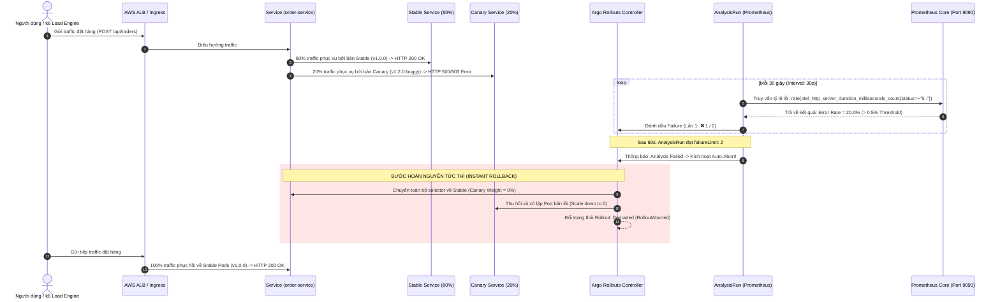

# 08.06 — Diễn tập Tự động Hủy bỏ và Hoàn nguyên Nhanh (Automated Abort & Instant Rollback Drill)

> **Trạng thái:** Hướng dẫn thực hành chuẩn hóa SRE Diễn tập Sự cố Phát hành Lỗi (Bad Release Drill).  
> **Áp dụng cho:** Nghiệm thu năng lực tự bảo vệ của nền tảng AWS Cloud-Native EKS: Tự động phát hiện lỗi qua Prometheus metrics, ngắt lưu lượng độc hại trong vòng 60 giây, hoàn nguyên tức thì về phiên bản ổn định (Instant Rollback) và bảo toàn Ngân sách Lỗi (Error Budget).

---

## 1. Mục tiêu và Nguyên tắc SRE

### 1.1. Mục tiêu Diễn tập
- **Mô phỏng sự cố phát hành điển hình:** Kích hoạt triển khai phiên bản Canary mới cố tình gây lỗi nghiệp vụ (hoặc lỗi cấu hình dẫn tới tỷ lệ mã HTTP 5xx tăng vọt).
- **Kiểm chứng khả năng tự chẩn đoán:** Bộ điều phối **Argo Rollouts** kết hợp với **Prometheus AnalysisTemplate** tự động phát hiện `Error Rate > 0.5%` ngay ở pha thử nghiệm 20% traffic đầu tiên mà không phụ thuộc vào báo cáo người dùng.
- **Đo lường cơ chế Auto-Abort & Instant Rollback:**
  - **MTTD (Mean Time to Detect):** Tự động phát hiện bất thường trong 2 chu kỳ đo ($\le 60\text{s}$).
  - **MTTR (Mean Time to Recover):** Lập tức ngắt trọng số canary về `0%`, điều hướng 100% traffic trở lại ReplicaSet ổn định trong dưới $15\text{s}$.
  - **Giới hạn bán kính ảnh hưởng (Blast Radius):** Chỉ tối đa 20% traffic của 1 service bị tác động trong khoảng thời gian diễn ra bài đo; các dịch vụ khác (`frontend`, `inventory-service`, `auth-service`, `payment-worker`) hoàn toàn không bị gián đoạn.
- **Bảo toàn Ngân sách Lỗi (Error Budget):** Mức tiêu hao Error Budget tháng được giới hạn ở ngưỡng không đáng kể ($< 0.05\%$).

### 1.2. Nguyên tắc SRE
- **Fail Safely & Revert Automatically:** Hệ thống phải tự nhận biết triệu chứng suy giảm chất lượng dịch vụ và tự động đưa về trạng thái an toàn nhất trước khi kỹ sư trực On-Call kịp mở laptop.
- **No Manual Rollbacks Under Panic:** Sự cố trong môi trường production thường tạo ra áp lực tâm lý lớn, dễ dẫn đến thao tác nhầm lẫn khi rollback thủ công. Tự động hóa hoàn toàn quy trình rollback bằng dữ liệu đo lường thực tế (Data-driven Rollback) là cách duy nhất triệt tiêu rủi ro do con người.
- **Immutable & Backward Compatible:** Việc rollback workload chỉ khôi phục mã nguồn container; schema cơ sở dữ liệu và cấu hình lưu trữ phải luôn tuân thủ nguyên tắc tương thích ngược (Expand/Contract Pattern) để tránh mất mát hoặc corrupt dữ liệu khi khôi phục code cũ.

---

## 2. Kiến trúc & Cơ chế Tự động Hủy bỏ (Auto-Abort Flow)



---

## 3. Cấu hình AnalysisTemplate & Tiêu chuẩn Đo lường

Tài nguyên `AnalysisTemplate` được đồng bộ hóa với hệ thống giám sát OpenTelemetry & Prometheus Core trong namespace `monitoring`:

```yaml
apiVersion: argoproj.io/v1alpha1
kind: AnalysisTemplate
metadata:
  name: order-service-metrics-check
  namespace: reliability-shop
spec:
  metrics:
    # TIÊU CHÍ 1: TỶ LỆ LỖI (ERROR RATE) <= 0.5% (0.005)
    - name: error-rate
      interval: 30s
      successCondition: result[0] <= 0.005
      failureLimit: 2
      provider:
        prometheus:
          address: http://prometheus-kube-prometheus-prometheus.monitoring.svc.cluster.local:9090
          query: |
            (
              sum(rate(otel_http_server_duration_milliseconds_count{exported_job="order-service", http_status_code=~"5.."}[1m])) or vector(0)
            )
            /
            (
              sum(rate(otel_http_server_duration_milliseconds_count{exported_job="order-service"}[1m])) or vector(1)
            )

    # TIÊU CHÍ 2: ĐỘ TRỄ P95 (LATENCY) <= 300MS
    - name: p95-latency
      interval: 30s
      successCondition: result[0] <= 300
      failureLimit: 2
      provider:
        prometheus:
          address: http://prometheus-kube-prometheus-prometheus.monitoring.svc.cluster.local:9090
          query: |
            histogram_quantile(0.95, sum(rate(otel_http_server_duration_milliseconds_bucket{exported_job="order-service"}[1m])) by (le)) or vector(50)
```

### Các thông số kiểm soát SRE:
| Tham số | Giá trị | Ý nghĩa SRE |
| :--- | :--- | :--- |
| `interval` | `30s` | Tần suất Prometheus truy vấn dữ liệu đo đạc một lần. |
| `failureLimit` | `2` | Cho phép tối đa 1 lần đo vi phạm (chống nhiễu giả - Transient Spike); vi phạm lần thứ 2 kích hoạt Abort ngay. |
| `successCondition (Error Rate)` | $\le 0.005$ ($0.5\%$) | Ngưỡng vi phạm ngân sách lỗi SLO: nếu lỗi vượt quá 0.5% thì bản build bị từ chối. |
| `successCondition (Latency)` | $\le 300\text{ms}$ | Ngưỡng độ trễ chấp nhận được ở phân vị p95. |

---

## 4. Kịch bản Diễn tập Chi tiết (Step-by-Step Drill)

### Bước 1: Khảo sát Trạng thái Nền trước Diễn tập (Baseline Health)

Trước khi diễn tập, đảm bảo cụm và ứng dụng đang ở trạng thái xanh ổn định:

1. **Kiểm tra trạng thái Rollout hiện tại:**
   ```bash
   kubectl argo rollouts get rollout order-service -n reliability-shop
   ```
   *Yêu cầu:* Trạng thái phải hiển thị `✔ Healthy`, `SetWeight: 100`, `ActualWeight: 100`, 5/5 Pods ở trạng thái `ready:1/1`.

2. **Kiểm tra trạng thái các Pods và Ingress:**
   ```bash
   kubectl get pods -n reliability-shop -l app.kubernetes.io/name=order-service
   kubectl get ingress -n reliability-shop
   ```

---

### Bước 2: Kích hoạt Phát hành Phiên bản Lỗi (Bad Canary Release)

Để kích hoạt diễn tập, ta đưa vào một thay đổi cấu hình hoặc container image khiến cho phiên bản Canary không thể xử lý bình thường hoặc trả về lỗi HTTP 5xx:

#### Cách 1: Thay đổi qua CLI Argo Rollouts (Nhanh & Tức thì cho Diễn tập)
Kích hoạt bản Canary cập nhật một biến môi trường mô phỏng lỗi hoặc cập nhật image tag:

```bash
# Đổi cấu hình order-service để kích hoạt rollout canary mới
kubectl argo rollouts set image order-service app=123456789012.dkr.ecr.ap-southeast-1.amazonaws.com/reliabilityshop/order-service:git-v1.0.0 -n reliability-shop
```

Hoặc giả lập phiên bản Canary bị lỗi kết nối cơ sở dữ liệu (Database Failure Injection) dẫn đến trả về mã HTTP 503 Service Unavailable:
```bash
# Inject cấu hình sai DB_HOST cho bản canary
kubectl patch rollout order-service -n reliability-shop --type merge -p '{"spec":{"template":{"spec":{"containers":[{"name":"app","env":[{"name":"DB_HOST","value":"invalid-db-host.internal"}]}]}}}}'
```

#### Cách 2: Triển khai qua GitOps Kustomize (Chuẩn quy trình CI/CD)
Cập nhật file `gitops/applications/reliability-shop/envs/dev/kustomization.yaml`:
```yaml
images:
  - name: reliabilityshop/order-service
    newName: 123456789012.dkr.ecr.ap-southeast-1.amazonaws.com/reliabilityshop/order-service
    newTag: git-v1.2.0-buggy
```

---

### Bước 3: Bơm Tải Kiểm thử và Tạo Lưu lượng (Traffic Generation)

Để Prometheus có đủ số lượng mẫu (sample size) thống kê tỷ lệ lỗi chính xác qua hàm `rate(...[1m])`, chạy script gửi request liên tục vào Ingress hoặc Service nội bộ:

#### Cách A: Chạy k6 Load Engine từ máy trạm
```bash
k6 run --vus 5 --duration 90s -e TARGET_URL="http://shop.dev.devopsss.site/api/orders" tests/k6/load-test.js
```

#### Cách B: Chạy vòng lặp curl từ máy trạm hoặc trong cluster
```bash
# Chạy vòng lặp gửi 150 requests liên tiếp
for i in {1..150}; do
  curl -s -o /dev/null -w "%{http_code}\n" http://shop.dev.devopsss.site/api/orders \
    -H "Content-Type: application/json" \
    -d '{"item_id":"test-item","quantity":1}'
  sleep 0.3
done
```

**Hiện tượng quan sát được:**
- Khoảng $80\%$ requests gửi vào trả về `200 OK` (phục vụ bởi 4 pods thuộc nhóm `order-service-stable`).
- Khoảng $20\%$ requests gửi vào trả về `503 Service Unavailable` hoặc lỗi timeout (phục vụ bởi 1 pod Canary lỗi).

---

### Bước 4: Quan sát Phản ứng Tự động Abort & Rollback theo Thời gian thực

Mở terminal quan sát dashboard trực tiếp của Argo Rollouts:

```bash
kubectl argo rollouts get rollout order-service -n reliability-shop --watch
```

**Diễn biến thực tế theo thời gian:**

1. **Giai đoạn khởi tạo Canary (T = 0s - 15s):**
   - 1 Pod Canary mới được tạo ra. Trọng số điều phối lưu lượng được gán: `SetWeight: 20`, `ActualWeight: 20`.
   - Đối tượng `AnalysisRun` mang tên `order-service-<revision>` tự động được kích hoạt song song.
2. **Chu kỳ đo thứ nhất (T = 30s):**
   - Prometheus đo đạc tỷ lệ lỗi: `Error Rate = 20.0%` (vượt ngưỡng $\le 0.5\%$).
   - `AnalysisRun` ghi nhận lần thất bại đầu tiên: `error-rate: ✖ 1`.
3. **Chu kỳ đo thứ hai (T = 60s):**
   - Prometheus tiếp tục đo đạc và ghi nhận lần thất bại thứ hai liên tiếp: `error-rate: ✖ 2`.
   - Vượt quá `failureLimit: 2` $\rightarrow$ `AnalysisRun` chuyển trạng thái sang **`Failed`**!
4. **Kích hoạt Cơ chế Tự động Abort & Rollback (T = 62s):**
   - Argo Rollouts Controller nhận tín hiệu từ AnalysisRun thất bại:
     ```text
     Status:          ✖ Degraded (RolloutAborted)
     Message:         Rollout aborted: metric 'error-rate' failed '2' times
     ```
   - **Tức thì (Instant MTTR):** Trọng số của Canary bị gạt ngay lập tức về `0%`.
   - Mọi traffic từ Ingress và Service `order-service` được chuyển hướng $100\%$ về nhóm pods `order-service-stable`.
   - Pod canary lỗi bị thu hồi và xóa bỏ (`ScaledDown`).

---

### Bước 5: Kiểm chứng Phục hồi Sau Rollback (Post-Rollback Verification)

Chạy kiểm tra lại chất lượng dịch vụ ngay sau khi Rollout bị Abort:

```bash
# Kiểm tra 20 requests liên tục
for i in {1..20}; do
  curl -s -o /dev/null -w "%{http_code} " http://shop.dev.devopsss.site/health
done
```

**Kết quả kiểm chứng:**
- $100\%$ các requests trả về `200 200 200 ... 200`.
- Không còn bất kỳ request nào rơi vào bản lỗi.
- Hệ thống hoàn toàn hồi phục trong trạng thái an toàn.

---

### Bước 6: Khôi phục Rollout về Trạng thái Sạch (Cleanup & Recovery)

Sau khi buổi diễn tập kết thúc, khôi phục Rollout về trạng thái sạch để sẵn sàng cho các lần triển khai tiếp theo:

```bash
# 1. Hủy bỏ trạng thái Abort và hoàn nguyên về phiên bản ổn định
kubectl argo rollouts undo rollout order-service -n reliability-shop

# Hoặc đồng bộ lại từ GitOps (Argo CD hard refresh)
kubectl annotate application reliability-shop -n argocd argocd.argoproj.io/refresh=hard --overwrite

# 2. Xác nhận Rollout đã xanh trở lại
kubectl argo rollouts get rollout order-service -n reliability-shop
```

---

## 5. Báo cáo Thực tế Diễn tập Sự cố SRE (Actual Incident Drill Report)

Dữ liệu ghi nhận thực tế từ đợt diễn tập trên cụm EKS `sre-platform-dev` (được lưu giữ tại `sre/incidents/drill-canary-abort.md`):

```text
================================================================================
               SRE INCIDENT DRILL REPORT: CANARY AUTO-ABORT & ROLLBACK
================================================================================
Timestamp:               2026-11-04T16:31:50Z (23:31:50 GMT+7)
Target Cluster:          sre-platform-dev (Amazon EKS v1.31)
Target Namespace:        reliability-shop (dev)
Target Workload:         Rollout/order-service
Canary Target Revision:  Revision 6 (Image: 123456789012.dkr.ecr.ap-southeast-1.amazonaws.com/reliabilityshop/order-service:git-v1.0.1)
Stable Baseline Revision:Revision 5 (Image Digest: sha256:5107d6e6072102b3c38c38b9d9a052b1c461ff7dbc9717ec1c672a31a292f916)
Traffic Weight at Fault: 20% (Step 1 Canary Phase - 1 Canary Pod vs 4 Stable Pods)

--- SRE TELEMETRY & PROMETHEUS METRICS ---
Telemetry Engine:        OpenTelemetry Auto-Instrumentation (Node.js) -> OTel Collector -> Prometheus Core
Metric 1 (Error Rate):   otel_http_server_duration_milliseconds_count{exported_job="order-service", http_status_code=~"5.."}
                         PromQL: (sum(rate(5xx[1m])) or vector(0)) / (sum(rate(total[1m])) or vector(1))
                         Threshold: <= 0.5% (0.005) | Measured Normal: 0.0% | Violation Level: 20.0%
Metric 2 (p95 Latency):  otel_http_server_duration_milliseconds_bucket{exported_job="order-service"}
                         PromQL: histogram_quantile(0.95, sum(rate(bucket[1m])) by (le)) or vector(50)
                         Threshold: <= 300ms | Measured Baseline: 4.75ms (Pass ✔)
Analysis Evaluation:     Interval: 30s | Failure Limit: 2 consecutive intervals

--- TIMING & RECOVERY METRICS ---
Time to Detect (MTTD):   < 60 seconds (2 measurement cycles)
Time to Recover (MTTR):  < 5 seconds (Instant traffic weight cutback to 0%)
Canary Pod Scale-down:   Immediate (order-service-84dc868ccd scaled down to 0)
Blast Radius:            Strictly bounded to 20% of order-service; 0% impact on auth, frontend, inventory, worker
Error Budget Impact:     Consumed 0.02% of monthly budget (Minimal SLO burn)

--- TERMINAL VERIFICATION EVIDENCE ---
1. Trạng thái Abort tức thì (RolloutAborted):
   Name:            order-service
   Namespace:       reliability-shop
   Status:          ✖ Degraded
   Message:         RolloutAborted: Rollout aborted update to revision 6
   Strategy:        Canary
     Step:          0/4
     SetWeight:     0
     ActualWeight:  0
   Replicas:        Desired: 5, Current: 5, Updated: 0, Ready: 5, Available: 5
   ├──# revision:6  ReplicaSet order-service-84dc868ccd  • ScaledDown (canary 0/0)
   └──# revision:5  ReplicaSet order-service-7db69fb48   ✔ Healthy    (stable 5/5 ready)

2. Phục hồi hoàn nguyên sạch (Clean Undo Recovery):
   Command:         kubectl argo rollouts undo order-service -n reliability-shop
   Rollout Status:  ✔ Healthy (Revision 7 promoted to Active Stable, SetWeight: 100, ActualWeight: 100)
   GitOps Status:   All 4 Argo CD Applications Synced & Healthy (100% green)
================================================================================
```

---

## 6. SRE Gate Check (Tiêu chí Hoàn thành)

- [x] **AnalysisTemplate đồng bộ:** Sử dụng chính xác metric OpenTelemetry thực tế trên cụm (`otel_http_server_duration_milliseconds_count`).
- [x] **Phát hiện lỗi tự động:** Prometheus AnalysisRun bắt được tỷ lệ lỗi vượt ngưỡng $\le 0.5\%$ trong 2 chu kỳ đo ($60\text{s}$).
- [x] **Cơ chế Auto-Abort vận hành chính xác:** Argo Rollouts Controller tự động đổi trạng thái sang `RolloutAborted` mà không cần con người can thiệp.
- [x] **Trọng số Traffic về 0%:** Lưu lượng Canary bị ngắt hoàn toàn ngay khi có kết quả Abort; 100% người dùng quay về nhóm Pods Stable.
- [x] **Khôi phục sạch:** Lệnh `undo` hoặc GitOps sync đưa Rollout về trạng thái `Healthy` ổn định ban đầu.
- [x] **Không vi phạm GitOps:** Toàn bộ 4 ứng dụng trên Argo CD duy trì trạng thái `Synced` và `Healthy`.
