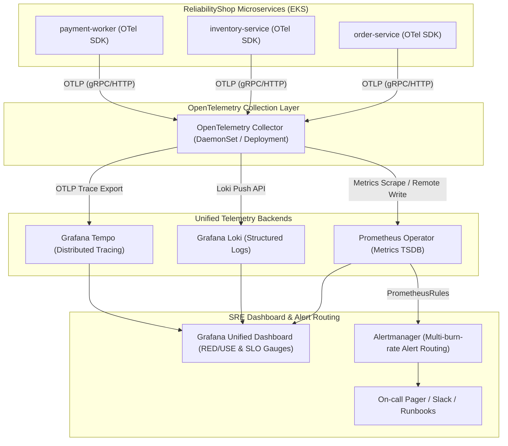
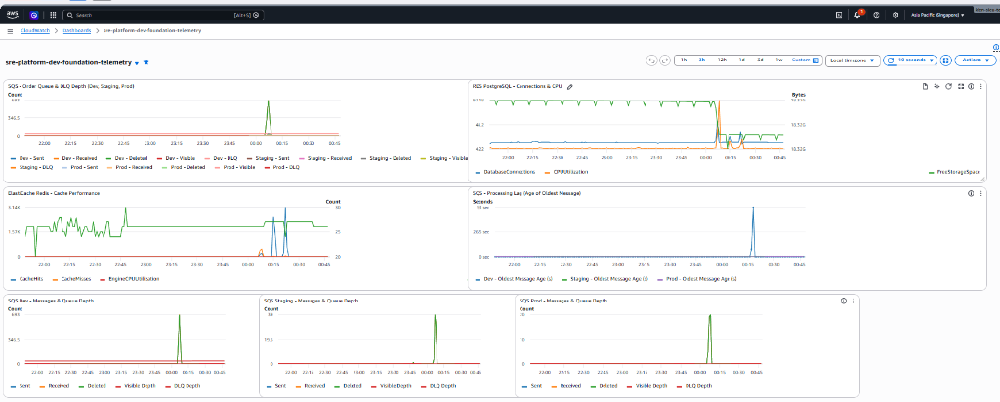
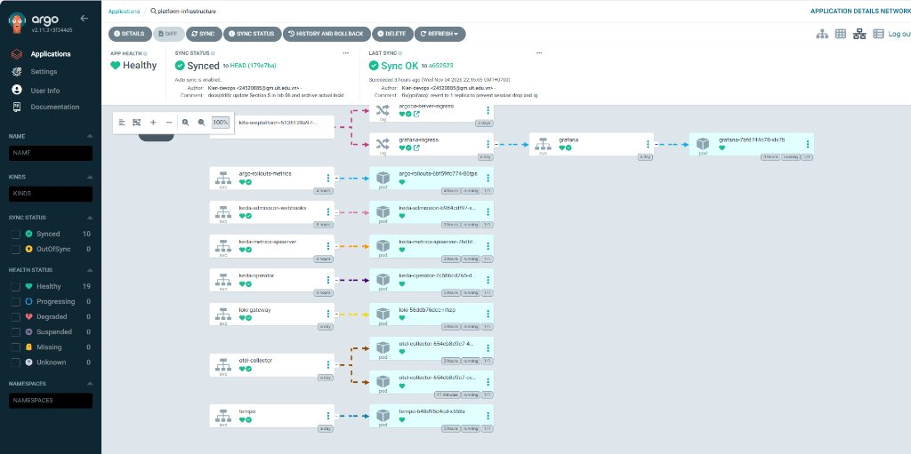
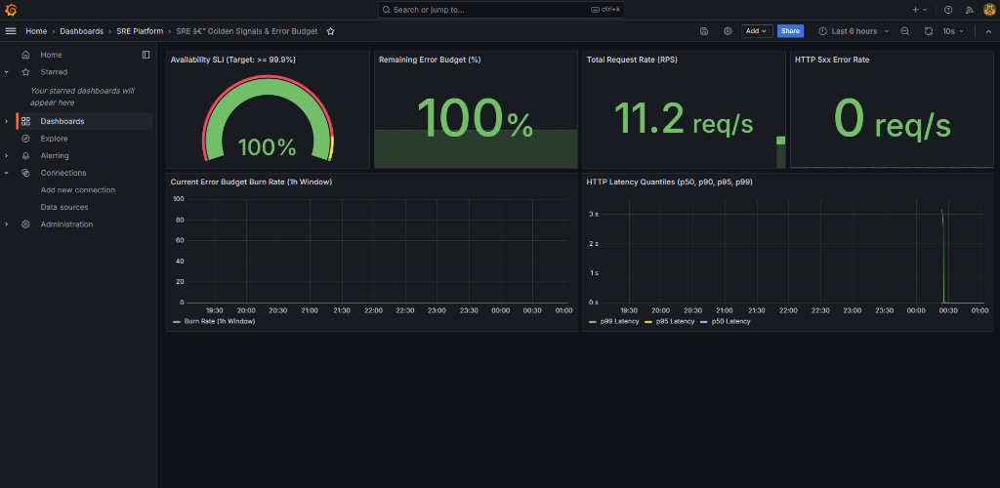

# Modern Full-Stack Telemetry & Observability

Thư mục này chứa toàn bộ cấu hình hạ tầng thu thập và phân tích dữ liệu quan sát (**Telemetry Stack**) cho **AWS Cloud-Native SRE Platform**. Nền tảng hợp nhất 3 trụ cột (Metrics, Logs, Traces) theo chuẩn công nghiệp **OpenTelemetry**, phục vụ giám sát độ tin cậy và cảnh báo theo ngân sách lỗi (Error Budget Alerting).

---

## 1. Kiến trúc Luồng Dữ liệu Quan sát (Observability Pipeline)



---

## 2. Minh chứng Giám sát Thực tế (Live Observability Evidence)

### 2.1. AWS CloudWatch Foundation Telemetry Dashboard
Theo dõi trực tiếp chiều sâu hàng đợi SQS, tỉ lệ lỗi/DLQ, Database Connections & CPU của RDS PostgreSQL, và hiệu năng Cache Hits/Misses của ElastiCache Redis:



### 2.2. GitOps Runtime Deployment của Telemetry Stack
Toàn bộ các thành phần quan sát (`otel-collector`, `prometheus`, `loki-gateway`, `tempo`, `grafana`) được triển khai và duy trì trạng thái `Healthy` bởi Argo CD:



### 2.3. Bảng Điều Khiển Grafana SRE Golden Signals & Error Budget (Live)
Bảng điều khiển Grafana giám sát SLO theo thời gian thực đạt **100% Availability SLI** (vượt chỉ tiêu $\ge 99.9\%$), **100% Remaining Error Budget**, **0 req/s HTTP 5xx**, và duy trì tốc độ xử lý **11.2 req/s**:



---

## 3. Các chỉ số SLI, SLO & Chính sách Ngân sách Lỗi (Error Budget Policy)

| Dịch vụ / Endpoint | Chỉ số SLI (Service Level Indicator) | Mục tiêu SLO | Error Budget (30 ngày) | Cơ chế Alerting |
| :--- | :--- | :--- | :--- | :--- |
| **API Availability** | $\frac{\text{HTTP requests non-5xx}}{\text{Total eligible HTTP requests}} \times 100\%$ | **$\ge 99.90\%$** | **0.10%** (~43 phút downtime) | Multi-Window Multi-Burn-Rate |
| **Order Processing Latency** | $\text{Tỷ lệ request POST /api/orders có latency } \le 200\text{ms}$ | **$\ge 99.00\%$** | **1.00%** | Prometheus Histogram Bucket |
| **PostgreSQL Write Latency** | $\text{Tỷ lệ query commit } \le 10\text{ms}$ | **$\ge 99.50\%$** | **0.50%** | RDS Performance Insights |
| **Redis Cache Hit Ratio** | $\frac{\text{Cache Hits}}{\text{Cache Hits} + \text{Cache Misses}} \times 100\%$ | **$\ge 95.00\%$** | **5.00%** | ElastiCache CloudWatch Metrics |

---

## 4. Công thức Cảnh báo Đa tốc độ Đốt (Multi-Window Multi-Burn-Rate Alerting)

Thay vì cảnh báo ngưỡng tĩnh (Static Thresholds) dễ gây báo động giả (Alert Fatigue), hệ thống áp dụng tiêu chuẩn Google SRE Workbook:

### 1. Cảnh báo khẩn cấp P1 (Fast Burn Rate - Đốt 2% Error Budget trong 1 giờ):
- **Điều kiện:** Burn Rate $\ge 14.4$ trên cả 2 cửa sổ thời gian (1 giờ và 5 phút).
- **Mức độ:** `severity: page` (Đánh thức kỹ sư On-call xử lý ngay lập tức).
```promql
(
  sum(rate(http_requests_total{status=~"5.."}[1h]))
  /
  sum(rate(http_requests_total[1h]))
) > (1 - 0.999) * 14.4
and
(
  sum(rate(http_requests_total{status=~"5.."}[5m]))
  /
  sum(rate(http_requests_total[5m]))
) > (1 - 0.999) * 14.4
```

### 2. Cảnh báo mức độ P2 (Slow Burn Rate - Đốt 5% Error Budget trong 6 giờ):
- **Điều kiện:** Burn Rate $\ge 6.0$ trên cả 2 cửa sổ thời gian (6 giờ và 30 phút).
- **Mức độ:** `severity: ticket` (Tạo ticket tự động vào hàng đợi Jira/Linear).
```promql
(
  sum(rate(http_requests_total{status=~"5.."}[6h]))
  /
  sum(rate(http_requests_total[6h]))
) > (1 - 0.999) * 6.0
and
(
  sum(rate(http_requests_total{status=~"5.."}[30m]))
  /
  sum(rate(http_requests_total[30m]))
) > (1 - 0.999) * 6.0
```

---

## 5. Cấu trúc thư mục

```text
observability/
├── opentelemetry/         # OpenTelemetry Collector Config & DaemonSet Manifests
├── prometheus/            # Prometheus Operator, ServiceMonitors, PrometheusRules
├── alertmanager/          # Cấu hình Alert Routing, Receiver Webhooks, Inhibit Rules
├── grafana/               # JSON Model Dashboards (Golden Signals, SLO Overview)
├── loki/                  # Cấu hình Loki Storage, Retention Policies (30 ngày)
└── tempo/                 # Cấu hình Tempo Distributed Tracing (S3 Block Storage)
```
