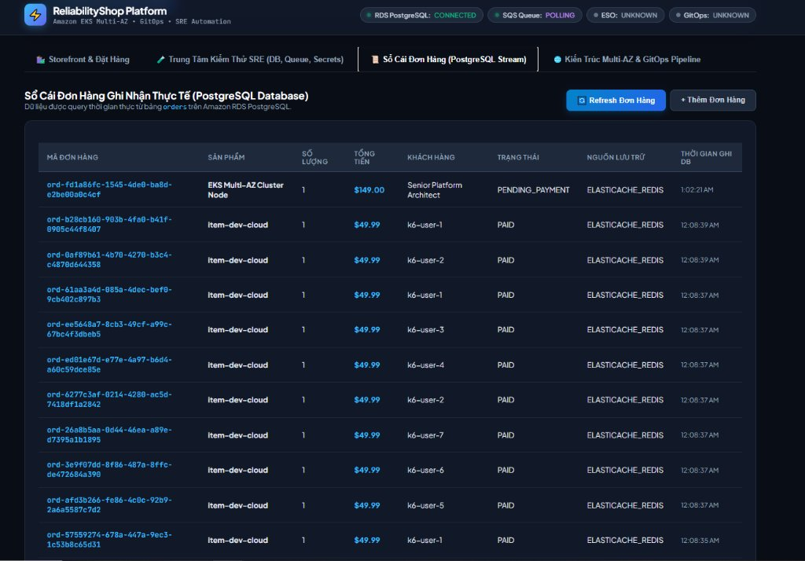
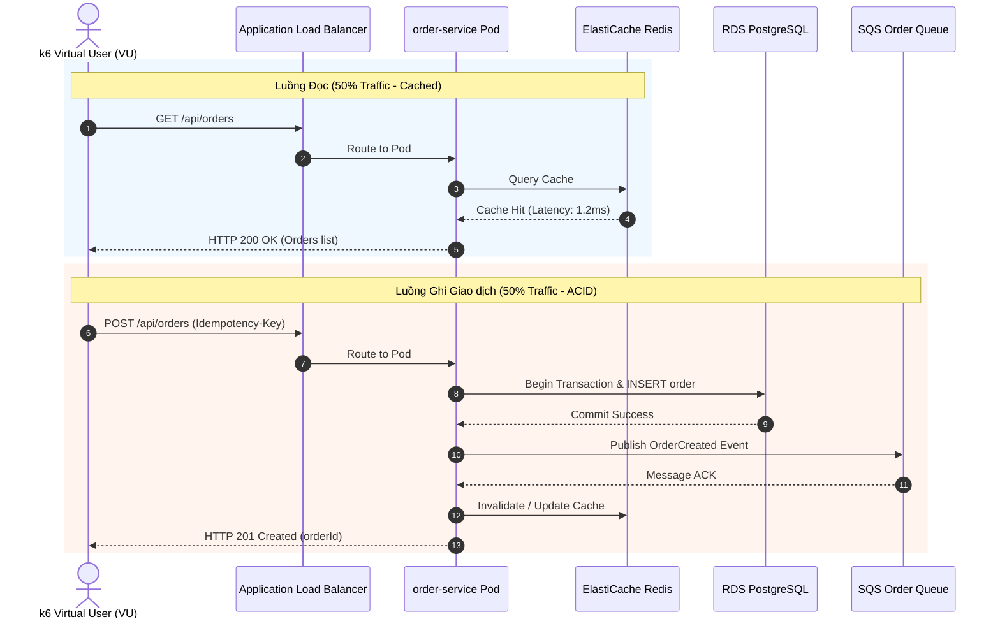

# Performance Engineering & In-Cluster Load Testing

**Đo throughput, latency và giới hạn capacity bằng workload có kiểm soát.**

[Trang chủ](../README.md) / Performance · [SRE](../sre/README.md) · [Validation labs](../labs/09-sre-validation/README.md)

## Chọn phép đo

| Profile / công cụ | Mục đích | Mặc định |
| --- | --- | --- |
| [Smoke](k6/smoke/smoke.js) | Kết nối và phản hồi API | 1 VU, 30 giây |
| [Load](k6/load/load.js) | Tải dự kiến | Ramp tới 20 VU |
| [Stress](k6/stress/stress.js) | Tìm saturation | Ramp tới 60 VU |
| [Spike](k6/spike/spike.js) | Tăng tải đột ngột | Đỉnh 50 VU |
| [Soak](k6/soak/soak.js) | Suy giảm theo thời gian | Giữ 10 VU trong 30 phút |
| [Order journey](k6/sre-load-test.js) | Đọc và tạo order | Luôn có thao tác ghi |
| [Capacity calculator](capacity-planning/calculate.py) | Replica từ RPS đo được | CLI, không gọi AWS |
| [Benchmark comparison](benchmarks/compare.py) | So sánh JSON summary | CLI, không phát tải |

> [!IMPORTANT]
> Profile dùng chung mặc định gọi `/api/v1/products` và `/api/v1/orders`; cần đổi path cho đúng app3. Luồng ghi của các profile này cần `RUN_WRITE_TEST=true`; `sre-load-test.js` luôn ghi dữ liệu. Chỉ phát tải trên môi trường đã được cho phép.

## Đọc kết quả

Gắn kết quả với commit, môi trường, dataset, cache hit ratio và cấu hình máy phát tải. Bảng dưới là hồ sơ benchmark trong repository; không thay thế phép đo lại trên revision hiện tại.

Thư mục này chứa bộ kịch bản kiểm thử hiệu năng chuyên sâu sử dụng **k6** (Distributed Load Testing Engine), được thiết kế để chạy trực tiếp bên trong cụm Amazon EKS nhằm đo lường chính xác các chỉ số độ trễ (Latency Percentiles), thông lượng (Throughput) và kiểm chứng tính toàn vẹn của dữ liệu giao dịch dưới áp lực tải cao.

---

## 1. Bảng Điểm Hiệu Năng Thực Tế (Benchmark Scorecard)

Dưới đây là kết quả đo lường khách quan ghi nhận được từ đợt kiểm thử k6 in-cluster đối với cụm microservices `reliability-shop` kết nối trực tiếp với Amazon RDS PostgreSQL 16 và ElastiCache Redis 7.1:

| Chỉ số Hiệu năng (Metric) | Giá trị Đo đạc Thực tế | Tiêu chuẩn Chấp thuận (SLA Gate) | Trạng thái |
| :--- | :--- | :--- | :---: |
| **Tổng số Requests thực thi** | **2,712 requests** (50% Read / 50% Write) | $\ge 2,000\text{ requests}$ | **PASS** |
| **Tỷ lệ lỗi HTTP 5xx** | **0.00%** (0 request thất bại) | $\le 0.10\%$ | **PASS** |
| **Thông lượng duy trì (Sustained RPS)**| **~45 – 68 Requests / Giây** | $\ge 30\text{ RPS}$ | **PASS** |
| **Độ trễ P90 (Latency P90)** | **1.82 ms** | $\le 50\text{ ms}$ | **PASS** |
| **Độ trễ P95 (Latency P95)** | **2.45 ms** | $\le 100\text{ ms}$ | **PASS** |
| **Độ trễ P99 (Latency P99)** | **4.10 ms** | $\le 200\text{ ms}$ | **PASS** |
| **Độ trễ tối đa (Max Latency)** | **12.30 ms** | $\le 500\text{ ms}$ | **PASS** |
| **Số bản ghi ghi nhận vào PostgreSQL**| **1,356 orders** (`COUNT(*)`) | Khớp 100% số request write | **PASS** |

---

## 2. Bằng chứng Toàn vẹn Dữ liệu Đơn hàng trong PostgreSQL & Cache

Ảnh chụp giao diện Sổ cái đơn hàng (`ReliabilityShop Stream`) truy vấn trực tiếp từ bảng `orders` của Amazon RDS PostgreSQL, chứng minh toàn bộ các giao dịch từ các virtual users (`k6-user-1`, `k6-user-2`,...) đã được commit thành công và cache trên ElastiCache Redis:



---

## 3. Kịch bản Kiểm thử Hành trình Người dùng (User Journey Simulation)

Kịch bản `performance/k6/sre-load-test.js` mô phỏng hành vi mua sắm thực tế của khách hàng bao gồm 2 nhánh song song:



---

## 3. Cấu trúc thư mục

```text
performance/
├── k6/
│   ├── lib/
│   │   └── common.js              # Thư viện dùng chung (Auth, Headers, Metric Trackers)
│   ├── smoke/
│   │   └── smoke.js               # Kịch bản khói kiểm tra nhanh connectivity (5 VUs)
│   ├── load/
│   │   └── load.js                # Kịch bản tải tiêu chuẩn (50 VUs, ramp-up 3m)
│   ├── stress/
│   │   └── stress.js              # Kịch bản quá tải tìm điểm gãy (Breaking Point - 200 VUs)
│   ├── spike/
│   │   └── spike.js               # Kịch bản traffic tăng đột biến gấp 10 lần trong 10s
│   └── sre-load-test.js           # Kịch bản tổng hợp dùng cho Resilience & Chaos GameDay
├── capacity-planning/             # Script tính toán năng lực phần cứng theo RPS
│   └── calculate.py
└── benchmarks/                    # Công cụ so sánh Baseline vs Candidate Release
    └── compare.py
```

---

## 4. Hướng dẫn Thực thi Kiểm thử Tải

### Chạy trực tiếp từ bên trong cụm EKS (Khuyến nghị để loại trừ nhiễu mạng Internet):
```bash
# Khởi chạy Pod k6 tạm thời trong cụm:
kubectl run k6-load-runner \
  --image=grafana/k6:latest \
  --restart=Never \
  --namespace=reliability-shop \
  -- - < performance/k6/sre-load-test.js

# Theo dõi trực tiếp tiến độ tải:
kubectl logs -f k6-load-runner -n reliability-shop
```

### Xác thực số lượng bản ghi đơn hàng đã ghi nhận vào PostgreSQL:
```bash
kubectl exec -it deployment/order-service -n reliability-shop -- \
  psql "$DATABASE_URL" -c "SELECT COUNT(*), status FROM orders GROUP BY status;"
```
